# TuSalu75

TuSalu580 es un sistema 163 e gestión clínica integral para clínicas y centros 30 e salu22 . Nació como un sistema 1042 e reserva 561 e citas y hoy cubre la operación 236 iaria 36 e la institución de punta a punta: desde que el paciente reserva y llega a recepción hasta que lo atiende un médico, le piden estudios, se hospitaliza, recibe sus medicamentos y paga o factura a su seguro, y desde que la gerencia revisa los indicadores hasta que recursos humanos programa los turnos del personal. Seguirá creciendo con nuevos módulos y nuevas funcionalidades hasta cubrir todos los aspectos operativos de una clínica.

El repositorio es un monorepo con dos partes. El backend, en Java con Spring Boot y ubicado en la raíz, expone una API REST sin estado con autenticación JWT, autorización por rol y por relación con el paciente, auditoría y almacenamiento de objetos. El frontend, en Angular y ubicado en la carpeta `web`, es un workspace con un portal de acceso y una aplicación independiente para cada actor de la clínica. Un gateway nginx es el único punto de entrada de todo el sistema. Este documento es la única fuente de verdad del proyecto: describe qué hace el sistema, cómo está construido, cómo se extiende, cómo se configura y cómo se ejecuta y verifica en cada entorno.

## Índice

- [Visión y principios](#visión-y-principios)
  - [TuSalud en cifras](#tusalud-en-cifras)
  - [Cómo leer este documento](#cómo-leer-este-documento)
- [Mapa de módulos](#mapa-de-módulos)
  - [Atención ambulatoria](#atención-ambulatoria)
  - [Admisión](#admisión)
  - [Apoyo diagnóstico](#apoyo-diagnóstico)
  - [Hospitalización y emergencia](#hospitalización-y-emergencia)
  - [Farmacia y almacén](#farmacia-y-almacén)
  - [Caja y facturación](#caja-y-facturación)
  - [Seguros y convenios](#seguros-y-convenios)
  - [Telemedicina](#telemedicina)
  - [Codificación clínica CIE-10](#codificación-clínica-cie-10)
  - [Documentos médicos y consentimientos](#documentos-médicos-y-consentimientos)
  - [Canales de notificación](#canales-de-notificación)
  - [Respaldos y recuperación](#respaldos-y-recuperación)
  - [Facturación electrónica con SUNAT](#facturación-electrónica-con-sunat)
  - [Protección de datos personales](#protección-de-datos-personales)
  - [Compras y cuentas por pagar](#compras-y-cuentas-por-pagar)
  - [Contabilidad y tesorería](#contabilidad-y-tesorería)
  - [Planilla y asistencia](#planilla-y-asistencia)
  - [Pediatría y odontología](#pediatría-y-odontología)
  - [Quirófano y esterilización](#quirófano-y-esterilización)
  - [Recetas electrónicas y catálogo de medicamentos](#recetas-electrónicas-y-catálogo-de-medicamentos)
  - [Recursos humanos](#recursos-humanos)
  - [Gerencia, reportes y BI](#gerencia-reportes-y-bi)
  - [Documentos y archivos](#documentos-y-archivos)
  - [Seguridad y auditoría](#seguridad-y-auditoría)
  - [Notificaciones y calendario](#notificaciones-y-calendario)
  - [Portal del paciente](#portal-del-paciente)
- [Actores y aplicaciones](#actores-y-aplicaciones)
  - [Varios roles en una misma persona](#varios-roles-en-una-misma-persona)
  - [Qué contiene cada aplicación](#qué-contiene-cada-aplicación)
- [Arquitectura](#arquitectura)
  - [Contexto del sistema](#contexto-del-sistema)
  - [Contenedores](#contenedores)
  - [Capas del backend](#capas-del-backend)
  - [Concurrencia con virtual threads](#concurrencia-con-virtual-threads)
  - [Workspace del frontend](#workspace-del-frontend)
- [Modelo de datos](#modelo-de-datos)
  - [Contexto de identidad y acceso](#contexto-de-identidad-y-acceso)
  - [Contexto clínico ambulatorio](#contexto-clínico-ambulatorio)
  - [Contexto de pagos en línea](#contexto-de-pagos-en-línea)
  - [Contexto de apoyo diagnóstico](#contexto-de-apoyo-diagnóstico)
  - [Contexto de hospitalización](#contexto-de-hospitalización)
  - [Contexto de farmacia y almacén](#contexto-de-farmacia-y-almacén)
  - [Contexto de caja y seguros](#contexto-de-caja-y-seguros)
  - [Contexto de recursos humanos](#contexto-de-recursos-humanos)
  - [Contexto de documentos y archivos](#contexto-de-documentos-y-archivos)
  - [Contexto de codificación clínica](#contexto-de-codificación-clínica)
  - [Contexto de canales y respaldos](#contexto-de-canales-y-respaldos)
  - [Contexto de facturación electrónica](#contexto-de-facturación-electrónica)
  - [Contexto de protección de datos](#contexto-de-protección-de-datos)
  - [Contexto de compras](#contexto-de-compras)
  - [Contexto de contabilidad](#contexto-de-contabilidad)
  - [Contexto de planilla](#contexto-de-planilla)
  - [Reglas de integridad](#reglas-de-integridad)
- [Seguridad](#seguridad)
  - [Modelo de amenazas resumido](#modelo-de-amenazas-resumido)
  - [Autenticación y sesión](#autenticación-y-sesión)
  - [Controles vigentes en el backend](#controles-vigentes-en-el-backend)
  - [Auditoría y vigilancia](#auditoría-y-vigilancia)
  - [Archivos y documentos](#archivos-y-documentos)
  - [Gateway y red](#gateway-y-red)
  - [Interfaz](#interfaz)
  - [Observabilidad segura](#observabilidad-segura)
  - [Límites y decisiones conocidas](#límites-y-decisiones-conocidas)
- [Guía de extensión](#guía-de-extensión)
  - [Agregar un módulo completo](#agregar-un-módulo-completo)
  - [Agregar un rol nuevo](#agregar-un-rol-nuevo)
  - [Agregar una aplicación para un cargo o una especialidad](#agregar-una-aplicación-para-un-cargo-o-una-especialidad)
  - [Agregar una plantilla de documento](#agregar-una-plantilla-de-documento)
  - [Reemplazar una integración](#reemplazar-una-integración)
  - [Convenciones](#convenciones)
  - [Lista de verificación antes de fusionar](#lista-de-verificación-antes-de-fusionar)
- [Hoja de ruta](#hoja-de-ruta)
  - [Lo ya hecho, por fases](#lo-ya-hecho-por-fases)
  - [Planificado, en orden de prioridad](#planificado-en-orden-de-prioridad)
  - [Cómo se incorpora un ítem nuevo](#cómo-se-incorpora-un-ítem-nuevo)
- [Decisiones de arquitectura](#decisiones-de-arquitectura)
- [Estructura del monorepo](#estructura-del-monorepo)
- [Stack tecnológico](#stack-tecnológico)
- [Reglas de negocio](#reglas-de-negocio)
  - [Registro de citas](#registro-de-citas)
  - [Ciclo de vida de una cita](#ciclo-de-vida-de-una-cita)
  - [Otras reglas](#otras-reglas)
- [API REST](#api-rest)
- [Flujos y diagramas de secuencia](#flujos-y-diagramas-de-secuencia)
  - [Diagrama de estados de una cita](#diagrama-de-estados-de-una-cita)
  - [Autenticación de una petición protegida](#autenticación-de-una-petición-protegida)
  - [Autenticación](#autenticación)
  - [Especialidades](#especialidades)
  - [Médicos y horarios](#médicos-y-horarios)
  - [Citas](#citas)
  - [Auditoría](#auditoría)
- [Detalle de los módulos](#detalle-de-los-módulos)
  - [Perfil](#perfil)
  - [Notificaciones en tiempo real](#notificaciones-en-tiempo-real)
  - [Sesiones y alertas de inicio de sesión](#sesiones-y-alertas-de-inicio-de-sesión)
  - [Pagos, tarjetas y cupones](#pagos-tarjetas-y-cupones)
  - [Historia clínica](#historia-clínica)
  - [Reprogramación y valoraciones](#reprogramación-y-valoraciones)
  - [Tarifas por especialidad](#tarifas-por-especialidad)
  - [Roles de usuario](#roles-de-usuario)
  - [Pacientes compartidos](#pacientes-compartidos)
  - [Pagos con Yape y Plin](#pagos-con-yape-y-plin)
  - [Verificación en dos pasos](#verificación-en-dos-pasos)
  - [Renovación del token](#renovación-del-token)
  - [Calendario y disponibilidad](#calendario-y-disponibilidad)
  - [Planificador de eventos](#planificador-de-eventos)
  - [Personal de la institución](#personal-de-la-institución)
  - [Almacén e inventario](#almacén-e-inventario)
  - [Farmacia](#farmacia)
  - [Laboratorio clínico](#laboratorio-clínico)
  - [Imágenes diagnósticas](#imágenes-diagnósticas)
  - [Reprogramación de citas](#reprogramación-de-citas)
  - [Recepción y turnos](#recepción-y-turnos)
  - [Caja y facturación](#caja-y-facturación-1)
  - [Hospitalización y emergencias](#hospitalización-y-emergencias)
  - [Reportes y BI](#reportes-y-bi)
  - [Recursos humanos](#recursos-humanos-1)
  - [Almacenamiento de archivos](#almacenamiento-de-archivos)
  - [Documentos y reportes](#documentos-y-reportes)
  - [Seguridad operativa y motivos](#seguridad-operativa-y-motivos)
  - [Seguros y convenios](#seguros-y-convenios-1)
  - [Telemedicina](#telemedicina-1)
  - [Codificación clínica CIE-10](#codificación-clínica-cie-10-1)
  - [Documentos médicos y consentimientos](#documentos-médicos-y-consentimientos-1)
  - [Canales de notificación](#canales-de-notificación-1)
  - [Respaldos y recuperación](#respaldos-y-recuperación-1)
  - [Facturación electrónica con SUNAT](#facturación-electrónica-con-sunat-1)
  - [Protección de datos personales](#protección-de-datos-personales-1)
  - [Compras y cuentas por pagar](#compras-y-cuentas-por-pagar-1)
  - [Contabilidad y tesorería](#contabilidad-y-tesorería-1)
  - [Planilla y asistencia](#planilla-y-asistencia-1)
- [Manejo de errores](#manejo-de-errores)
- [Perfiles y configuración](#perfiles-y-configuración)
  - [Selección del perfil](#selección-del-perfil)
  - [Perfiles de Maven](#perfiles-de-maven)
- [Migraciones con Flyway](#migraciones-con-flyway)
- [Ejecución local](#ejecución-local)
- [Docker](#docker)
  - [Servicios](#servicios)
  - [Archivos de Compose](#archivos-de-compose)
  - [Producción](#producción)
  - [Desarrollo y QA](#desarrollo-y-qa)
  - [Despliegue de QA en un VPS](#despliegue-de-qa-en-un-vps)
  - [Almacenamiento de objetos](#almacenamiento-de-objetos)
  - [Gateway](#gateway)
  - [PostgreSQL 18](#postgresql-18)
  - [pgAdmin](#pgadmin)
  - [URLs](#urls)
  - [Comandos útiles](#comandos-útiles)
- [Aplicación web](#aplicación-web)
  - [Requisitos](#requisitos)
  - [Estructura](#estructura)
  - [Aplicaciones por rol](#aplicaciones-por-rol)
  - [Enrutamiento entre aplicaciones](#enrutamiento-entre-aplicaciones)
  - [Crear una aplicación nueva](#crear-una-aplicación-nueva)
  - [Arquitectura del frontend](#arquitectura-del-frontend)
  - [Interceptores HTTP](#interceptores-http)
  - [Rutas](#rutas)
  - [Validaciones](#validaciones)
  - [Interfaz y componentes](#interfaz-y-componentes)
  - [Sistema de diseño y experiencia por rol](#sistema-de-diseño-y-experiencia-por-rol)
  - [Pruebas del frontend](#pruebas-del-frontend)
  - [Entornos](#entornos)
  - [Comandos](#comandos)
  - [Desarrollo con recarga en caliente](#desarrollo-con-recarga-en-caliente)
  - [Imagen Docker y Compose](#imagen-docker-y-compose)
- [Observabilidad](#observabilidad)
- [Datos de prueba](#datos-de-prueba)
  - [Datos de demostración](#datos-de-demostración)
- [Pruebas automatizadas](#pruebas-automatizadas)
- [Flujo de trabajo con Git](#flujo-de-trabajo-con-git)
  - [Hooks de Git](#hooks-de-git)
  - [Formateadores](#formateadores)
- [Colección Postman](#colección-postman)
- [Variables de entorno](#variables-de-entorno)

## Visión y principios

La visión es que cada persona que trabaja en una clínica, desde quien recibe al paciente hasta quien dirige la institución, tenga en una sola plataforma exactamente las herramientas que necesita para su trabajo y nada más, y que el paciente tenga un portal claro y seguro para su propia salud. Estos principios guían cada decisión de diseño y se aplican a cada módulo nuevo.

- **Seguridad primero.** Los datos de salud son sensibles. La seguridad no es una capa final sino una condición de diseño: cada endpoint declara quién puede usarlo, cada archivo se valida y se sirve solo tras autorizar, cada acceso a una historia ajena se registra y los secretos no viajan por URLs ni por la telemetría.
- **Mínimo privilegio y minimización de datos.** Cada rol recibe solo los campos que necesita. Recepción no ve diagnósticos, caja no ve datos clínicos, farmacia solo ve lo ligado a la receta y los reportes gerenciales son agregados sin datos de pacientes. El administrador gestiona la institución pero no lee ni escribe datos clínicos.
- **Relación asistencial.** Tener el rol correcto no basta para ver los datos de una persona: hace falta una relación real con ella, como haberla atendido, tenerla ingresada a cargo o que otro médico se la haya compartido. Una única regla decide este acceso en todos los módulos clínicos.
- **Auditoría.** Las lecturas de datos clínicos ajenos, los cambios laborales, los eventos de seguridad y las acciones sensibles quedan registrados con quién, cuándo y por qué. Las acciones que se deshacen, como cancelar o anular, exigen un motivo.
- **Modularidad por actor.** Cada tipo de personal tiene su propia aplicación web con sus rutas, su menú, su tablero de inicio y sus flujos. El código de administración no se descarga en el navegador de un paciente.
- **Extensibilidad.** Agregar un módulo, un rol, una aplicación o un documento sigue pasos conocidos y verificables, descritos en la guía de extensión. Las integraciones externas, como el almacenamiento, la verificación de cobertura o la confirmación de pagos con billetera, están detrás de interfaces para poder cambiarlas.
- **Un solo origen detrás de un gateway.** El navegador habla con un único origen. El gateway sirve las aplicaciones, enruta la API, limita la tasa, aplica las cabeceras de seguridad y nunca expone la base de datos ni el almacén de objetos.
- **Verificabilidad.** Cada capa tiene sus pruebas: unitarias y de integración en el backend, unitarias en las librerías y aplicaciones del frontend, pruebas de extremo a extremo con un navegador real y una colección de Postman contra el stack completo.

### TuSalud en cifras

Las cifras salen del código y de las corridas de prueba más recientes.

| Medida                               | Valor |
| ------------------------------------ | ----- |
| Roles                                | 15    |
| Aplicaciones web, incluido el portal | 16    |
| Controladores REST                   | 75    |
| Endpoints                            | 580   |
| Entidades JPA                        | 163   |
| Migraciones de esquema               | 30    |
| Migraciones de datos de demostración | 22    |
| Pruebas del backend                  | 1042  |
| Pruebas unitarias del frontend       | 561   |
| Pruebas de extremo a extremo         | 236   |
| Carpetas de la colección de Postman  | 36    |

### Cómo leer este documento

- Para entender el producto, lee el mapa de módulos y los actores y aplicaciones.
- Para entender cómo está construido, lee la arquitectura, el modelo de datos, la seguridad y las decisiones de arquitectura.
- Para hacer crecer el sistema, lee la guía de extensión y la hoja de ruta.
- Para operarlo, lee Docker y gateway, perfiles, Flyway, variables de entorno y datos de prueba.
- Para consultar un detalle, usa la referencia de la API, los flujos y el detalle de cada módulo.

## Mapa de módulos

TuSalud se organiza por áreas operativas de la clínica. Cada área agrupa módulos que comparten actores y datos. La tabla resume el mapa completo y las fichas de más abajo describen cada área con su propósito, sus actores, sus reglas clave, sus endpoints principales, sus pantallas y su estado. El detalle fino de cada módulo está en la sección Detalle de los módulos y los diagramas de secuencia en Flujos y diagramas de secuencia.

| Área                                            | Módulos                                                                                                                                                                                              | Actores principales                                    | Estado                                                |
| ----------------------------------------------- | ---------------------------------------------------------------------------------------------------------------------------------------------------------------------------------------------------- | ------------------------------------------------------ | ----------------------------------------------------- |
| Atención ambulatoria                            | Citas, agenda, atención, historia clínica, recetas, valoraciones                                                                                                                                     | Paciente, médico                                       | Operativo                                             |
| Admisión                                        | Recepción, turnos, sala de espera, pacientes y citas de mostrador                                                                                                                                    | Recepción, médico, paciente                            | Operativo                                             |
| Apoyo diagnóstico                               | Laboratorio clínico, imágenes diagnósticas                                                                                                                                                           | Laboratorio, imágenes, médico, paciente                | Operativo                                             |
| Hospitalización y emergencia                    | Camas, ingresos, triaje, evoluciones, altas                                                                                                                                                          | Enfermería, médico                                     | Operativo                                             |
| Farmacia y almacén                              | Dispensación, venta libre, inventario por lotes con FEFO                                                                                                                                             | Farmacia, almacén                                      | Operativo                                             |
| Caja y facturación                              | Caja, cobros, comprobantes, pagos en línea, cupones                                                                                                                                                  | Caja, paciente, administrador                          | Operativo con billeteras simuladas                    |
| Seguros y convenios                             | Aseguradoras, convenios, pólizas, preautorizaciones, liquidaciones                                                                                                                                   | Recepción, caja, finanzas, médico                      | Operativo con verificador simulado                    |
| Codificación clínica                            | Catálogo CIE-10, diagnósticos de la atención, reporte de morbilidad                                                                                                                                  | Médico, administrador, gerencia, calidad               | Operativo con catálogo de muestra                     |
| Documentos médicos                              | Certificados, descansos, informes, referencias, epicrisis, consentimientos con firma, verificación pública                                                                                           | Médico, paciente, administrador, enfermería            | Operativo                                             |
| Canales de notificación                         | Avisos por correo, SMS y WhatsApp con consentimiento, preferencias, plantillas y bitácora de entregas                                                                                                | Todos los usuarios, administrador, operaciones         | Operativo con proveedores de SMS y WhatsApp simulados |
| Respaldos y recuperación                        | Respaldos cifrados de la base y del almacén, retención, prueba de restauración automática y alertas                                                                                                  | Administrador, operaciones                             | Operativo                                             |
| Facturación electrónica                         | Boletas, facturas y notas firmadas, envío a SUNAT con constancia, resumen diario, bajas y registro de ventas                                                                                         | Caja, finanzas, administrador, gerencia, paciente      | Operativo con SUNAT simulado                          |
| Compras y cuentas por pagar                     | Requisiciones, cotizaciones comparativas, órdenes de compra con aprobación por monto, recepción, devoluciones y cuentas por pagar                                                                    | Farmacia, almacén, finanzas, gerencia, administrador   | Operativo                                             |
| Contabilidad y tesorería                        | Plan contable, periodos con cierre, asientos con reversa, contabilización automática de cobros y compras, tesorería, conciliación bancaria, estados financieros, flujo de caja y libros electrónicos | Finanzas, gerencia                                     | Operativo                                             |
| Planilla y asistencia                           | Contratos, conceptos y parámetros del régimen peruano, asistencia con marcación manual y por terminal, planilla mensual con boletas, aprobación y pago con segregación y asiento contable            | Recursos humanos, finanzas, gerencia, todo el personal | Operativo                                             |
| Pediatría y odontología                         | Carné de vacunación con esquema configurable, curvas de crecimiento con percentiles y alertas, odontograma con historial inmutable y planes de tratamiento con cobro                                 | Médico, enfermería, paciente, caja, administración     | Operativo, con datos de referencia por validar        |
| Quirófano y esterilización                      | Agenda de quirófanos, equipo quirúrgico, lista de verificación, nota operatoria, anestesia, ciclos de autoclave y trazabilidad del instrumental                                                      | Médico, enfermería, paciente, calidad, administración  | Operativo                                             |
| Recetas electrónicas y catálogo de medicamentos | Catálogo por denominación común, alertas de alergias, interacciones, dosis y embarazo al prescribir, receta firmada con verificación pública y dispensación parcial                                  | Médico, farmacia, paciente, administración             | Operativo                                             |
| Protección de datos                             | Política versionada, consentimientos, derechos ARCO, retención, incidentes y registro de tratamientos                                                                                                | Paciente, calidad, administrador                       | Operativo                                             |
| Recursos humanos                                | Fichas laborales, turnos, ausencias, vacaciones, Mi espacio                                                                                                                                          | Recursos humanos, todo el personal                     | Operativo                                             |
| Gerencia, reportes y BI                         | Reportes ejecutivo, financiero, operativo, de calidad y de morbilidad                                                                                                                                | Gerencia, finanzas, operaciones, calidad               | Operativo                                             |
| Documentos y archivos                           | Almacén de objetos, PDF con Jasper, Excel con POI, plantillas                                                                                                                                        | Todos los roles según el documento                     | Operativo                                             |
| Seguridad y auditoría                           | Autenticación, MFA, sesiones, eventos de seguridad, auditoría clínica                                                                                                                                | Administrador y todos los usuarios                     | Operativo                                             |
| Notificaciones y calendario                     | Avisos en tiempo real, calendario personal y bloqueos de agenda                                                                                                                                      | Todos los roles                                        | Operativo                                             |
| Portal del paciente                             | Reservar, pagar, resultados, estudios, recetas, seguros, ingresos                                                                                                                                    | Paciente                                               | Operativo                                             |

### Atención ambulatoria

- **Propósito.** Es el corazón histórico del sistema: el paciente elige especialidad, médico y un horario libre; el médico confirma y atiende; la atención queda en la historia clínica con su receta.
- **Actores.** Paciente, médico y, para la gestión de especialidades, médicos y tarifas, el administrador.
- **Reglas clave.** La reserva es atómica y serializa las reservas sobre un mismo médico. Una cita no puede cruzarse con otra del médico ni del paciente. El precio de la consulta pertenece a la especialidad y queda fijado en la cita. Cancelar exige un motivo. Una atención no se reescribe pasadas 48 horas ni con la receta dispensada. El paciente consulta su historia pero no la edita. Un médico solo ve pacientes con los que tiene relación asistencial y puede compartir un paciente con otro colega.
- **Endpoints principales.** `/api/v1/citas`, `/api/v1/medicos`, `/api/v1/especialidades`, `/api/v1/historia-clinica` y `/api/v1/pacientes/{pacienteId}`.
- **Pantallas.** Paciente: Reservar cita, Mis citas, Reprogramar, Historia clínica, Médicos y especialidades. Médico: Mi agenda, Mis pacientes, Atención y Calendario.
- **Estado.** Operativo.

### Admisión

- **Propósito.** Es la puerta de entrada de la clínica: registra la llegada de los pacientes, administra la cola de espera con prioridades y atiende el mostrador.
- **Actores.** Recepción, médico y paciente.
- **Reglas clave.** Los turnos se numeran por día y prioridad con `A-001`, `P-001` y `U-001`. La cola ordena urgentes, preferentes y normales. Un médico solo opera sus turnos. El mostrador registra pacientes nuevos con una contraseña temporal que se entrega una sola vez y reserva citas con las mismas reglas de horario que el paciente.
- **Endpoints principales.** `/api/v1/recepcion`.
- **Pantallas.** Recepción: Panel, Pacientes, Reservar en mostrador y Sala de espera. Médico: Cola de pacientes.
- **Estado.** Operativo.

### Apoyo diagnóstico

- **Propósito.** El laboratorio clínico y las imágenes diagnósticas atienden las órdenes de los médicos y devuelven resultados e informes al paciente y al médico solicitante.
- **Actores.** Laboratorio, imágenes, médico, paciente, caja y, para la agenda de salas, recepción y administración sin datos clínicos.
- **Reglas clave.** Un médico solo pide estudios para pacientes con relación asistencial. Los resultados de laboratorio marcan los valores fuera de rango y conservan una copia del catálogo del momento. Las imágenes se validan por contenido, se guardan en el almacén de objetos y se sirven solo con autorización. El informe de imágenes lleva firma y versiones, y un hallazgo crítico avisa de inmediato al médico. El paciente solo ve lo que ya está publicado o informado.
- **Endpoints principales.** `/api/v1/laboratorio` y `/api/v1/imagenes`.
- **Pantallas.** Laboratorio: Órdenes, Solicitar exámenes y Catálogo. Imágenes: Cola, Agenda de salas, Visor, Informe y Catálogo. Paciente: Mis resultados y Mis estudios.
- **Estado.** Operativo.

### Hospitalización y emergencia

- **Propósito.** Administra las camas, los ingresos, el triaje de emergencia, las evoluciones y las altas.
- **Actores.** Enfermería, médico y, con datos resumidos, recepción y administración.
- **Reglas clave.** Un paciente no puede tener dos ingresos activos. El triaje clasifica del nivel 1 rojo al 5 azul y los niveles 1 y 2 avisan a los médicos. El cargo de cama se acumula por tramos. Cada rol escribe solo sus evoluciones. El alta exige diagnóstico e indicaciones y libera la cama a limpieza. Cancelar un ingreso exige un motivo. Enfermería ve las evoluciones pendientes de su turno.
- **Endpoints principales.** `/api/v1/hospitalizacion`.
- **Pantallas.** Mapa de camas, Emergencias, Ingresos, Ficha del ingreso y Camas. Paciente: Mis hospitalizaciones.
- **Estado.** Operativo.

### Farmacia y almacén

- **Propósito.** La farmacia dispensa las recetas y vende productos libres. El almacén controla el inventario por lotes y vencimientos.
- **Actores.** Farmacia, almacén y, de forma limitada, laboratorio y administración.
- **Reglas clave.** Las salidas descuentan por FEFO. Un producto con receta solo se vende contra un ítem de receta pendiente. El stock se valida completo antes de descontar. Anular una dispensación devuelve el stock y exige un motivo. Las alertas cubren stock bajo, lotes por vencer y vencidos.
- **Endpoints principales.** `/api/v1/farmacia`, `/api/v1/almacen`, `/api/v1/almacen/productos` y `/api/v1/almacen/proveedores`.
- **Pantallas.** Farmacia: Panel, Dispensar e Historial. Almacén: Resumen, Productos, Ingresos, Proveedores y Kardex. Paciente: Mis medicamentos.
- **Estado.** Operativo.

### Caja y facturación

- **Propósito.** Cobra las consultas, los estudios y los servicios, emite boletas y facturas con IGV incluido y cierra cada turno con su diferencia. Incluye los pagos en línea del paciente.
- **Actores.** Caja, paciente, administrador y, para los reportes, finanzas.
- **Reglas clave.** Sin caja abierta no se cobra. Las boletas usan la serie `B001` y las facturas la `F001`. Anular un comprobante exige un motivo y revierte lo que cobró. El cajero solo anula los de su caja abierta. Las tarjetas guardan solo la marca y los últimos cuatro dígitos. Los pagos con Yape y Plin pasan por una interfaz con proveedor simulado.
- **Endpoints principales.** `/api/v1/caja`, `/api/v1/pagos/qr`, `/api/v1/metodos-pago`, `/api/v1/cupones` y `/api/v1/admin/pagos`.
- **Pantallas.** Caja: Panel, Cobrar, Comprobantes, Historial y Reporte de ingresos. Paciente: Mis pagos y Métodos de pago. Administración: Pagos y cupones.
- **Estado.** Operativo, con el proveedor de billeteras simulado.

### Seguros y convenios

- **Propósito.** Permite atender a pacientes con seguro: cobertura por categoría de servicio, copago, preautorizaciones y cobro a las aseguradoras.
- **Actores.** Recepción, caja, finanzas, médico, administrador y paciente en solo lectura.
- **Reglas clave.** El cálculo de cobertura respeta porcentajes o copagos fijos, topes anuales, exclusiones y vigencia, con redondeo a céntimos. Caja cobra solo el copago y se genera la cuenta por cobrar a la aseguradora. Las órdenes que el convenio condiciona exigen una preautorización aprobada, con excepción para emergencias. Finanzas arma liquidaciones mensuales con PDF. La verificación de cobertura está detrás de una interfaz y hoy la resuelve una implementación simulada determinista.
- **Endpoints principales.** `/api/v1/seguros`.
- **Pantallas.** Recepción: pólizas y verificación. Caja: desglose de cobertura. Finanzas: aseguradoras, convenios, cartera y liquidaciones. Médico: preautorizaciones. Paciente: Mis seguros.
- **Estado.** Operativo, con el verificador de cobertura simulado.

### Telemedicina

- **Propósito.** Permite atender por video a un paciente que no puede asistir, con la misma cita, el mismo cobro y la misma historia clínica que una consulta presencial.
- **Actores.** Médico y paciente de la cita. Administración, recepción y los demás médicos no entran a la sala ni ven la teleconsulta.
- **Reglas clave.** Una cita puede ser presencial o virtual y, si es virtual, usa la tarifa virtual de la especialidad cuando existe. La sala se habilita 10 minutos antes de la hora y se cierra 30 minutos después. El paciente acepta antes de su primera sesión un consentimiento versionado que queda en la auditoría, espera en una sala de espera hasta que el médico lo admite, y el médico puede finalizar la sesión para ambos. El audio y el video van directamente entre los dos navegadores y no se graban, y el chat no se conserva.
- **Endpoints principales.** `/api/v1/teleconsultas` y el canal de señalización `/ws/teleconsulta`.
- **Pantallas.** Paciente: Teleconsultas y la tarjeta de próxima teleconsulta en su inicio. Médico: Teleconsultas con apertura de sala, resumen mínimo del paciente y acceso a registrar la atención. Ambos: preparación de cámara y micrófono, sala de video y chat. Reserva de cita con elección de modalidad.
- **Estado.** Operativo. La conexión directa se verificó entre dos navegadores en la misma red; atravesar redes reales con NAT depende del servidor TURN y no se probó.

### Codificación clínica CIE-10

- **Propósito.** Convierte el diagnóstico de texto libre en un diagnóstico codificado con la Clasificación Internacional de Enfermedades, para que la historia clínica hable un idioma común y los reportes de morbilidad se calculen sobre datos limpios.
- **Actores.** El médico codifica cada atención. El administrador mantiene el catálogo. Gerencia, calidad y operaciones consultan la morbilidad. El paciente ve los códigos de sus propias atenciones.
- **Reglas clave.** Toda atención nueva lleva al menos un diagnóstico y exactamente uno es el principal. No se repite un código en la misma atención y solo se aceptan códigos activos del catálogo. Si el código no corresponde al sexo o a la edad del paciente, el sistema guarda la atención y avisa al médico, porque el criterio clínico manda. Recepción y caja no ven diagnósticos, el administrador no ve los de los pacientes y la constancia de atención sale sin diagnóstico por privacidad. La morbilidad solo muestra agregados y oculta las celdas con menos de cinco casos en los cortes por edad y sexo.
- **Endpoints principales.** `/api/v1/cie10`, `/api/v1/admin/cie10` y `/api/v1/reportes/morbilidad`.
- **Pantallas.** Médico: selector de diagnósticos en la atención y diagnósticos frecuentes en su inicio. Médico: código opcional en el ingreso y en el alta de hospitalización. Administrador: Catálogo CIE-10 con búsqueda, importación y versiones. Gerencia, calidad, operaciones y administrador: Morbilidad. Paciente: códigos en su historia clínica.
- **Estado.** Operativo. El catálogo que se instala trae una muestra de 263 códigos frecuentes con descripciones abreviadas, marcada como tal. El catálogo oficial se carga desde un CSV, como se explica en el detalle del módulo.

### Documentos médicos y consentimientos

- **Propósito.** Emite documentos clínicos formales con validez verificable y registra los consentimientos informados por procedimiento con la firma manuscrita del paciente.
- **Actores.** El médico con relación asistencial emite y anula sus documentos y solicita consentimientos. El paciente descarga sus documentos y firma o revoca sus consentimientos. Enfermería ve solo que existe una epicrisis y el estado de los consentimientos de sus hospitalizados. El administrador gestiona los establecimientos de salud y las plantillas de consentimiento sin ver contenido clínico. Cualquier persona puede verificar un documento con su código.
- **Reglas clave.** Todo documento nace en borrador, se emite y puede anularse con motivo. Un documento emitido es inmutable: guarda el hash SHA-256 de su contenido y de su PDF, un número correlativo por tipo y año como CM-2026-000001 y un código de verificación aleatorio. Se corrige anulando y emitiendo uno nuevo que referencia al anterior. Los diagnósticos CIE-10 solo se incluyen con la autorización del paciente y el informe la exige. El descanso valida que no se solape con otro vigente, un máximo de días y una retroactividad configurables.
- **Endpoints principales.** `/api/v1/documentos-medicos`, `/api/v1/consentimientos`, `/api/v1/establecimientos-salud` y `/api/v1/verificacion/{codigo}`.
- **Pantallas.** Médico: Documentos, Consentimientos y la sección de documentos en la ficha del ingreso. Paciente: Mis documentos y Mis consentimientos con firma en lienzo. Administrador: Establecimientos de salud y Plantillas de consentimiento. Portal: la verificación pública en `/verificar`.
- **Estado.** Operativo. El catálogo de establecimientos y las seis plantillas de consentimiento son datos de demostración.

### Canales de notificación

- **Propósito.** Lleva los avisos del sistema fuera de la aplicación, a un correo, a un teléfono o a WhatsApp, sin exponer datos clínicos y respetando lo que cada persona consintió.
- **Actores.** Cada usuario activa y verifica sus canales y elige qué avisos quiere recibir. El administrador mantiene las plantillas de los mensajes. El administrador y operaciones consultan la bitácora de entregas, y solo el administrador reintenta las fallidas.
- **Reglas clave.** Un canal externo solo recibe mensajes con el consentimiento explícito del usuario y su destino verificado con un código de seis dígitos. El correo es siempre el de la cuenta. Los mensajes son genéricos, con el nombre de pila y un enlace a la aplicación, y nunca llevan diagnósticos, resultados ni datos clínicos. Las alertas de seguridad no se pueden desactivar y se envían a todo canal activo y verificado. Los avisos no urgentes respetan un horario de silencio nocturno y un máximo por hora para cada destinatario. Cada mensaje trae un enlace de baja firmado y, en el correo, las cabeceras de baja con un clic.
- **Endpoints principales.** `/api/v1/canales`, `/api/v1/canales/entregas`, `/api/v1/admin/canales` y los públicos `/api/v1/canales/baja` y `/api/v1/canales/webhook/{canal}`.
- **Pantallas.** Todos los roles: la pestaña Avisos del perfil con los canales, la matriz de preferencias y el horario de silencio. Administrador: Plantillas de mensajes y Entregas de avisos. Operaciones: Entregas de avisos. Portal: la página pública de baja en `/baja`.
- **Estado.** Operativo. El correo sale por SMTP y en desarrollo lo recibe Mailpit. Los proveedores de SMS y WhatsApp se configuran por HTTP y por defecto usan una simulación que guarda los mensajes en memoria. Falta contratar un proveedor real.

### Respaldos y recuperación

- **Propósito.** Protege los datos de la clínica con respaldos automáticos cifrados de la base y del almacén de objetos, y comprueba cada semana que se pueden restaurar.
- **Actores.** El contenedor de respaldos ejecuta y reporta. El administrador y operaciones consultan el estado y el historial y reciben una alerta cuando algo falla o vence.
- **Reglas clave.** Cada respaldo se cifra, lleva su checksum y su manifiesto y se conserva según una retención diaria, semanal y mensual. Una prueba de restauración levanta una base temporal aislada, restaura el último respaldo, valida las migraciones, las tablas, los conteos y los checksums del almacén, y reporta el resultado. La API solo acepta esos reportes con un secreto compartido. Un respaldo fallido o vencido y una prueba vencida generan una alerta de seguridad.
- **Endpoints principales.** `/api/v1/respaldos`, `/api/v1/respaldos/estado` y `/api/v1/respaldos/ejecuciones`.
- **Pantallas.** Administrador y operaciones: Respaldos, con un semáforo, el último respaldo y la última prueba exitosos, los objetivos de recuperación, el historial y el plan de recuperación.
- **Estado.** Operativo. La copia a un segundo destino S3 es opcional y no se ha probado contra un destino real.

### Facturación electrónica con SUNAT

- **Propósito.** Convierte cada cobro de caja en un comprobante electrónico firmado, lo envía a SUNAT y guarda la constancia de recepción. Sin credenciales reales funciona completo contra un SUNAT simulado.
- **Actores.** La caja cobra y consulta la bandeja. Finanzas y administración configuran al emisor, emiten notas, comunican bajas y consultan el registro de ventas. Gerencia consulta el registro de ventas. El paciente ve y descarga sus comprobantes.
- **Reglas clave.** Cada boleta o factura de caja genera su comprobante electrónico con la misma serie y número del cobro. El XML sigue el estándar UBL 2.1 de SUNAT y se firma con XMLDSig. Un comprobante aceptado es inmutable y se corrige con una nota de crédito o de débito, que no puede acreditar más que el original. Un rechazo se corrige cambiando los datos del cliente y se reenvía con el mismo número. Los fallos de red se reintentan con retroceso exponencial hasta seis veces. Una baja solo procede dentro del plazo configurado y si no hay notas de crédito. Anular un cobro ya enviado comunica la baja. Los servicios de salud se pueden emitir como gravados, exonerados o inafectos.
- **Endpoints principales.** `/api/v1/facturacion`, con documentos, notas, series, configuración, resúmenes, registro de ventas y mis comprobantes.
- **Pantallas.** Caja y finanzas: Comprobantes electrónicos. Finanzas y administración: Resúmenes y bajas, Registro de ventas y Configuración fiscal. Gerencia: Registro de ventas. Paciente: Mis comprobantes.
- **Estado.** Operativo con un proveedor simulado y un certificado de prueba autofirmado. Hace falta un certificado digital, el RUC, la afiliación y la homologación ante SUNAT para operar de verdad.

### Protección de datos personales

- **Propósito.** Da soporte operativo al cumplimiento de la Ley 29733: política versionada, consentimientos por finalidad, derechos de acceso, rectificación, cancelación y oposición, retención de datos, incidentes y registro de tratamientos. Las referencias normativas están por confirmar con un asesor legal.
- **Actores.** El paciente ejerce sus derechos desde Mi privacidad. Calidad y administración atienden las solicitudes y gestionan el registro, la retención y los incidentes.
- **Reglas clave.** Cada versión publicada de la política es inmutable y cada usuario registra qué versión aceptó. Un consentimiento nunca se edita, se agrega un registro de otorgar o revocar. Las finalidades necesarias para el servicio no admiten revocación. Una solicitud tiene plazo en días hábiles y una sola solicitud abierta por derecho. La cancelación muestra de antemano qué se conserva y por qué: la historia clínica, los comprobantes y los registros de auditoría quedan bloqueados, y solo se cancelan los canales de aviso, los consentimientos opcionales y la foto de perfil. La retención anonimiza o depura datos técnicos vencidos y solo marca las historias inactivas para revisión, sin eliminarlas.
- **Endpoints principales.** `/api/v1/privacidad` para el titular y `/api/v1/privacidad/gestion` para el personal, más la política pública en `/api/v1/privacidad/politica`.
- **Pantallas.** Paciente: Mi privacidad. Calidad y administración: Solicitudes ARCO, Registro de tratamientos, Retención de datos, Incidentes de datos y Política de privacidad. Portal: la página pública `/privacidad`.
- **Estado.** Operativo. El texto de la política de demostración debe ser validado por un asesor legal.

### Compras y cuentas por pagar

- **Propósito.** Abastece el almacén con control: la farmacia o el almacén piden con una requisición, el almacén cotiza con varios proveedores y genera la orden de compra, finanzas o gerencia la aprueban según el monto, el almacén recibe la mercadería contra la orden y finanzas registra los comprobantes del proveedor y los paga.
- **Actores.** Farmacia y almacén solicitan. El almacén cotiza, ordena, recibe y devuelve. Finanzas aprueba hasta el límite configurado, registra los comprobantes y paga. Gerencia aprueba lo que supera el límite. Administración consulta.
- **Reglas clave.** Quien solicita una requisición no aprueba su orden ni la recibe. Quien crea una orden no la aprueba, y quien la aprueba no la recibe. Las órdenes hasta el límite de finanzas las aprueba finanzas o gerencia y las mayores solo gerencia. La orden recibe su número correlativo al aprobarse y desde entonces es inmutable: se corrige anulándola y creando otra. La recepción ingresa los lotes al inventario con su vencimiento, no admite más de lo pendiente y exige motivo para cada unidad rechazada. Una devolución a proveedor descuenta el lote y genera un crédito que finanzas aplica a un comprobante. El comprobante del proveedor valida el RUC con su dígito verificador, rechaza duplicados y no puede superar lo recibido de la orden. Los pagos pueden ser parciales y nunca exceden el saldo. Cada paso queda en una bitácora de auditoría.
- **Endpoints principales.** `/api/v1/compras`, con requisiciones, cotizaciones, órdenes, recepciones, devoluciones, comprobantes, cuentas por pagar, reportes y auditoría. Los proveedores siguen en `/api/v1/almacen/proveedores`.
- **Pantallas.** Farmacia: Requisiciones. Almacén: Requisiciones, Órdenes de compra, Recepciones y devoluciones y Proveedores. Finanzas: Órdenes de compra, Cuentas por pagar y Compras por proveedor. Gerencia: Órdenes de compra, Cuentas por pagar y Compras por proveedor. Administración: las mismas de consulta.
- **Estado.** Operativo. Los asientos de sus cobros y pagos los genera la contabilidad.

### Contabilidad y tesorería

- **Propósito.** Convierte la operación en contabilidad sin doble digitación: cada cobro de caja, cada comprobante de proveedor y cada pago a proveedor generan su asiento solos, y finanzas registra a mano lo que no viene de otro módulo. Con esos asientos arma el libro diario, el mayor, el balance de comprobación y los estados financieros, controla las cuentas de caja y bancos, concilia el extracto del banco, proyecta el flujo de caja y prepara los libros electrónicos para SUNAT.
- **Actores.** Finanzas registra, contabiliza, reversa, configura y concilia. Gerencia consulta todo y es quien reabre un periodo cerrado. Los demás roles, incluida la administración, no ven la contabilidad.
- **Reglas clave.** Un asiento cuadra o no se contabiliza. Una vez contabilizado es inmutable: se corrige con una reversa, que es un contraasiento enlazado al original, y no se reversa dos veces ni una reversa. Cada asiento contabilizado recibe un número correlativo por año, sin huecos, asignado con bloqueo pesimista. Un periodo cerrado no recibe asientos. Quien registró o contabilizó asientos de un periodo no puede cerrarlo. Los hechos que no se pudieron contabilizar, por ejemplo por un periodo cerrado o una plantilla inactiva, no frenan la operación: quedan como pendientes que finanzas reprocesa. Las cuentas que genera el sistema salen de plantillas configurables.
- **Endpoints principales.** `/api/v1/contabilidad`, con cuentas, periodos, asientos, plantillas, pendientes y auditoría. `/api/v1/contabilidad/libros`, con el diario, el mayor, el balance, los estados y los libros electrónicos. `/api/v1/contabilidad/tesoreria`, con cuentas, movimientos, flujo de caja y conciliación.
- **Pantallas.** Finanzas: Resumen contable, Asientos, Libros y estados, Periodos, Plan contable, Plantillas de asiento, Libros electrónicos, Cuentas y movimientos de tesorería, Conciliación y Flujo de caja. Gerencia: Resumen contable, Libros y estados, Periodos y cierre, Tesorería y Flujo de caja.
- **Estado.** Operativo. Los asientos de la planilla también los genera la contabilidad.

### Planilla y asistencia

- **Propósito.** Convierte los contratos, los turnos, las ausencias aprobadas y las marcaciones en la planilla mensual y en la boleta de cada trabajador, sin hojas de cálculo aparte. Calcula remuneración, asignación familiar, horas extra, descuentos, pensión, renta de quinta categoría y el aporte del empleador, y deja el asiento contable y el abono listos.
- **Actores.** Recursos humanos configura, registra la asistencia y calcula. Finanzas aprueba, paga y valida los parámetros. Gerencia ve los totales y cierra. Cada empleado ve solo su asistencia y sus boletas ya pagadas. La administración no ve nada de la planilla.
- **Reglas clave.** Quien calcula no aprueba y quien aprueba no paga. Cada boleta lleva su número y su huella, y al aprobar se verifica que ninguna cambió. Una planilla aprobada no se recalcula ni admite cambios de asistencia de su mes. Los parámetros del régimen peruano se versionan por vigencia desde el primer día de un mes, y todos nacen por validar con el contador. Las horas extra se pagan con sobretasa o se compensan con descanso.
- **Endpoints principales.** `/api/v1/planilla` y `/api/v1/asistencia`.
- **Pantallas.** Planilla mensual, Contratos laborales, Asistencia, Terminales de asistencia, Conceptos de planilla y Parámetros laborales en recursos humanos. Planilla mensual, Conceptos y Parámetros en finanzas. Planilla mensual y Parámetros en gerencia. Mis boletas y Mi asistencia para todo el personal.
- **Estado.** Operativo, con parámetros de demostración por validar con el contador.

### Pediatría y odontología

- **Propósito.** Cubre dos servicios especializados. En pediatría lleva el carné de vacunación de cada paciente con el esquema nacional como catálogo configurable por vigencia, calcula las dosis atrasadas y la próxima dosis, avisa al representante y mide el crecimiento con peso, talla, perímetro cefálico e IMC frente a la referencia de la OMS. En odontología mantiene el odontograma de cada paciente, con dentición permanente y temporal, y los planes de tratamiento con presupuesto, aceptación del paciente, sesiones y cobro en caja.
- **Actores.** El médico con relación asistencial y la enfermería con una atención o un ingreso vigente registran dosis y mediciones. Solo el médico anula registros, escribe en el odontograma y arma planes. El paciente ve y descarga lo suyo, acepta o rechaza sus planes y recibe avisos de vacunas. Caja cobra los planes aceptados. Administración mantiene el esquema y el catálogo de procedimientos. Recepción, finanzas, gerencia y los demás roles no ven datos clínicos de estos módulos.
- **Reglas clave.** Cada dosis se valida contra el esquema vigente: existe, no está repetida, el paciente tiene la edad mínima y se respeta el intervalo desde la dosis anterior. Una dosis registrada no se edita: se anula con motivo y se puede volver a registrar. El estado de cada dosis es aplicada, próxima, atrasada, pendiente o fuera de edad, con 30 días de tolerancia. Las curvas calculan el puntaje z y el percentil con los parámetros LMS de la referencia, interpolados por edad, y alertan por fuera de más o menos 2 y 3 desviaciones estándar y por descensos marcados entre mediciones. El odontograma guarda cada cambio como un evento inmutable con fecha y responsable, y el estado actual sale del último evento por pieza y superficie. Un procedimiento que requiere consentimiento no se ejecuta sin uno firmado y vigente del mismo paciente. Una sesión actualiza el odontograma con el estado que deja cada procedimiento. Caja solo cobra con su sesión abierta y sin superar el saldo, y no ve el detalle clínico del plan.
- **Endpoints principales.** `/api/v1/vacunacion`, con vacunas, esquemas, pacientes, carné, PDF y dosis. `/api/v1/crecimiento`, con curvas y mediciones. `/api/v1/odontologia`, con procedimientos, odontograma, historial, planes, sesiones y pagos. El carné en PDF lleva código de verificación y QR, y se valida en la página pública de verificación de documentos.
- **Pantallas.** Médico: Vacunación, Crecimiento, Odontograma y Planes odontológicos. Enfermería: Vacunación y Crecimiento. Paciente: Mi carné de vacunación, Mi crecimiento y Mi salud dental. Caja: Cobros odontológicos. Administración: Esquemas de vacunación y Procedimientos odontológicos. El odontograma se recorre con el teclado y las curvas tienen un resumen y una tabla para lectores de pantalla.
- **Estado.** Operativo. Los esquemas y las tablas de referencia de crecimiento son un resumen marcado como por validar, y el cobro de planes no emite comprobante electrónico ni asiento contable todavía.

### Quirófano y esterilización

- **Propósito.** Programa y documenta la cirugía de punta a punta y controla el instrumental que se usa en ella. Un médico solicita la cirugía con su diagnóstico CIE-10, el bloque quirúrgico la programa en un quirófano con su equipo, se piden los consentimientos, se completa la lista de verificación de cirugía segura en sus tres momentos y se registran la nota operatoria, la anestesia, los insumos y los sets esterilizados. La central de esterilización registra los ciclos de autoclave con sus indicadores y deja cada lote trazado hasta la cirugía en que se usó.
- **Actores.** El médico solicitante y el cirujano, el anestesiólogo y el resto del equipo asignado, la enfermería quirúrgica, calidad en lectura de esterilización, administración para los catálogos y el paciente para ver su cirugía y sus consentimientos. Recepción, caja, finanzas y gerencia no acceden.
- **Reglas clave.** Los estados son solicitada, programada, en preparación, en curso, finalizada, suspendida y cancelada, y suspender o cancelar exige un motivo. Un quirófano no admite dos cirugías solapadas y una persona no puede estar en dos equipos a la vez, con bloqueo de la sala mientras se programa. El equipo exige exactamente un cirujano y un anestesiólogo cuando la anestesia lo requiere, y cada rol se valida contra el rol del usuario. La cirugía no inicia sin el consentimiento quirúrgico y, si hay anestesia, el anestésico firmados, ni sin la lista antes de la inducción. Las listas antes de la incisión y antes de salir se completan en orden, no se repiten y no se modifican. La cirugía no finaliza sin las tres listas, la nota operatoria y el registro anestésico. Solo el cirujano del equipo inicia, finaliza y escribe la nota, solo el anestesiólogo escribe el registro anestésico, y solo el equipo registra listas, insumos y sets. Los insumos se descuentan del inventario con el motivo consumo quirúrgico y el número de la cirugía como referencia. Un lote esterilizado solo se usa si su ciclo quedó conforme con los indicadores químico y biológico y si su esterilidad no venció. Un indicador no conforme cierra el ciclo, bloquea todos sus lotes y avisa a enfermería y a calidad. El médico sin relación asistencial ve la cirugía en la agenda como reservada, sin paciente ni procedimiento. La parte clínica solo la ven el solicitante, el equipo y los médicos con relación. La trazabilidad no expone datos del paciente, solo el código de la cirugía.
- **Endpoints principales.** `/api/v1/quirofano`, con quirófanos, personal, insumos, agenda, mis cirugías, detalle, historial y las acciones de la cirugía. `/api/v1/esterilizacion`, con esterilizadores, sets, ciclos, indicadores, lotes, trazabilidad y alertas.
- **Pantallas.** Médico: Agenda quirúrgica, con calendario, solicitud y detalle de cada cirugía. Enfermería: Agenda quirúrgica y Esterilización. Paciente: Mis cirugías. Administración: Quirófanos y equipos, y Esterilizadores y sets. Calidad: Esterilización.
- **Estado.** Operativo. La esterilización la opera enfermería porque no existe un rol propio de central de esterilización. Una cirugía de urgencia sigue exigiendo los consentimientos y no hay modo de excepción. No hay facturación ni asiento contable de la cirugía. El vínculo con hospitalización guarda el ingreso en la cirugía, sin generar evoluciones por sí mismo. Las listas de verificación siguen el modelo de la OMS y deben validarse con el comité de calidad.

### Recetas electrónicas y catálogo de medicamentos

- **Propósito.** Convierte la receta de la atención en un documento formal, numerado, firmado y verificable, y ayuda al médico a prescribir con seguridad. El médico asocia cada línea de la receta con un medicamento del catálogo, revisa las alertas de alergias, interacciones, duplicidad, dosis, embarazo, lactancia y función renal, justifica las graves y emite la receta, que farmacia dispensa total o parcialmente y que el paciente descarga con su código de verificación pública.
- **Actores.** El médico de la atención emite y anula. Farmacia busca la receta y la dispensa, y ve solo lo necesario para hacerlo, sin diagnóstico, indicaciones ni firma. El paciente ve y descarga sus recetas, sin las alertas internas ni las justificaciones del médico. Administración gestiona el catálogo, los principios activos, las interacciones y la importación. Recepción, caja, enfermería, laboratorio y administración no ven el contenido de una receta.
- **Catálogo.** Cada principio activo se identifica por su denominación común y trae su clase terapéutica, su grupo y sus alias de alergia, la dosis máxima diaria del adulto y por kilo en pediatría, la categoría en el embarazo, la compatibilidad con la lactancia y un aviso por función renal. Cada medicamento agrega forma farmacéutica, concentración, vía, presentación, categoría de control, estado de venta, si está en el petitorio y un vínculo opcional con un producto de la farmacia. La migración de demostración carga 130 principios activos, 199 presentaciones y 75 interacciones, con 12 presentaciones vinculadas a los productos de la farmacia. Esos datos de interacciones, dosis y categorías están por validar con un químico farmacéutico y con el petitorio vigente del MINSA.
- **Alertas al prescribir.** Una alergia registrada que coincide con el principio activo, con sus alias o con su grupo es contraindicada. Una reacción cruzada básica entre penicilinas y cefalosporinas, o dentro de los antiinflamatorios, es grave. Una interacción toma la severidad registrada, contraindicada, grave, moderada o leve, también contra el tratamiento vigente de otras recetas. El mismo principio activo dos veces es una duplicidad grave y dos de la misma clase terapéutica es moderada. La dosis diaria que supera el máximo del adulto, o el pediátrico por el último peso registrado, es grave. Con embarazo marcado, las categorías X y D son contraindicada y grave, y con lactancia marcada, un medicamento contraindicado en la lactancia es grave. El aviso renal es informativo. Las alertas graves exigen una justificación de diez caracteres y las contraindicadas de treinta, y el servidor las recalcula al emitir, sin confiar en lo que envía el cliente. Cada alerta queda registrada con su justificación, su autor y su hora.
- **Receta.** Tiene un número correlativo por año, con el formato RX seguido del año y seis dígitos, que no se repite aunque emitan varios médicos a la vez. Guarda un contenido canónico con el paciente, el médico, el diagnóstico CIE-10 principal y cada ítem, calcula su hash SHA-256 y lo firma con RSA y SHA-256. La vigencia es de 30 días por defecto y de 7 con medicamentos de control especial, que son los psicotrópicos y los estupefacientes. Una receta emitida es inmutable. Se corrige anulándola con un motivo, solo mientras no tenga dispensaciones, y emitiendo otra que indica a cuál reemplaza. Mientras una atención tenga una receta vigente, su receta clínica no se puede modificar. El PDF lleva el QR, el código de verificación, el hash y el estado de la firma, y la verificación pública distingue una receta válida, anulada, vencida y alterada sin mostrar datos del paciente.
- **Firma.** Es una firma electrónica del servidor con el certificado digital configurable de la clínica, el mismo mecanismo de la facturación electrónica, y en desarrollo con un certificado de prueba autofirmado. Cada receta guarda su firma y el certificado público con el que se verifica, de modo que sigue verificándose aunque el certificado cambie. No equivale a una firma digital con certificado de una entidad acreditada ante INDECOPI, y la interfaz y el PDF lo advierten mientras el certificado sea de prueba. No hay un certificado por médico todavía.
- **Dispensación.** Farmacia busca por número, DNI o nombre y dispensa solo recetas vigentes, con la firma verificable y sin anular. Cada ítem admite varias dispensaciones parciales hasta completar la cantidad, y una cantidad mayor a lo pendiente se rechaza. La dispensación usa el flujo existente de farmacia, con su comprobante, su descuento de inventario y su anulación, que devuelve la cantidad a la receta. Los ítems de control especial se muestran con una advertencia. Un medicamento sin producto de farmacia vinculado no se puede dispensar.
- **Endpoints principales.** `/api/v1/medicamentos`, con el catálogo, los principios activos, las interacciones, la plantilla y la importación por CSV con vista previa. `/api/v1/recetas`, con las alertas, la emisión, la consulta, el PDF, la verificación de la firma, la anulación y la vista y la dispensación de farmacia.
- **Pantallas.** Médico: Recetas electrónicas, con la emisión desde la atención y el detalle. Paciente: Mis recetas. Farmacia: Recetas electrónicas. Administración: Catálogo de medicamentos. La verificación pública reconoce los códigos de receta en la página de verificación.
- **Estado.** Operativo con datos de demostración por validar. Faltan un certificado por médico y la firma digital acreditada, el petitorio y las interacciones oficiales, la receta para dispensar en otros establecimientos y la integración con el registro nacional de recetas.

### Recursos humanos

- **Propósito.** Administra la ficha laboral, los turnos y las ausencias del personal.
- **Actores.** Recursos humanos, gerencia en lectura, administración sin datos sensibles y cada empleado sobre lo suyo.
- **Reglas clave.** El sueldo y el contacto de emergencia solo los ven recursos humanos y gerencia. Los turnos detectan cruces, exceso de 48 horas semanales y ausencias. Las ausencias las resuelve recursos humanos con motivo y nadie resuelve la suya. Las vacaciones respetan el saldo anual. Los cambios se auditan sin guardar montos.
- **Endpoints principales.** `/api/v1/rrhh`.
- **Pantallas.** Resumen de plantilla, Empleados, Turnos, Ausencias y, para todo el personal, Mi espacio.
- **Estado.** Operativo.

### Gerencia, reportes y BI

- **Propósito.** Da a los cargos directivos tableros agregados, de solo lectura y sin datos de pacientes, con comparación contra el periodo anterior.
- **Actores.** Gerencia, finanzas, operaciones, calidad y administración.
- **Reglas clave.** Cada rol ve solo los reportes de su área. Los rangos están limitados a 366 días. Una prueba comprueba que ningún reporte contiene DNI, correo ni nombre de paciente.
- **Endpoints principales.** `/api/v1/reportes`.
- **Pantallas.** Reporte ejecutivo, financiero, operativo y de calidad, con indicadores, gráficos accesibles y un mapa de calor de demanda.
- **Estado.** Operativo.

### Documentos y archivos

- **Propósito.** Genera documentos y reportes en PDF con JasperReports y en Excel con Apache POI, y guarda todos los archivos de la plataforma en un almacén de objetos compatible con S3.
- **Actores.** Cada rol descarga solo los documentos que su dato de origen le permite. El administrador gestiona las plantillas.
- **Reglas clave.** Toda descarga pasa por el backend y se autoriza con las mismas reglas del dato. Los tipos de archivo se validan por contenido. Las exportaciones pesadas son asíncronas y se purgan con una retención. Las plantillas se validan y rechazan scripts y recursos externos. El Excel neutraliza las fórmulas.
- **Endpoints principales.** `/api/v1/archivos`, `/api/v1/documentos`, `/api/v1/exportaciones` y `/api/v1/plantillas`.
- **Pantallas.** Botones de documento y exportación en cada módulo, Mis exportaciones y la gestión de plantillas del administrador.
- **Estado.** Operativo.

### Seguridad y auditoría

- **Propósito.** Protege el acceso y deja evidencia: autenticación con JWT y renovación rotativa, verificación en dos pasos, sesiones, eventos de seguridad y auditoría de lecturas clínicas.
- **Actores.** Todos los usuarios para su cuenta y el administrador para la vigilancia.
- **Reglas clave.** Ver la sección Seguridad.
- **Endpoints principales.** `/api/v1/auth`, `/api/v1/auth/mfa`, `/api/v1/perfil`, `/api/v1/perfil/sesiones`, `/api/v1/admin/seguridad`, `/api/v1/admin/sistema` y `/api/v1/admin/auditoria`.
- **Pantallas.** Perfil y seguridad de cada usuario, Seguridad y estado del sistema en administración, bloqueo por inactividad y modo privacidad en todas las aplicaciones.
- **Estado.** Operativo.

### Notificaciones y calendario

- **Propósito.** Mantiene informado a cada usuario en tiempo real y le da una agenda personal.
- **Actores.** Todos los roles.
- **Reglas clave.** Los avisos llegan por un canal de eventos y quedan guardados. Los tipos de evento del calendario dependen del rol. Un médico puede bloquear su agenda y el bloqueo quita esos turnos de la disponibilidad. Los recordatorios usan una anticipación elegida en minutos.
- **Endpoints principales.** `/api/v1/notificaciones` y `/api/v1/calendario`.
- **Pantallas.** Campana de notificaciones, página Notificaciones y Calendario con vistas de mes, semana, día y agenda.
- **Estado.** Operativo.

### Portal del paciente

- **Propósito.** Reúne en una aplicación clara y de uso sencillo todo lo que el paciente necesita para su salud.
- **Actores.** Paciente.
- **Reglas clave.** El paciente solo ve lo suyo, no edita su historia clínica y recibe aviso para contactar al centro de salud si un dato no es correcto. Los estudios aparecen cuando ya están informados.
- **Endpoints principales.** Los de cada módulo con autorización de propietario.
- **Pantallas.** Inicio con la próxima cita y accesos rápidos, Reservar cita, Mis citas, Historia clínica, Mis resultados, Mis estudios, Mis hospitalizaciones, Mis medicamentos, Mis pagos, Mis seguros, Calendario y Perfil.
- **Estado.** Operativo.

## Actores y aplicaciones

Cada actor tiene su propia aplicación web. Todas se sirven bajo el mismo origen, el portal en la raíz y cada aplicación en su ruta base, así que comparten la sesión guardada en el navegador. La tabla indica para cada rol su aplicación, su página de inicio, lo que hace y lo que por diseño no ve. El control real lo ejerce siempre el backend con `@PreAuthorize`, la relación asistencial y los DTO por rol, y las aplicaciones solo muestran lo que el rol puede usar.

| Rol                | Aplicación    | Base            | Inicio                | Qué hace                                                                                                                                               | Qué no ve                                                                                     |
| ------------------ | ------------- | --------------- | --------------------- | ------------------------------------------------------------------------------------------------------------------------------------------------------ | --------------------------------------------------------------------------------------------- |
| Sin sesión         | `portal`      | `/`             | `/auth/login`         | Inicia sesión, se registra como paciente y verifica el segundo factor. Después lo envía a la aplicación de su rol.                                     | Nada del sistema                                                                              |
| `ROLE_PACIENTE`    | `paciente`    | `/paciente/`    | `/paciente/inicio`    | Reserva, reprograma y cancela citas, paga, consulta su historia, resultados, estudios, recetas, ingresos y seguros, y usa su calendario.               | Datos de otras personas, administración, agenda ajena y la indicación clínica de sus estudios |
| `ROLE_MEDICO`      | `medico`      | `/medico/`      | `/medico/inicio`      | Agenda, cola de pacientes, atención con receta, pacientes con relación asistencial, estudios, hospitalización, preautorizaciones y bloqueos de agenda. | Pacientes sin relación, caja, finanzas, sueldos y datos de otros médicos                      |
| `ROLE_ADMIN`       | `admin`       | `/admin/`       | `/admin/`             | Usuarios y roles, especialidades y tarifas, médicos, cupones, pagos, plantillas, seguridad, estado del sistema, camas, convenios y reportes.           | Historias clínicas, atenciones, resultados, informes, evoluciones y sueldos                   |
| `ROLE_GERENCIA`    | `gerencia`    | `/gerencia/`    | `/gerencia/inicio`    | Los cuatro reportes, el resumen de recursos humanos y las fichas con sueldo en solo lectura.                                                           | Datos de pacientes y datos clínicos                                                           |
| `ROLE_FINANZAS`    | `finanzas`    | `/finanzas/`    | `/finanzas/inicio`    | Reporte financiero, aseguradoras, convenios, cartera, liquidaciones y comprobantes.                                                                    | Datos clínicos y reportes de otras áreas                                                      |
| `ROLE_OPERACIONES` | `operaciones` | `/operaciones/` | `/operaciones/inicio` | Reporte operativo con ocupación, esperas, demanda, agenda e inventario crítico.                                                                        | Datos de pacientes y reportes financieros o de calidad                                        |
| `ROLE_CALIDAD`     | `calidad`     | `/calidad/`     | `/calidad/inicio`     | Reporte de calidad con valoraciones, tasas de cancelación y ausencia, tiempos de entrega y motivos de anulación.                                       | Nombres de pacientes y datos clínicos                                                         |
| `ROLE_RRHH`        | `rrhh`        | `/rrhh/`        | `/rrhh/`              | Plantilla, fichas con sueldo, turnos, ausencias y vacaciones.                                                                                          | Datos de pacientes y datos clínicos                                                           |
| `ROLE_RECEPCION`   | `recepcion`   | `/recepcion/`   | `/recepcion/`         | Llegadas, cola, sala de espera, alta de pacientes, citas de mostrador, pólizas y mapa de camas resumido.                                               | Diagnósticos, motivos de ingreso, evoluciones e historia clínica                              |
| `ROLE_CAJA`        | `caja`        | `/caja/`        | `/caja/`              | Apertura y cierre de caja, cobros con copago, comprobantes, historial y reporte de ingresos.                                                           | Datos clínicos                                                                                |
| `ROLE_ENFERMERIA`  | `enfermeria`  | `/enfermeria/`  | `/enfermeria/`        | Mapa de camas, emergencias y triaje, evoluciones de enfermería, evoluciones pendientes y traslados.                                                    | Datos clínicos de pacientes que no están hospitalizados                                       |
| `ROLE_LABORATORIO` | `laboratorio` | `/laboratorio/` | `/laboratorio/`       | Cola de órdenes, toma de muestra, captura y validación de resultados y catálogo de exámenes.                                                           | Historia clínica y datos que no sean la orden                                                 |
| `ROLE_IMAGENES`    | `imagenes`    | `/imagenes/`    | `/imagenes/`          | Cola, agenda de salas, toma con carga de imágenes, visor, informes con firma y catálogo.                                                               | Historia clínica y datos que no sean la orden                                                 |
| `ROLE_FARMACIA`    | `farmacia`    | `/farmacia/`    | `/farmacia/`          | Recetas pendientes, dispensación, venta libre, historial y consulta de stock.                                                                          | El diagnóstico completo: solo ve lo ligado a la receta                                        |
| `ROLE_ALMACEN`     | `almacen`     | `/almacen/`     | `/almacen/`           | Productos, lotes, ingresos, proveedores, kardex y alertas de reposición.                                                                               | Datos de pacientes                                                                            |

Todo el personal cuenta además con Mi espacio, que muestra sus turnos, sus ausencias y su ficha, con el calendario personal, las notificaciones, el perfil y los documentos que su rol puede exportar.

### Varios roles en una misma persona

Una persona puede tener más de un rol. Al iniciar sesión el portal la envía a su módulo principal, que se elige con esta prioridad: administrador, gerencia, médico, enfermería, finanzas, operaciones, calidad, recursos humanos, laboratorio, imágenes, farmacia, almacén, recepción, caja y paciente. El menú del avatar ofrece Cambiar de módulo con un enlace a cada aplicación a la que tiene acceso.

### Qué contiene cada aplicación

Cada aplicación incluye exactamente las pantallas y permisos de su rol, compuestos desde la librería `@tusalud/features`. Por eso el paquete que descarga un paciente no contiene el código de administración. Esto reduce la superficie expuesta pero no reemplaza la seguridad real, que está en el backend. El enrutamiento entre aplicaciones y la creación de una aplicación nueva se explican en la sección Aplicación web.

## Arquitectura

TuSalud se compone de un gateway, las aplicaciones web, la API, la base de datos, un almacén de objetos y un stack de observabilidad. Los diagramas muestran el sistema de lo general a lo particular: el contexto, los contenedores, las capas del backend y el workspace del frontend.

### Contexto del sistema

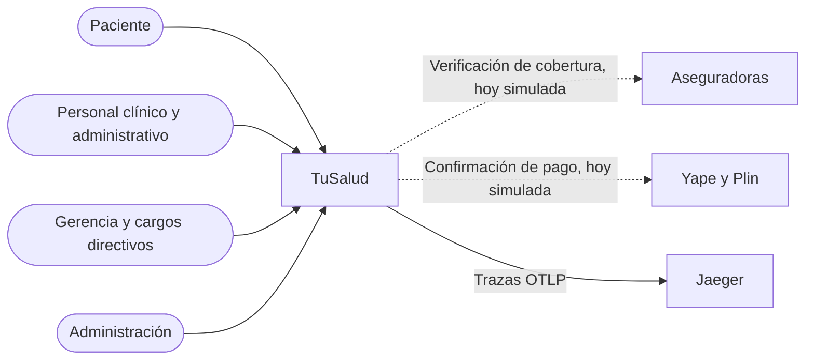

### Contenedores

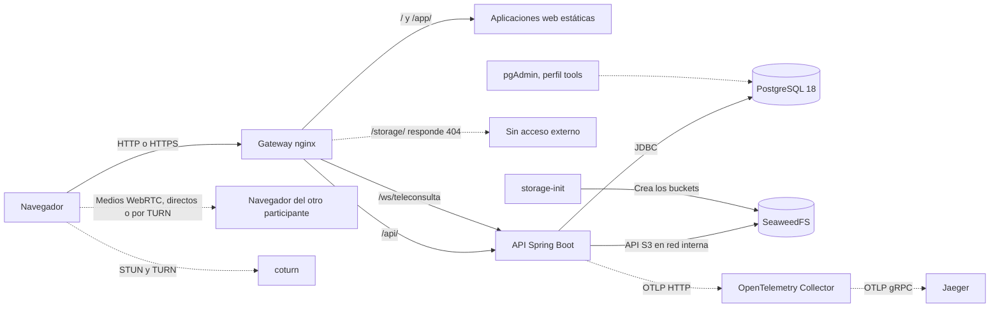

El gateway es el único servicio que publica puertos. La API, la base de datos y el almacén solo son visibles en la red interna de Docker, con la excepción de PostgreSQL, que se publica únicamente en el loopback del host para el desarrollo local. El detalle del stack, de los archivos de Compose y del gateway está en la sección Docker.

### Capas del backend

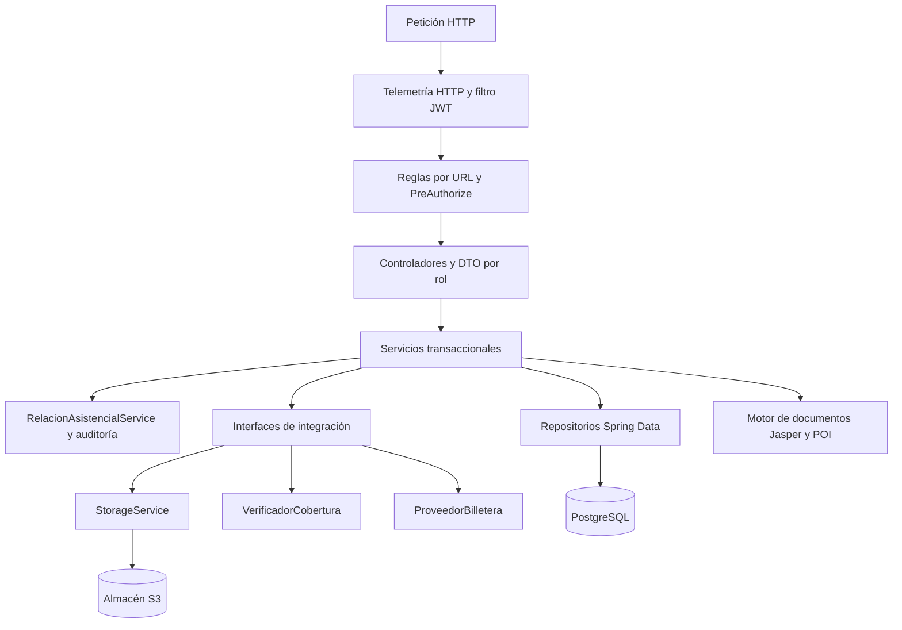

El proyecto sigue una arquitectura en capas bajo el paquete `com.codesoftlabs.tusalud.app`. Cada petición entra por un controlador, que delega en un servicio con la lógica de negocio y las transacciones, y el servicio accede a la base de datos a través de repositorios con consultas JPQL.

```text
src/main/java/com/codesoftlabs/tusalud/app/
├── config/             Seguridad, CORS, OpenAPI, propiedades y telemetría HTTP con su redactor
├── controllers/        Controladores REST con validaciones y documentación OpenAPI
├── documentos/         Motor de plantillas Jasper, libros de Excel y documentos por tipo
├── dto/
│   ├── request/        Cuerpos de entrada validados con Jakarta Validation
│   └── response/       Respuestas de la API, una por rol cuando los datos difieren, y formato de error
├── entities/           Entidades JPA y enumeraciones
├── exceptions/         Excepciones de negocio y manejador global de errores
├── repositories/       Repositorios Spring Data con consultas JPQL
├── security/           JWT, filtro de autenticación, MFA, cifrado de secretos y UserDetailsService
├── services/
│   ├── interfaces/     Contratos de servicio
│   ├── impl/           Implementaciones transaccionales
│   ├── pagos/          Proveedor de billeteras y su implementación simulada
│   ├── seguros/        Cálculo de cobertura, pólizas, preautorizaciones, liquidaciones y verificador de cobertura
│   └── events/         Evento interno que alimenta las notificaciones en tiempo real
└── storage/            StorageService con implementaciones S3 y local, detección de contenido y nombres seguros
```

### Concurrencia con virtual threads

La API corre sobre Java 25 con virtual threads activados mediante `spring.threads.virtual.enabled: true`. Tomcat atiende cada petición en un virtual thread en lugar de tomar uno de un pool limitado de hilos del sistema operativo. Mientras una petición espera a PostgreSQL, su hilo virtual se desmonta y el hilo del sistema queda libre para atender otra, de modo que la API sostiene muchas más peticiones concurrentes con la misma memoria. Las tareas asíncronas y programadas de Spring usan el mismo modelo.

Desde Java 24 un bloque `synchronized` ya no fija el hilo virtual a su hilo del sistema, por lo que las librerías que todavía usan `synchronized` no anulan la ventaja. El límite real de concurrencia contra la base de datos lo marca el pool de conexiones de Hikari: cuando todas las conexiones están ocupadas, las peticiones adicionales esperan su turno sin consumir hilos del sistema.

Las entidades nunca se serializan directamente. Cada respuesta se construye con un DTO, lo que evita ciclos en la serialización y problemas con relaciones perezosas. La propiedad `open-in-view` está desactivada, de modo que toda carga de datos ocurre dentro de la transacción del servicio.

### Workspace del frontend

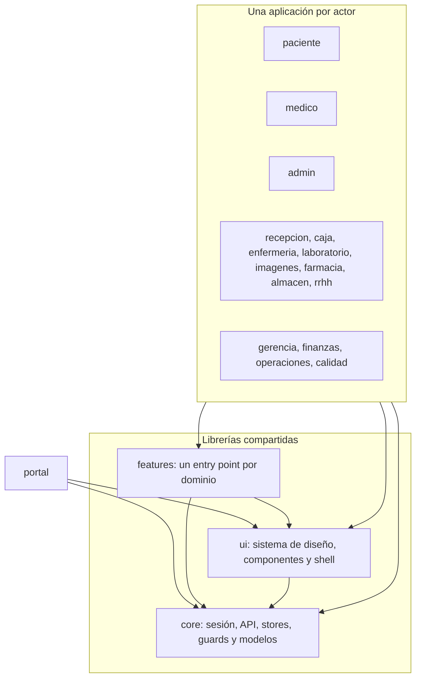

Las dependencias van siempre hacia abajo: una aplicación compone rutas desde `features`, y `features` usa `ui` y `core`. Nunca al revés. La estructura de carpetas, el enrutamiento entre aplicaciones y la creación de una aplicación nueva están en la sección Aplicación web.

## Modelo de datos

El modelo tiene 170 entidades JPA y 31 migraciones de esquema. Todas las tablas usan un identificador UUID. Las relaciones usan carga perezosa, la propiedad `open-in-view` está desactivada y las entidades nunca se serializan directamente: cada respuesta se construye con un DTO. Los diagramas se agrupan por contexto delimitado. Cada contexto se relaciona con los demás a través de `Usuario`, `Paciente`, `Medico` y `Cita`, que aparecen repetidos como puntos de conexión.

### Contexto de identidad y acceso

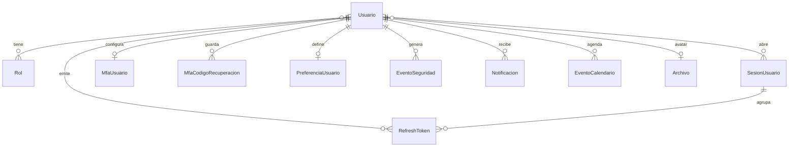

### Contexto clínico ambulatorio

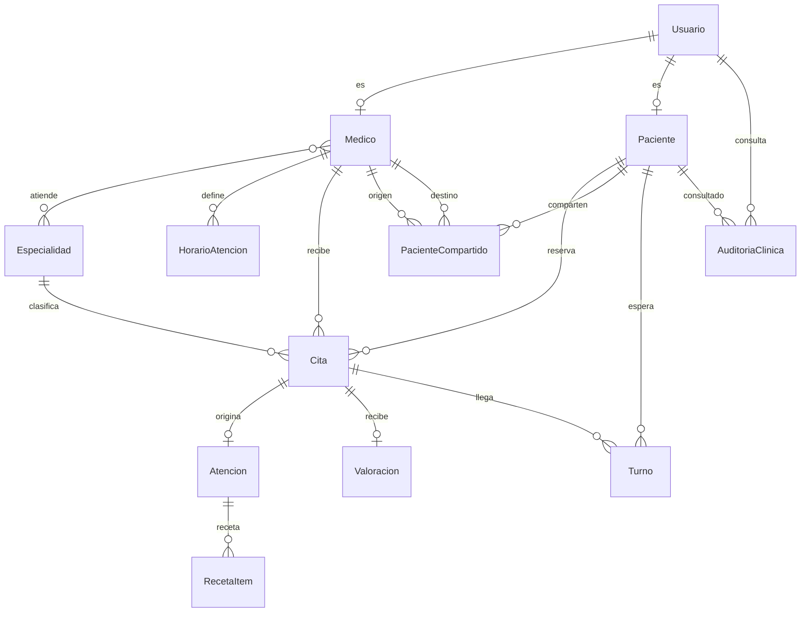

### Contexto de pagos en línea

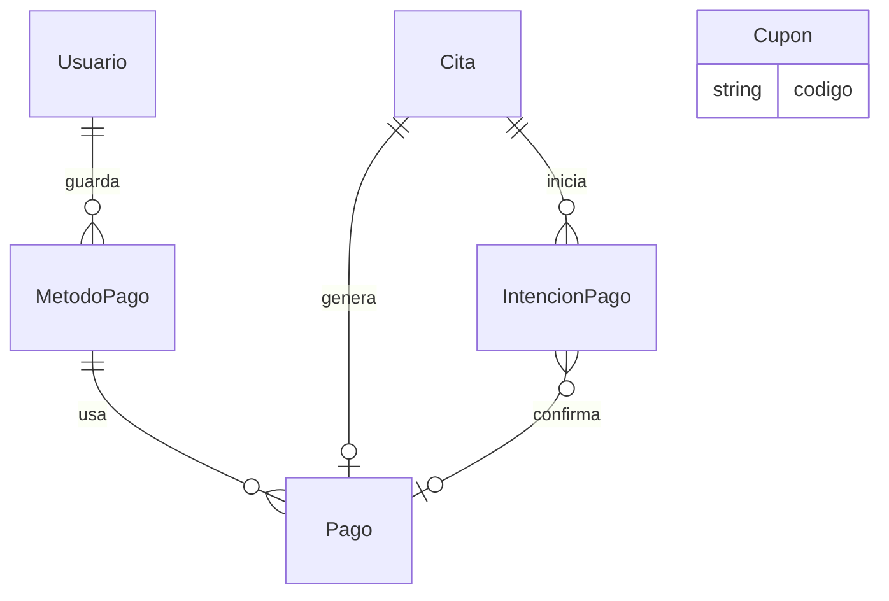

El pago guarda el código del cupón aplicado y no una clave foránea, y los ítems de receta son una colección incrustada en la atención.

### Contexto de apoyo diagnóstico

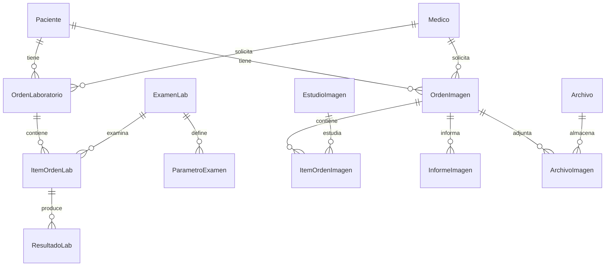

### Contexto de hospitalización

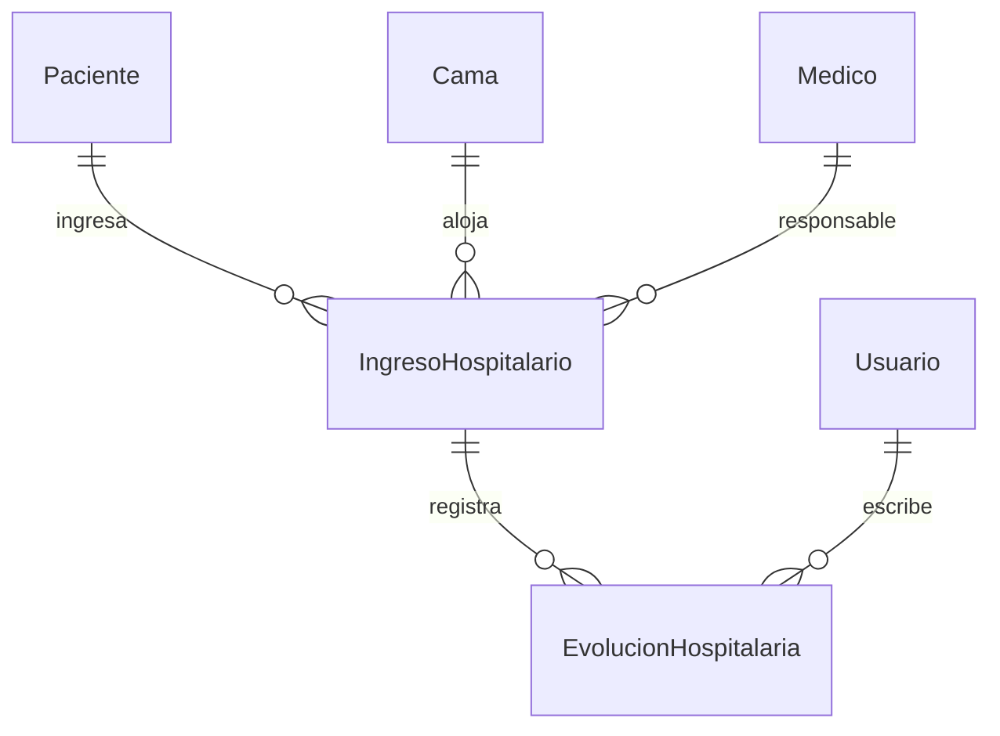

### Contexto de farmacia y almacén

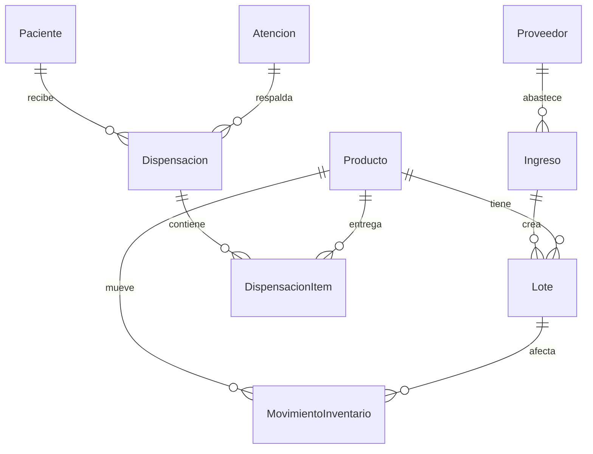

### Contexto de caja y seguros

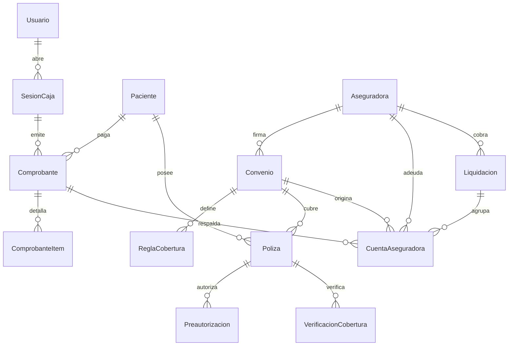

### Contexto de recursos humanos

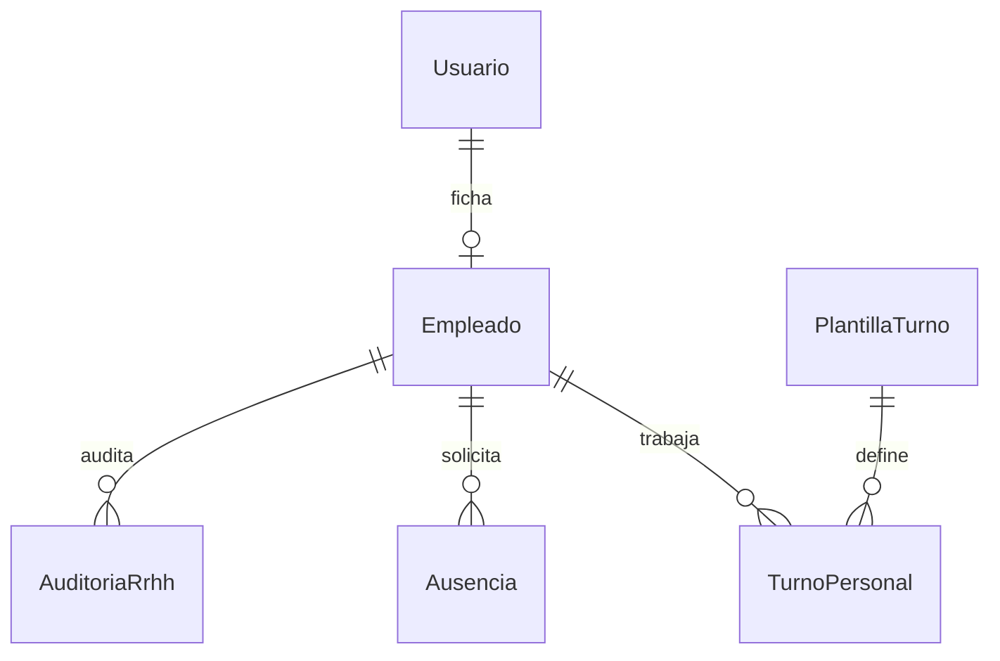

### Contexto de documentos y archivos

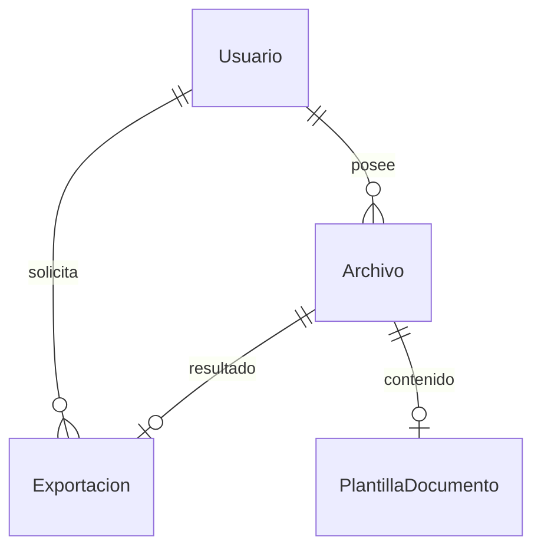

### Contexto de codificación clínica

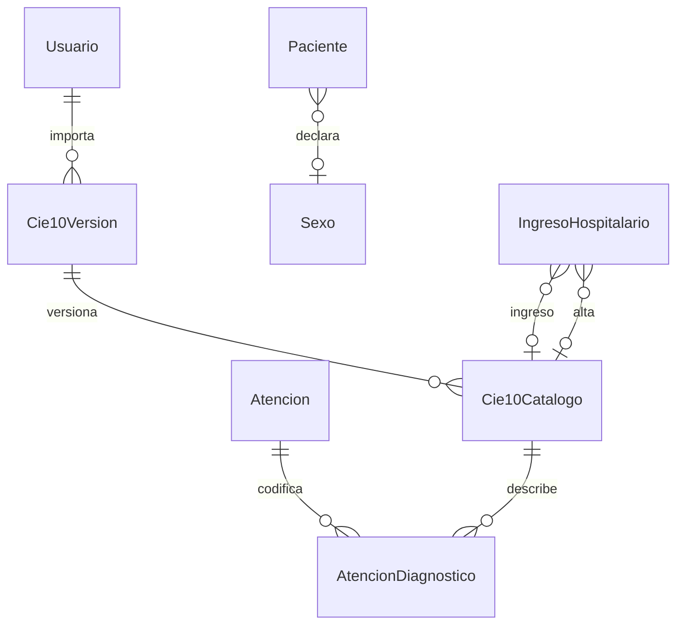

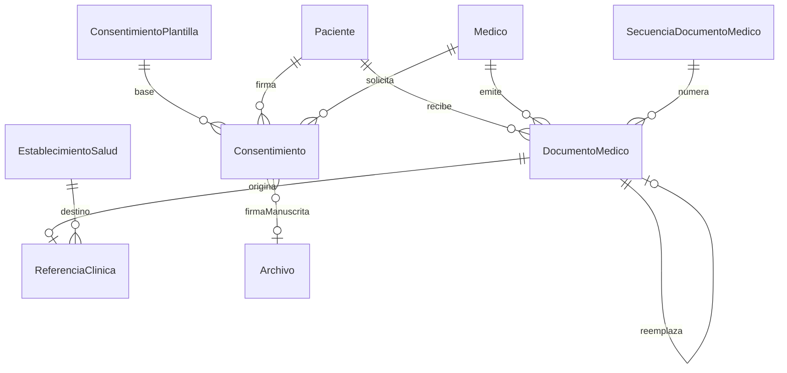

### Contexto de canales y respaldos

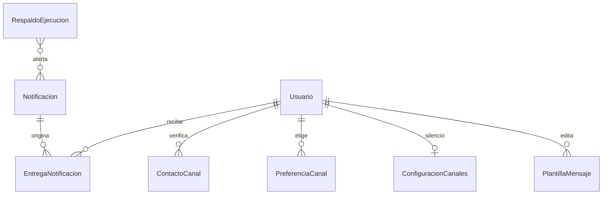

- `contactos_canal` guarda el destino, la fecha del consentimiento y de la verificación, la baja, el rebote y el hash del código vigente con sus intentos. `preferencias_canal` guarda un interruptor por usuario, tipo de aviso y canal, y `configuracion_canales` el horario de silencio.
- `plantillas_mensaje` conserva cada versión y marca una sola como activa. Si un tipo y un canal no tienen versión activa, se usa el texto predeterminado del código.
- `entregas_notificacion` es una bandeja de salida: la entrega nace pendiente en la misma transacción que el aviso, una clave de idempotencia única impide duplicarla y no guarda el texto del mensaje, solo el destino enmascarado, el estado, los intentos y el motivo.
- `respaldo_ejecuciones` guarda cada respaldo y cada prueba de restauración con su duración, tamaño, checksum y validaciones.

### Contexto de facturación electrónica

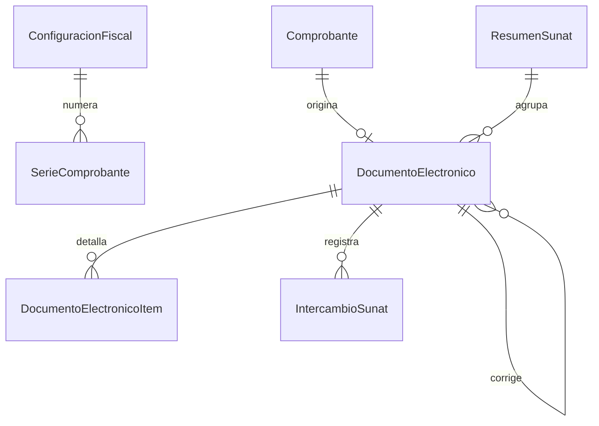

- `configuracion_fiscal` guarda al emisor, el proveedor, el ambiente, la afectación de los servicios y los plazos. Las credenciales SOL y el certificado digital no se guardan en la base de datos, se configuran como secretos del servidor.
- `series_comprobante` lleva el último número de cada serie con bloqueo pesimista para que la numeración no se repita.
- `documentos_electronicos` guarda los montos, el estado, el valor resumen de la firma, el hash del XML, la constancia y los reintentos. El XML firmado y la constancia viven en el almacén de objetos. Una nota apunta al comprobante que corrige.
- `resumenes_sunat` representa tanto el resumen diario de boletas como la comunicación de baja, con su ticket y su constancia.
- `intercambios_sunat` es la bitácora de cada envío, con el resultado y la duración, y sin guardar el contenido.

### Contexto de protección de datos

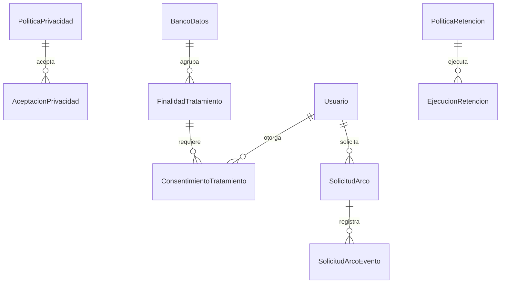

- `politicas_privacidad` y `aceptaciones_privacidad` conservan cada versión con su huella y la aceptación de cada usuario.
- `consentimientos_tratamiento` es un registro que solo crece. El estado vigente es el último movimiento de cada finalidad.
- `solicitudes_arco` y `solicitud_arco_eventos` guardan la solicitud, su plazo, su responsable, la resolución y su línea de tiempo. La exportación de datos vive en el almacén de objetos.
- `politicas_retencion` y `ejecuciones_retencion` definen el plazo y la acción por tipo de dato y guardan lo que hizo cada ejecución.
- `incidentes_datos`, `encargados_tratamiento`, `bancos_datos` y `finalidades_tratamiento` completan el registro de tratamientos.

### Contexto de compras

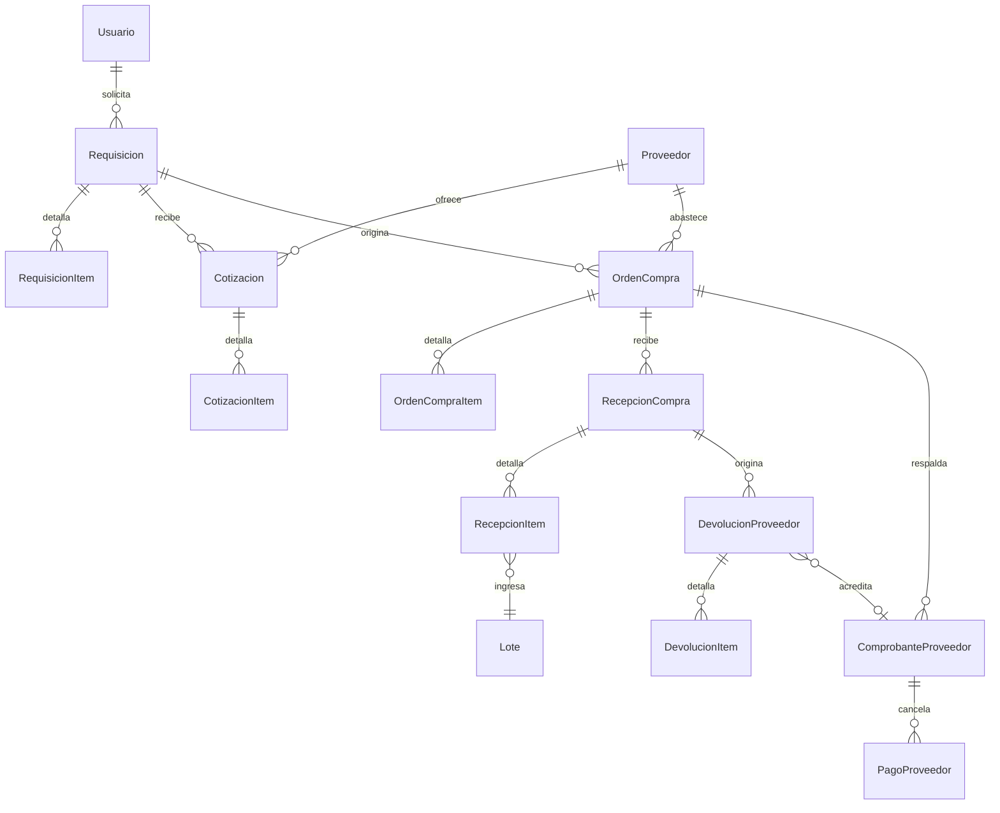

- `requisiciones` y `requisicion_items` guardan el pedido interno con su prioridad y su área solicitante. Las generadas desde el stock bajo quedan marcadas como sugeridas.
- `cotizaciones` y `cotizacion_items` guardan una oferta por proveedor y requisición, con su vigencia, su plazo de entrega y su condición de pago.
- `ordenes_compra` y `orden_compra_items` guardan los montos con IGV, el nivel de aprobación, la huella de la orden aprobada y las cantidades recibidas y rechazadas de cada ítem. El número y el código se asignan al aprobar y son únicos por año.
- `recepciones_compra` y `recepcion_items` guardan lo recibido contra la orden con su lote, su vencimiento, el motivo de cada discrepancia y el ingreso de almacén que generaron.
- `devoluciones_proveedor` y `devolucion_items` guardan lo devuelto por lote, su monto con IGV y el comprobante al que se aplicó el crédito.
- `comprobantes_proveedor` y `pagos_proveedor` llevan la cuenta por pagar, con su vencimiento, su saldo y cada pago. Un mismo proveedor no repite tipo, serie y número.
- `secuencias_compras` numera requisiciones, órdenes, recepciones y devoluciones por año con bloqueo pesimista.
- `compras_auditoria` registra quién hizo cada paso y cuándo. Los proveedores ganan condición de pago, plazo de entrega y datos bancarios.

### Contexto de contabilidad

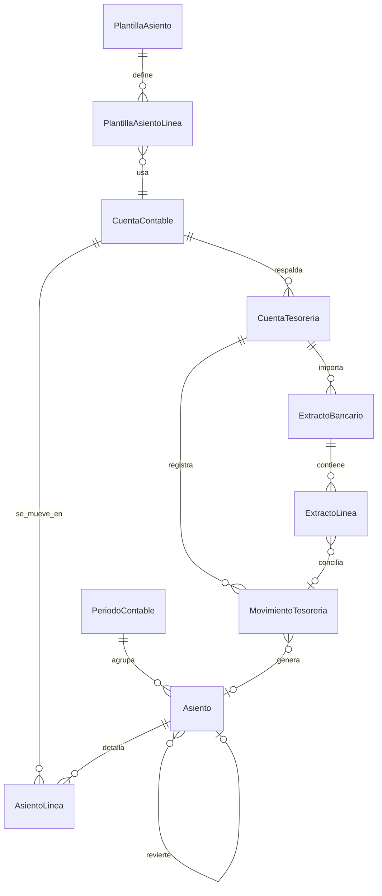

- `cuentas_contables` guarda el plan contable simplificado, con su tipo, su naturaleza y si recibe asientos. Las de agrupación solo suman a sus hijas por el prefijo del código.
- `periodos_contables` guarda un mes por fila, con quién lo cerró o lo reabrió y el motivo de la reapertura.
- `asientos` y `asiento_lineas` guardan el libro diario. El origen y la referencia son únicos, de modo que un mismo cobro o pago no genera dos asientos. `secuencias_contables` numera por año con bloqueo pesimista.
- `plantillas_asiento` y `plantilla_asiento_lineas` dicen qué cuenta se debita o abona por cada concepto de monto, como el total, la base, el IGV o lo cubierto por la aseguradora.
- `asientos_pendientes` guarda el hecho serializado y el motivo del fallo hasta que se reprocesa.
- `cuentas_tesoreria` guarda solo los cuatro últimos dígitos de la cuenta bancaria. `movimientos_tesoreria` es único por origen y referencia.
- `extractos_bancarios` y `extracto_lineas` guardan lo importado, con una huella que evita importar dos veces la misma línea.
- `contabilidad_auditoria` registra quién hizo cada paso, y el sistema figura como autor de los asientos automáticos.

### Contexto de planilla

```mermaid
erDiagram
    Empleado ||--o{ ContratoLaboral : firma
    Empleado ||--o{ EmpleadoConcepto : recibe
    ConceptoPlanilla ||--o{ EmpleadoConcepto : define
    Empleado ||--o{ Marcacion : registra
    TerminalAsistencia ||--o{ Marcacion : origina
    Empleado ||--o{ AsistenciaDia : consolida
    TurnoPersonal ||--o| AsistenciaDia : programa
    Planilla ||--o{ BoletaPago : genera
    Empleado ||--o{ BoletaPago : cobra
    ContratoLaboral ||--o{ BoletaPago : sustenta
    BoletaPago ||--o{ BoletaLinea : detalla
    ParametroPlanilla }o--o{ Planilla : rige
```

- `contratos_laborales` guarda el régimen, la remuneración, el sistema pensionario, la cuenta de abono y la vigencia. Un empleado no puede tener dos contratos que se crucen.
- `parametros_planilla` guarda cada valor de ley con su vigencia. Una nueva versión cierra la anterior y la planilla usa la vigente al final del mes.
- `conceptos_planilla` mezcla los conceptos del sistema, que se calculan solos, con los de la clínica, y `empleado_conceptos` asigna los recurrentes a cada trabajador con su vigencia.
- `marcaciones` guarda cada entrada y salida con su origen, manual o terminal. `asistencias_dia` guarda el día consolidado, con tardanza, minutos trabajados, minutos extra y su destino.
- `terminales_asistencia` guarda solo el hash del token de cada terminal. El código de marcación de cada empleado vive en `empleados`.
- `planillas` es única por año y mes, con su estado, totales, huella y quién hizo cada paso. `boletas_pago` y `boleta_lineas` congelan el cálculo, y `secuencias_planilla` numera las boletas por año.
- `planilla_auditoria` registra quién hizo cada paso.

### Reglas de integridad

- La tabla `citas` tiene índices por médico y fecha y por paciente y fecha, y el campo `version` aplica bloqueo optimista para que dos operaciones concurrentes no sobrescriban la misma cita.
- El correo, el DNI, la colegiatura y el número de historia clínica son únicos. Los códigos de negocio, como los comprobantes, los turnos y los ingresos, son correlativos y legibles, y no se usan como identificador.
- Las líneas de comprobantes, órdenes y resultados guardan su posición, porque un UUID no conserva el orden de creación.
- Los datos que deben sobrevivir a cambios del catálogo se copian al momento de usarlos: el precio de la consulta en la cita y el nombre, la unidad y el rango de un parámetro en el resultado de laboratorio.
- El diagnóstico codificado copia el código y la descripción en `atencion_diagnosticos`, de modo que una actualización del catálogo no reescribe una historia clínica ya firmada. La unicidad de un solo principal por atención se valida en el servicio y no con un índice parcial, para que la misma regla funcione en PostgreSQL y en H2.
- Un documento médico emitido no se modifica: guarda el hash SHA-256 del contenido canónico y del PDF, y la numeración por tipo y año se asigna con un bloqueo pesimista sobre `secuencias_documentos_medicos`, de modo que dos emisiones simultáneas nunca repiten número. Los índices únicos parciales de número y de código de verificación lo respaldan en la base.
- Los archivos no se guardan en la base de datos: la tabla `archivos` guarda los metadatos, el bucket, la clave, el tamaño, el hash y el propietario, y los bytes viven en el almacén de objetos.

## Seguridad

La seguridad de TuSalud sigue la defensa en profundidad: el gateway filtra y limita, el backend autentica, autoriza por rol y por relación con el dato, valida cada entrada y audita lo sensible, y la interfaz reduce la exposición. Ninguna capa confía en la anterior. En particular, el frontend nunca es la barrera: oculta lo que el rol no puede usar pero el backend decide siempre.

### Modelo de amenazas resumido

| Amenaza                                              | Controles principales                                                                                                                          |
| ---------------------------------------------------- | ---------------------------------------------------------------------------------------------------------------------------------------------- |
| Robo o adivinación de credenciales                   | BCrypt, verificación en dos pasos, bloqueo por intentos, límite de tasa en el gateway, eventos de seguridad y alertas de dispositivo nuevo     |
| Robo de sesión                                       | Token de acceso de 15 minutos, refresh token opaco que rota y se guarda solo con hash, sesiones revocables y bloqueo por inactividad           |
| Acceso a datos de otros pacientes por la URL o el id | UUID no adivinables, relación asistencial en cada módulo clínico, propiedad del dato para el paciente y auditoría de lecturas ajenas           |
| Exceso de datos expuestos a un rol                   | DTO distintos por rol, minimización por campo, reportes agregados sin datos de pacientes y administrador sin acceso clínico                    |
| Alteración o falsificación de datos clínicos         | Solo el personal de salud con relación escribe datos clínicos, ventana de 48 horas para reescribir una atención y versiones en los informes    |
| Archivos maliciosos                                  | Tipo detectado por contenido, rechazo de ejecutables, SVG y HTML, nombres sanitizados, tamaños acotados y descarga siempre por el backend      |
| Plantillas de documentos maliciosas                  | Validación con lista blanca que rechaza scripts, importaciones peligrosas, entidades externas y recursos externos, con versión y auditoría     |
| Inyección y mass assignment                          | Consultas parametrizadas, DTO de entrada con validación y campos que el cliente no controla, como estado, precio, rol o propietario            |
| Fuga por telemetría y logs                           | Redacción de credenciales y datos sensibles en los spans, sin cuerpos en rutas clínicas y de autenticación, y logs con ids en lugar de correos |
| Abuso y denegación de servicio                       | Límites de tasa y de tamaño en el gateway, límites de filas y de exportaciones por usuario y virtual threads con pool de conexiones acotado    |
| Exposición de la infraestructura                     | Un solo servicio con puertos publicados, almacén y API solo en red interna, versión de nginx oculta y política de contenido estricta           |

### Autenticación y sesión

- Los tokens de acceso se firman con HMAC-SHA y la clave `JWT_SECRET`, y duran 15 minutos. El refresh token es opaco, dura 7 días, se guarda solo como hash SHA-256 y rota en cada uso. Reutilizar un refresh token ya rotado se detecta.
- La verificación en dos pasos usa TOTP estándar con una aplicación autenticadora. El secreto se guarda cifrado con AES-GCM y existen códigos de recuperación de un solo uso. Cinco fallos seguidos bloquean el intento durante 5 minutos.
- Cada usuario ve sus sesiones activas y puede cerrarlas. Un inicio de sesión desde un dispositivo nuevo genera una alerta.
- Un usuario inactivo no puede iniciar sesión y su token deja de ser válido aunque no haya expirado. Un inicio de sesión con una cuenta inexistente responde igual que uno con contraseña incorrecta.

### Controles vigentes en el backend

- Los tokens se firman con HMAC-SHA usando la clave `JWT_SECRET`, que debe estar codificada en Base64 y tener al menos 256 bits. Cada token incluye el email como sujeto, el emisor, la expiración, el id del usuario, su nombre y sus roles. El token de acceso dura 15 minutos y se renueva con un refresh token rotativo.
- Un usuario inactivo no puede iniciar sesión y su token deja de ser válido aunque no haya expirado.
- Las contraseñas se almacenan con BCrypt.
- Todas las entidades y tablas usan UUID versión 4 como identificador, generado en la aplicación y con `gen_random_uuid()` como valor por defecto en la base. Así los ids no se pueden adivinar ni recorrer en orden. Un id con formato inválido en la ruta responde 400 y uno inexistente responde 404. Los códigos legibles de negocio, como los comprobantes, los turnos y los ingresos, siguen siendo correlativos.
- CORS permite peticiones desde `http://localhost:4200` con los métodos GET, POST, PUT, DELETE y OPTIONS. El origen se configura con `CORS_ALLOWED_ORIGINS`. Como el gateway sirve el frontend y la API desde el mismo origen, el navegador no necesita CORS en el uso normal.
- Los archivos nunca se exponen por una dirección pública. El almacén de objetos solo es accesible desde la red interna de Docker y toda descarga pasa por la API, que valida la sesión y la relación con el dato antes de entregar el contenido. Los tipos se detectan por el contenido y no por la extensión, se rechazan SVG, HTML, scripts y ejecutables, y los nombres se sanitizan.
- El gateway nginx es el único servicio que publica puertos. Limita la tasa de los intentos de inicio de sesión, renovación, registro y verificación en dos pasos, acota el tamaño de las peticiones por ruta, bloquea los métodos poco comunes, oculta la versión de nginx y entrega una política de seguridad de contenido estricta junto con las demás cabeceras de seguridad.
- La autorización combina reglas por URL en `SecurityConfig` con `@PreAuthorize` en cada método de los controladores.
- Tener el rol correcto no basta para ver los datos de una persona: hace falta una relación con ella. `RelacionAsistencialService` es la única regla y la cumple un médico que atendió al paciente en una cita no cancelada, que tiene un ingreso activo a su cargo o a quien otro médico le compartió el paciente. Ese acceso se aplica a la historia clínica, el laboratorio, la hospitalización y la lista de pacientes del médico.
- Los datos clínicos los modifica solo el personal de salud. El paciente consulta su historia y, si algún dato no es correcto, se comunica con el centro de salud. El médico con relación actualiza los datos médicos y queda registrado quién y cuándo, y cada consulta de una historia ajena se guarda en `auditoria_clinica`.
- Cada rol recibe solo los campos que necesita: recepción y administración no ven diagnósticos ni indicaciones, caja no ve datos clínicos, farmacia solo ve las recetas, el correo y el teléfono de un médico solo los ven el administrador y el propio médico, y las valoraciones públicas abrevian el nombre del paciente. El administrador gestiona la institución pero no lee ni escribe datos clínicos.
- Una atención no se reescribe pasadas 48 horas ni cuando su receta ya fue dispensada.
- Los canales externos exigen consentimiento y destino verificado, no llevan datos clínicos y ocultan los destinos con máscara en toda respuesta y en la bitácora. Los códigos de verificación se guardan con HMAC, caducan en 10 minutos y admiten cinco intentos. El enlace de baja y el webhook de entrega van firmados con HMAC-SHA256, el webhook además exige una marca de tiempo de menos de cinco minutos y la comparación de firmas es de tiempo constante.
- Los respaldos se cifran con AES-256 y una clave derivada con PBKDF2 antes de salir del contenedor de respaldos, y la API solo acepta sus reportes con el secreto compartido de la cabecera `X-Respaldo-Token`.
- La teleconsulta solo admite al médico y al paciente de la cita. El canal de señalización se abre con un ticket de un solo uso y 30 segundos que nunca viaja en el token de sesión, valida el tipo y el tamaño de cada mensaje, limita su tasa y cierra las conexiones inactivas. El audio y el video no pasan por el servidor ni se graban, el chat no se conserva y las credenciales del servidor TURN caducan en una hora.

### Auditoría y vigilancia

- **Auditoría clínica.** Cada lectura de una historia ajena y cada modificación de datos médicos quedan en `auditoria_clinica` con quién, a quién y cuándo. Las descargas de documentos clínicos se registran igual.
- **Auditoría de recursos humanos.** Los cambios de fichas y ausencias quedan en `auditoria_rrhh` sin guardar los montos.
- **Eventos de seguridad.** La tabla `eventos_seguridad` registra inicios de sesión fallidos o repetidos, intentos con cuentas inactivas, dispositivos nuevos, bloqueos, cambios de MFA, de contraseña, de roles y de estado de cuenta, accesos denegados repetidos y descargas masivas. La dirección IP se guarda enmascarada, nunca se guardan contraseñas ni el correo de una cuenta inexistente y una purga programada aplica la retención, de 90 días por defecto. El administrador los consulta con filtros y un resumen.
- **Motivos obligatorios.** Cancelar una cita, anular una dispensación o un comprobante y cancelar un ingreso o una orden exigen un motivo de entre 5 y 300 caracteres, que queda guardado.

### Archivos y documentos

- Los archivos viven en un almacén de objetos compatible con S3 al que solo accede la API. El tipo se detecta por la firma del contenido, se rechazan SVG, HTML, scripts y ejecutables, los nombres se sanitizan y cada propósito tiene su lista de tipos y su tamaño máximo.
- Cada descarga se autoriza con las mismas reglas que el dato de origen, no existen direcciones públicas y el token nunca viaja en una URL: el frontend descarga con la cabecera de autorización y muestra el archivo desde un objeto en memoria.
- Los documentos llevan una marca con el usuario, la fecha y un código de verificación. El Excel neutraliza las celdas que empiezan con `=`, `+`, `-` o `@`.
- Las plantillas JRXML que sube el administrador se validan contra una lista blanca antes de guardarse y no pueden ejecutar código ni leer recursos externos.

### Gateway y red

- El gateway nginx es el único servicio con puertos publicados. Enruta el frontend, la API con soporte de eventos en tiempo real y bloquea `/storage/`.
- Limita la tasa de inicio de sesión, renovación, registro y verificación en dos pasos, aplica la zona `verificacion` también a la baja de canales, al webhook de entrega y al reporte de respaldos, acota el tamaño de las peticiones por ruta, bloquea métodos poco comunes y archivos ocultos, y oculta la versión de nginx.
- Entrega una política de seguridad de contenido estricta, `X-Content-Type-Options`, `Referrer-Policy` y las demás cabeceras de seguridad, y admite TLS con HSTS cuando se activa.
- PostgreSQL solo se publica en el loopback del host.

### Interfaz

- **Bloqueo por inactividad.** Tras un tiempo configurable por aplicación, con aviso y cuenta regresiva, la pantalla se bloquea y exige la contraseña o el código de verificación. Hay también una duración máxima de sesión y el estado se sincroniza entre pestañas.
- **Modo privacidad.** Un botón de la barra difumina los datos personales sensibles y enmascara el DNI, el teléfono y el correo hasta que el usuario decida mostrarlos, para estaciones compartidas.
- **Avisos de acceso auditado** al abrir historias clínicas, imágenes y documentos, y confirmación con motivo en las acciones sensibles.
- Los campos sensibles no usan autocompletado y ningún dato personal aparece en los títulos de pestaña ni en las URLs.
- Cada aplicación contiene solo el código de su rol y el menú muestra únicamente lo que el rol puede usar.

### Observabilidad segura

La telemetría registra método, ruta, estado y tamaño de cada petición. Los cuerpos y cabeceras solo se registran cuando es seguro, con redacción recursiva de campos sensibles y truncado, y nunca en las rutas de autenticación, perfil, pagos, historia clínica, laboratorio, imágenes, hospitalización, farmacia, archivos, documentos, canales y respaldos. Los DTO con credenciales ocultan sus valores en `toString`, los logs usan ids en lugar de correos y el Collector elimina las cabeceras sensibles antes de exportar. En desarrollo los parámetros SQL solo se imprimen en el perfil local.

### Límites y decisiones conocidas

- La sesión se guarda en el almacenamiento local del navegador. Es una decisión que permite compartirla entre las aplicaciones del mismo origen. Se compensa con una política de seguridad de contenido estricta, tokens de corta duración y bloqueo por inactividad, pero un XSS lograría leerla.
- La verificación de cobertura de seguros y la confirmación de pagos con billetera son simuladas detrás de interfaces. Antes de producción deben reemplazarse por integraciones reales.
- El almacén de objetos es un solo nodo y las subidas no pasan por un antivirus, y ambos puntos están en la hoja de ruta. Los respaldos automáticos existen, pero la copia a un segundo destino es opcional y no se ha probado contra un destino real.
- Los canales de SMS y WhatsApp usan un proveedor simulado hasta que se configure uno real, y el webhook de estado solo entiende el formato propio descrito en el detalle del módulo. Un enlace de baja firmado no caduca, porque debe seguir funcionando en correos antiguos.
- La combinación completa de `compose.yaml` en modo producción con TLS y credenciales reales no se ha probado de punta a punta.
- La migración que pasó los archivos al almacén de objetos borró los bytes de las imágenes y avatares que estuvieran en la base, porque SQL no puede subir objetos. Las bases de desarrollo previas se recrean.
- Un evento de seguridad se guarda en la misma transacción de la petición, de modo que se pierde si la petición revierte. Los casos de inicio de sesión fallido y de bloqueo están cubiertos para que no se pierdan.

## Guía de extensión

TuSalud está pensado para crecer. Esta guía describe los pasos verificados para agregar cada tipo de pieza y las convenciones que mantienen el sistema coherente. Antes de empezar, define para el cambio nuevo quién puede hacerlo, qué datos ve cada rol y si el dato es clínico, porque de esas respuestas salen la autorización, los DTO y la auditoría.

### Agregar un módulo completo

1. **Diseña los permisos.** Decide los roles que usan el módulo, los campos que ve cada uno y si hace falta relación asistencial con el paciente. Un dato clínico siempre la exige. Un dato administrativo se limita por rol y por propiedad.
2. **Entidad y migración.** Crea las entidades en `entities/` con identificador UUID generado con `@GeneratedValue` de tipo UUID, y una migración Flyway nueva en `src/main/resources/db/migration` con el siguiente número libre, hoy la `V21`. Los enumerados van en `entities/enums/`. Agrega los índices que necesiten tus consultas.
3. **Repositorio.** Crea el repositorio en `repositories/` con consultas JPQL y parámetros nombrados. Ordena siempre de forma explícita, porque un UUID no conserva el orden de creación.
4. **DTO por rol.** Crea los DTO de entrada con Jakarta Validation en `dto/request/` y los de salida en `dto/response/`. Si dos roles deben ver campos distintos, usa dos DTO o campos opcionales que el servicio rellena según el rol. Nunca devuelvas una entidad ni aceptes campos que el cliente no debe controlar, como estado, precio, propietario o rol.
5. **Servicio.** Define la interfaz en `services/interfaces/` y la implementación transaccional en `services/impl/`. Aplica las reglas de negocio y las transiciones de estado validando al actor. Para un dato clínico, usa `RelacionAsistencialService` en lugar de comprobar solo el rol, y registra la lectura ajena con `AuditoriaClinicaService`. Para acciones que se deshacen, exige un motivo. Para avisar a alguien, usa `NotificacionService` y agrega el tipo a `TipoNotificacion`.
6. **Controlador.** Crea el controlador en `controllers/` con `@PreAuthorize` en cada método, `@Tag` y `@Operation` en español y respuestas documentadas. Un id con formato inválido responde 400 sin trabajo extra y uno inexistente debe responder 404 con el mensaje en español de las excepciones de negocio.
7. **Telemetría.** Si el módulo recibe o devuelve cuerpos con datos clínicos o credenciales, agrega su ruta a `RUTAS_SIN_CUERPO` en `TelemetryRedactor`.
8. **Documentos y archivos.** Si genera documentos, agrega un valor a `TipoDocumento` con los roles permitidos y una plantilla, como se explica más abajo. Si recibe archivos, usa `ArchivoService` con un propósito nuevo que declare tipos permitidos, tamaño máximo y regla de autorización.
9. **Pruebas del backend.** Escribe pruebas de servicio con las reglas y los casos borde, y una prueba de seguridad por rol que verifique el 401, el 403, el acceso a datos ajenos por id y los campos que cada rol no debe ver. El backend debe seguir verde con `./mvnw test` y `./mvnw spotless:check`.
10. **Datos de demostración.** Si el módulo necesita datos de ejemplo, agrégalos en una migración de `db/demo` con el siguiente número libre, hoy la `V114`. Nunca crees datos iniciales desde código Java: la carga de datos es siempre SQL versionado.
11. **Postman.** Agrega una carpeta numerada a `postman/Tusalud.postman_collection.json`, hoy la `27`, con los casos felices y los 400, 401, 403, 404 y 409. La colección debe pasar dos veces seguidas sin reiniciar la base, por lo que cada caso crea y limpia sus propios datos.
12. **Frontend, modelos y datos.** En `web/projects/core` agrega los modelos TypeScript con ids de tipo texto, el cliente de la API y el store con `AsyncState`.
13. **Frontend, pantallas.** En `web/projects/features` crea un entry point nuevo con su `ng-package.json` y su `public-api.ts`, que exporte las rutas del dominio. Las pantallas usan los componentes de `@tusalud/ui`, como `tablero`, `dialogo-motivo`, `carga-archivos` y `boton-documento`.
14. **Frontend, aplicaciones.** Agrega las rutas del dominio en el `app.routes.ts` de cada aplicación cuyo rol lo use, con su guard de rol. Agrega los ítems de menú en su `nav.config.ts` y los pasos de la guía de bienvenida de ese rol. Si el módulo aporta indicadores, agrégalos al inicio de la aplicación.
15. **Pruebas del frontend.** Escribe pruebas unitarias del cliente, del store y de los componentes, y una prueba de humo de las rutas del entry point. Escribe pruebas e2e en `web/e2e` que usen cuentas de `support.ts`, el helper `ir` para construir las URLs y datos propios para que sean repetibles.
16. **Documentación.** Agrega la ficha del módulo al mapa de módulos, su detalle a la sección Detalle de los módulos, sus endpoints a la tabla de la API, la fila de la hoja de ruta y los conteos de pruebas al README.

### Agregar un rol nuevo

1. Agrega el valor a `RolNombre` y una migración que inserte el rol en la tabla `roles`.
2. Registra su descripción en `UsuarioAdminServiceImpl` y los tipos de evento de calendario que le corresponden en `EventoCalendarioServiceImpl`. Verifica que el alta de personal de administración admita el rol nuevo.
3. En el frontend agrega el rol al tipo `Rol` y a las constantes de `auth.model.ts`, a `HOME_BY_ROLE` en `auth.service.ts`, a `MODULOS` en `modulos.ts` con su aplicación, ruta base, etiqueta, icono y prioridad, a los pasos de `tour.service.ts` y a los tipos de evento de `evento-calendario.ts`.
4. Revisa los `@PreAuthorize` de los controladores que el rol debe usar y escribe la prueba de seguridad que demuestra qué ve y qué no ve.
5. Agrega una cuenta de ejemplo en una migración de demostración y a `CUENTAS` en `web/e2e/support.ts`, y documenta el rol en la tabla de actores.

### Agregar una aplicación para un cargo o una especialidad

Una aplicación nueva se justifica cuando un actor tiene flujos propios. Una especialidad con pantallas específicas, como un odontograma o las curvas de crecimiento pediátricas, se agrega como una aplicación más.

1. Genera el proyecto con `ng generate application nombre` y copia el bloque del `angular.json` de una aplicación existente para heredar sus configuraciones de build, la ruta base y los entornos compartidos.
2. Crea los archivos de la aplicación copiándolos de una existente: `app.config.ts`, `app.routes.ts`, `app.id.ts`, `nav.config.ts` y el spec de humo. `app.routes.ts` compone las rutas desde `@tusalud/features` y protege la entrada con `entradaModulo`.
3. Registra el módulo en `MODULOS` de `@tusalud/core` con su rol, su ruta base, su etiqueta y su icono.
4. Agrega la aplicación a los scripts `build:all` y `test:apps` de `web/package.json`, a la lista de bases de la plantilla del gateway y al `Dockerfile` del frontend.
5. Si la aplicación necesita una pantalla que ninguna otra usará, créala dentro del proyecto. Si puede reutilizarse, créala en un entry point de `@tusalud/features`.
6. Agrega los e2e de la aplicación y actualiza la tabla de actores.

### Agregar una plantilla de documento

1. Agrega un valor a `TipoDocumento` con su código, el nombre de la plantilla, si es clínico, los formatos permitidos y los roles que pueden descargarlo.
2. Crea la plantilla `nombre.jrxml` en `src/main/resources/reportes/`. La plantilla recibe un conjunto de datos armado en Java y nunca ejecuta una consulta SQL ni scripts. Usa fuentes con soporte de tildes.
3. Arma los datos en la clase de documentos que corresponda y aplica la misma autorización que el dato de origen.
4. El administrador puede reemplazar la plantilla desde la página de plantillas. La que sube se valida con `ValidadorPlantilla` y se puede restaurar a la empaquetada.
5. Agrega las pruebas de `MotorPlantillasTest` y de autorización de `DocumentoServiceTest`, y el botón de documento en la pantalla correspondiente.

### Reemplazar una integración

Las dependencias externas están detrás de interfaces para poder cambiarlas sin tocar el dominio.

| Integración               | Interfaz               | Implementaciones                           | Cómo cambiarla                                                                                       |
| ------------------------- | ---------------------- | ------------------------------------------ | ---------------------------------------------------------------------------------------------------- |
| Almacén de archivos       | `StorageService`       | `S3StorageService` y `LocalStorageService` | Se elige con `app.storage.tipo`. Cualquier almacén compatible con S3 funciona cambiando el endpoint. |
| Verificación de cobertura | `VerificadorCobertura` | `VerificadorCoberturaSimulado`             | Crear una implementación que consulte a la aseguradora y marcarla como el bean activo.               |
| Pagos con billetera       | `ProveedorBilletera`   | `BilleteraSimulada`                        | Crear una implementación que confirme con el proveedor real y mantener la validación del código.     |

Una integración nueva debe incluir una prueba de contrato contra la interfaz, mantener la autorización y la auditoría en el servicio y no cambiar los DTO.

### Convenciones

- **Nombres.** Los paquetes, clases, métodos y rutas están en español para el dominio. Los endpoints cuelgan de `/api/v1/` con el nombre del módulo en minúsculas. Las clases siguen el sufijo de su capa, como `Controller`, `Service` y `Repository`, y los DTO terminan en `Request` o `Response`.
- **Migraciones.** Se numeran de forma correlativa sin huecos. El esquema usa el rango V1 a V31 y la siguiente es la V32. Los datos de demostración usan el rango V100 a V123 y la siguiente es la V124. Una migración ya fusionada no se edita: cada cambio posterior es una migración nueva. Durante el desarrollo temprano, antes de contar con datos reales, las migraciones se reescribieron en sitio, por ejemplo al pasar a UUID, y por eso las bases anteriores se recrean con `docker compose down -v`.
- **Pruebas.** Las pruebas del backend terminan en `Test` y las de seguridad por módulo en `SeguridadTest`. Cada módulo cubre servicio, seguridad y casos borde. Los e2e usan datos propios y no dependen del estado ni de la hora.
- **Mensajes.** Los errores de negocio y de validación se escriben en español, claros para el usuario y sin datos sensibles.
- **Estilo.** El código Java se formatea con Spotless y el resto con Prettier, y los hooks de Git lo verifican. El código no lleva comentarios.

### Lista de verificación antes de fusionar

- Cada endpoint nuevo tiene `@PreAuthorize` y una prueba de 401 y 403.
- Un dato clínico exige relación asistencial y una lectura ajena se audita.
- Cada rol recibe solo los campos que necesita y lo demuestra una prueba.
- Los ids son UUID y las consultas ordenan de forma explícita.
- Las acciones que se deshacen exigen un motivo.
- Las rutas con datos sensibles están en `RUTAS_SIN_CUERPO` de la telemetría.
- La migración es nueva, correlativa e inmutable, y los datos de demostración son SQL.
- `./mvnw test`, `./mvnw spotless:check`, `npm run test:all` y el build de producción de las aplicaciones tocadas pasan sin avisos.
- Los e2e nuevos son repetibles y la suite completa pasa por el gateway.
- La carpeta de Postman pasa dos veces seguidas.
- El README tiene la ficha, los endpoints, la hoja de ruta y los conteos actualizados.

## Hoja de ruta

La hoja de ruta muestra cómo evolucionó el sistema y hacia dónde va. Cada ítem está marcado como hecho, en curso o planificado, sin fechas comprometidas. El orden de lo planificado indica la prioridad actual.

### Lo ya hecho, por fases

| Fase | Contenido                                                                                                                                                            | Estado |
| ---- | -------------------------------------------------------------------------------------------------------------------------------------------------------------------- | ------ |
| 1    | Reserva de citas, agenda de médicos, especialidades con tarifa, atención, historia clínica, recetas, pagos con tarjeta y cupones, notificaciones, auditoría y perfil | Hecho  |
| 2    | Pagos con Yape y Plin simulados, verificación en dos pasos, renovación de sesión, calendario y planificador, pacientes compartidos, reprogramación y valoraciones    | Hecho  |
| 3    | Roles de personal con almacén, farmacia y laboratorio clínico                                                                                                        | Hecho  |
| 4    | Recepción y turnos, caja y facturación, hospitalización y emergencias                                                                                                | Hecho  |
| 5    | Identificadores UUID, auditoría clínica y relación asistencial, minimización de datos por rol y telemetría enmascarada                                               | Hecho  |
| 6    | Frontend dividido en un portal y una aplicación por actor, con las librerías `core`, `ui` y `features`                                                               | Hecho  |
| 7    | Cargos directivos: reportes y BI, recursos humanos, turnos y ausencias                                                                                               | Hecho  |
| 8    | Imágenes diagnósticas con visor e informes                                                                                                                           | Hecho  |
| 9    | Almacén de objetos con SeaweedFS y gateway nginx como único punto de entrada                                                                                         | Hecho  |
| 10   | Documentos y reportes en PDF con Jasper y en Excel con POI, exportaciones asíncronas y plantillas                                                                    | Hecho  |
| 11   | Rediseño de la interfaz con sistema de diseño, inicio por rol, bloqueo por inactividad y modo privacidad                                                             | Hecho  |
| 12   | Seguridad operativa: eventos de seguridad, estado del sistema, evoluciones pendientes y motivos obligatorios                                                         | Hecho  |
| 13   | Seguros y convenios con copago, preautorizaciones, cartera y liquidaciones                                                                                           | Hecho  |
| 14   | Telemedicina con videoconsulta de uno a uno por WebRTC, consentimiento, sala de espera y modalidad virtual en las citas                                              | Hecho  |
| 15   | Reescritura de la documentación como sistema clínico integral                                                                                                        | Hecho  |
| 16   | Codificación clínica con CIE-10, diagnósticos por atención y reporte de morbilidad                                                                                   | Hecho  |
| 17   | Documentos médicos formales y consentimientos informados con firma manuscrita y verificación pública                                                                 | Hecho  |
| 18   | Canales externos de notificación por correo, SMS y WhatsApp, y respaldos cifrados con prueba de restauración automática                                              | Hecho  |
| 19   | Facturación electrónica con SUNAT y protección de datos personales según la Ley 29733                                                                                | Hecho  |
| 20   | Compras con requisiciones, cotizaciones, órdenes con aprobación por monto, recepción y devoluciones, y cuentas por pagar                                             | Hecho  |
| 21   | Contabilidad y tesorería con asientos automáticos, periodos con cierre, estados financieros, conciliación bancaria, flujo de caja y libros electrónicos              | Hecho  |
| 22   | Planilla y asistencia con contratos, parámetros por vigencia, boletas, aprobación y pago con segregación y asiento contable                                          | Hecho  |

### Planificado, en orden de prioridad

| Ítem                                                                                                                                                 | Estado      |
| ---------------------------------------------------------------------------------------------------------------------------------------------------- | ----------- |
| Flujos propios por especialidad como aplicaciones nuevas: odontología con odontograma y presupuesto, y pediatría con curvas de crecimiento y vacunas | Planificado |
| Antivirus para las subidas de archivos                                                                                                               | Planificado |
| Réplica del almacén de objetos a otro sitio y ensayo de recuperación ante desastres en una máquina nueva                                             | Planificado |
| Contratar y conectar un proveedor real de SMS y WhatsApp y el servidor de correo de producción                                                       | Planificado |
| Prueba de punta a punta de `compose.yaml` en modo producción con TLS y credenciales reales                                                           | Planificado |
| Más reportes y BI, con tableros guardados y exportaciones programadas                                                                                | Planificado |
| Integración real de verificación de cobertura con aseguradoras y de confirmación de pagos con billeteras                                             | Planificado |
| Certificado digital real y homologación de la facturación electrónica ante SUNAT                                                                     | Planificado |
| Integración con un reloj biométrico físico y planillas propias de gratificación y CTS                                                                | Planificado |
| Recetas electrónicas con firma                                                                                                                       | Hecho       |
| Citas recurrentes y lista de espera                                                                                                                  | Planificado |
| Mensajería interna entre el personal                                                                                                                 | Planificado |
| Encuestas de satisfacción del paciente                                                                                                               | Planificado |
| Quirófano y esterilización                                                                                                                           | Planificado |
| Ambulancias y traslados                                                                                                                              | Planificado |
| Conmutador de densidad de tablas, prefijo propio de las librerías y recarga automática del navegador en el desarrollo con varias aplicaciones        | Planificado |

### Cómo se incorpora un ítem nuevo

Cada ítem se convierte en un módulo siguiendo la guía de extensión. Al terminarlo se actualiza esta tabla, el mapa de módulos, la tabla de actores si hay un rol o una aplicación nuevos, y los conteos de pruebas.

## Decisiones de arquitectura

Estas son las decisiones que más condicionan el diseño y el motivo de cada una. Se revisan cuando cambia el contexto que las motivó.

| Decisión                                                       | Motivo                                                                                                                                                                                                                                                                               |
| -------------------------------------------------------------- | ------------------------------------------------------------------------------------------------------------------------------------------------------------------------------------------------------------------------------------------------------------------------------------ |
| Identificadores UUID versión 4 en todas las entidades          | Los ids numéricos se adivinan y se recorren en orden, lo que facilita el acceso a datos ajenos. Con UUID el id deja de ser una pista, y la autorización por relación sigue siendo la defensa real.                                                                                   |
| Migraciones reescritas en sitio durante el desarrollo temprano | Mientras no había datos reales, reescribir el esquema inicial fue más simple y seguro que convertir claves en tablas ya pobladas. Desde la fusión de la V20 cada cambio es una migración nueva e inmutable.                                                                          |
| Una aplicación web por actor                                   | Cada actor tiene flujos, vocabulario y densidad propios. Separarlos reduce la superficie que descarga cada usuario y permite que un equipo evolucione una aplicación sin tocar las demás.                                                                                            |
| Librerías `core`, `ui` y `features` con entry points           | Comparten sesión, componentes y dominios sin duplicar código. Un entry point por componente o dominio evita que cada aplicación cargue lo que no usa.                                                                                                                                |
| Un portal único de acceso y navegación entre aplicaciones      | El login es el mismo para todos. Tras autenticarse, una carga completa lleva al usuario a su módulo, y compartir el origen permite compartir la sesión.                                                                                                                              |
| Gateway nginx como único punto de entrada                      | Un solo origen elimina el CORS cruzado y concentra el TLS, las cabeceras, los límites de tasa y de tamaño, y oculta la infraestructura interna.                                                                                                                                      |
| WebRTC punto a punto con señalización propia y coturn          | El video no pasa por el servidor, así que no hay nada clínico que grabar, almacenar ni proteger en tránsito más allá del cifrado de WebRTC, y no hace falta una infraestructura de medios. Para uno a uno basta. TURN solo retransmite tráfico cifrado cuando no hay camino directo. |
| SeaweedFS con API S3 en lugar de MinIO                         | La edición comunitaria de MinIO quedó archivada y sin imágenes oficiales. SeaweedFS es de código abierto con licencia Apache 2.0 y compatible con S3, y la interfaz `StorageService` permite cambiarlo.                                                                              |
| Descarga de archivos siempre por el backend                    | Las direcciones prefirmadas incluyen el host en la firma, complican el proxy y se escapan de la autorización por relación. Servir desde el backend mantiene una sola regla y la auditoría.                                                                                           |
| Relación asistencial como única regla de acceso clínico        | Evita que cada módulo reinvente su propia comprobación. Una sola implementación se prueba mejor y no deja huecos entre módulos.                                                                                                                                                      |
| DTO distintos por rol y datos mínimos                          | Un rol nunca debería recibir un campo que no necesita, aunque la interfaz no lo muestre.                                                                                                                                                                                             |
| El administrador sin acceso a datos clínicos                   | Administrar la institución no requiere leer historias. Separarlo reduce el daño de una cuenta de administración comprometida.                                                                                                                                                        |
| JasperReports con conjuntos de datos armados en Java           | Las plantillas no ejecutan consultas ni scripts, así que una plantilla subida por un administrador no puede leer datos que no se le entregaron.                                                                                                                                      |
| Exportaciones pesadas asíncronas con retención                 | Evitan peticiones largas y dejan un resultado descargable que se purga solo, sin acumular archivos con datos.                                                                                                                                                                        |
| Verificador de cobertura y proveedor de billeteras simulados   | No existe una integración real disponible. Las interfaces permiten desarrollar y probar todo el flujo y reemplazar la implementación sin tocar el dominio.                                                                                                                           |
| Virtual threads sobre Java 25                                  | Las peticiones esperan a la base de datos sin ocupar hilos del sistema, y el pool de conexiones acota la concurrencia real.                                                                                                                                                          |
| Datos de demostración solo en SQL de Flyway                    | Una única fuente de datos de ejemplo, versionada y sin código de arranque que pueda ejecutarse por error en producción.                                                                                                                                                              |
| Bloqueo por inactividad y modo privacidad en la interfaz       | Las estaciones de una clínica son compartidas y las pantallas están a la vista. Estas medidas reducen la exposición sin depender del usuario.                                                                                                                                        |

## Estructura del monorepo

```text
tusalud/
├── src/                Código fuente y pruebas del backend, con las migraciones de Flyway en db/migration y db/demo
├── .githooks/          Hooks de Git para formatear antes de commit y push
├── docker/             Gateway nginx, almacén de objetos, contenedor de respaldos, agente y Collector de OpenTelemetry, y pgAdmin
├── scripts/            Utilidades del repositorio, como la generación del certificado de desarrollo
├── postman/            Colección de Postman
├── web/                Workspace de Angular con el portal, una aplicación por rol, las librerías compartidas y las pruebas e2e
├── compose.yaml        Stack completo en modo producción
├── compose.dev.yaml    Sobrescritura para el perfil dev
├── compose.hot.yaml    Sobrescritura para el desarrollo con el frontend montado desde el código fuente
├── compose.qa.yaml     Sobrescritura para el perfil qa
├── Dockerfile          Imagen del backend
├── users.txt           Usuarios, roles y datos de ejemplo para probar
└── pom.xml             Build de Maven del backend
```

El backend y el frontend se construyen por separado. El `.dockerignore` de la raíz excluye la carpeta `web`, de modo que la imagen del backend no incluye el código del frontend.

## Stack tecnológico

| Componente                        | Versión                      |
| --------------------------------- | ---------------------------- |
| Java                              | 25                           |
| Spring Boot                       | 4.1.1                        |
| Spring Framework                  | 7.0.9                        |
| Jackson                           | 3.1.5                        |
| Spring Security                   | 7.1.1                        |
| Hibernate ORM                     | 7.4.5                        |
| JJWT                              | 0.13.0                       |
| springdoc-openapi                 | 3.1.1                        |
| PostgreSQL                        | 18                           |
| H2                                | 2.4.240                      |
| Lombok                            | 1.18.46                      |
| Maven Wrapper con Maven           | 3.9.16                       |
| OpenTelemetry Java Agent          | 2.32.0                       |
| OpenTelemetry Collector Contrib   | 0.162.0                      |
| Jaeger                            | 2.22.0                       |
| Angular                           | 21.2.25                      |
| Angular CLI                       | 21.2.26                      |
| Node.js para compilar el frontend | 24                           |
| nginx                             | 1.30, imagen sin privilegios |
| Spotless Maven Plugin             | 3.10.4                       |
| palantir-java-format              | 2.102.0                      |
| Prettier                          | 3.9.10                       |

## Reglas de negocio

Esta sección reúne las reglas de la atención ambulatoria, que es el núcleo histórico del sistema. Las reglas de los demás módulos están en la sección Detalle de los módulos.

### Registro de citas

`CitaService.crearCita` se ejecuta en una única transacción atómica y aplica estas validaciones en orden:

1. El paciente se obtiene del token del usuario autenticado.
2. La fila del médico se bloquea con `SELECT ... FOR UPDATE`, lo que serializa las reservas simultáneas sobre un mismo médico.
3. La fecha y hora se normaliza al minuto y debe ser futura.
4. El médico debe tener un bloque de atención ese día de la semana, la cita debe caber completa dentro del bloque y debe empezar en un turno exacto según la duración configurada.
5. No puede existir otra cita activa del médico ni del paciente que se cruce con esa franja. Las citas canceladas no ocupan horario.
6. La especialidad elegida debe pertenecer al médico y la cita se guarda en estado `PENDIENTE` con el precio vigente de esa especialidad, que queda fijado en la cita.

Cualquier conflicto lanza una excepción de negocio, la transacción hace rollback y la API responde 409.

### Ciclo de vida de una cita

| Transición                               | Quién puede ejecutarla                  |
| ---------------------------------------- | --------------------------------------- |
| `PENDIENTE` a `CONFIRMADA`               | El médico de la cita o un administrador |
| `PENDIENTE` o `CONFIRMADA` a `ATENDIDA`  | Solo el médico de la cita               |
| `PENDIENTE` o `CONFIRMADA` a `CANCELADA` | El paciente dueño o un administrador    |

Un paciente no puede cancelar una cita cuya fecha ya pasó, mientras que un administrador sí. Una cita solo es visible para su paciente, su médico y los administradores.

### Otras reglas

- El email de los usuarios es único sin distinguir mayúsculas y se guarda en minúsculas.
- El DNI y la colegiatura son únicos. La colegiatura se guarda en mayúsculas.
- El número de historia clínica se genera con el formato `HC-000001`.
- Los bloques de horario de un médico no pueden cruzarse en un mismo día, la hora de fin debe ser posterior a la de inicio y el bloque debe admitir al menos una cita.
- Una especialidad con médicos asignados no puede eliminarse.
- La disponibilidad de un médico se calcula a partir de sus bloques y descarta los turnos ocupados y, si la fecha es hoy, los turnos que ya pasaron.

## API REST

La documentación interactiva está en `http://localhost:8080/swagger-ui.html` y la especificación OpenAPI en `http://localhost:8080/v3/api-docs`. Para probar endpoints protegidos desde Swagger UI, obtén un token con el login y pégalo en el botón Authorize.

| Método                                                                                                                       | Ruta                                                                                                                                                                                                                                                                                                                                | Acceso                                                                                                       | Respuesta |
| ---------------------------------------------------------------------------------------------------------------------------- | ----------------------------------------------------------------------------------------------------------------------------------------------------------------------------------------------------------------------------------------------------------------------------------------------------------------------------------- | ------------------------------------------------------------------------------------------------------------ | --------- |
| `POST`                                                                                                                       | `/api/v1/auth/login`                                                                                                                                                                                                                                                                                                                | Público                                                                                                      | 200       |
| `POST`                                                                                                                       | `/api/v1/auth/register`                                                                                                                                                                                                                                                                                                             | Público, registra pacientes                                                                                  | 201       |
| `GET`                                                                                                                        | `/api/v1/especialidades`                                                                                                                                                                                                                                                                                                            | Autenticado                                                                                                  | 200       |
| `GET`                                                                                                                        | `/api/v1/especialidades/{id}`                                                                                                                                                                                                                                                                                                       | Autenticado                                                                                                  | 200       |
| `POST`                                                                                                                       | `/api/v1/especialidades`                                                                                                                                                                                                                                                                                                            | Admin                                                                                                        | 201       |
| `PUT`                                                                                                                        | `/api/v1/especialidades/{id}`                                                                                                                                                                                                                                                                                                       | Admin                                                                                                        | 200       |
| `DELETE`                                                                                                                     | `/api/v1/especialidades/{id}`                                                                                                                                                                                                                                                                                                       | Admin                                                                                                        | 204       |
| `GET`                                                                                                                        | `/api/v1/medicos?especialidadId=`                                                                                                                                                                                                                                                                                                   | Autenticado                                                                                                  | 200       |
| `GET`                                                                                                                        | `/api/v1/medicos/{id}`                                                                                                                                                                                                                                                                                                              | Autenticado                                                                                                  | 200       |
| `POST`                                                                                                                       | `/api/v1/medicos`                                                                                                                                                                                                                                                                                                                   | Admin                                                                                                        | 201       |
| `GET`                                                                                                                        | `/api/v1/medicos/{id}/horarios`                                                                                                                                                                                                                                                                                                     | Autenticado                                                                                                  | 200       |
| `POST`                                                                                                                       | `/api/v1/medicos/{id}/horarios`                                                                                                                                                                                                                                                                                                     | Admin                                                                                                        | 201       |
| `DELETE`                                                                                                                     | `/api/v1/medicos/{id}/horarios/{horarioId}`                                                                                                                                                                                                                                                                                         | Admin                                                                                                        | 204       |
| `GET`                                                                                                                        | `/api/v1/medicos/{id}/disponibilidad?fecha=`                                                                                                                                                                                                                                                                                        | Autenticado                                                                                                  | 200       |
| `GET`                                                                                                                        | `/api/v1/medicos/me/agenda?fecha=&inicio=&fin=`                                                                                                                                                                                                                                                                                     | Médico                                                                                                       | 200       |
| `POST`                                                                                                                       | `/api/v1/citas`                                                                                                                                                                                                                                                                                                                     | Paciente                                                                                                     | 201       |
| `GET`                                                                                                                        | `/api/v1/citas/mis-citas?inicio=&fin=`                                                                                                                                                                                                                                                                                              | Paciente                                                                                                     | 200       |
| `GET`                                                                                                                        | `/api/v1/citas/{id}`                                                                                                                                                                                                                                                                                                                | Paciente dueño, médico o admin                                                                               | 200       |
| `PUT`                                                                                                                        | `/api/v1/citas/{id}/cancelar`                                                                                                                                                                                                                                                                                                       | Paciente dueño, médico de la cita o admin, con motivo                                                        | 200       |
| `PUT`                                                                                                                        | `/api/v1/citas/{id}/confirmar`                                                                                                                                                                                                                                                                                                      | Médico de la cita o admin                                                                                    | 200       |
| `PUT`                                                                                                                        | `/api/v1/citas/{id}/atender`                                                                                                                                                                                                                                                                                                        | Médico de la cita                                                                                            | 200       |
| `GET`                                                                                                                        | `/api/v1/admin/auditoria/citas-por-estado`                                                                                                                                                                                                                                                                                          | Admin                                                                                                        | 200       |
| `GET`                                                                                                                        | `/api/v1/admin/auditoria/citas?inicio=&fin=`                                                                                                                                                                                                                                                                                        | Admin                                                                                                        | 200       |
| `POST`                                                                                                                       | `/api/v1/auth/logout`                                                                                                                                                                                                                                                                                                               | Autenticado                                                                                                  | 204       |
| `POST`                                                                                                                       | `/api/v1/auth/refresh`                                                                                                                                                                                                                                                                                                              | Público                                                                                                      | 200       |
| `GET`                                                                                                                        | `/api/v1/auth/mfa/estado`                                                                                                                                                                                                                                                                                                           | Autenticado                                                                                                  | 200       |
| `POST`                                                                                                                       | `/api/v1/auth/mfa/configurar`                                                                                                                                                                                                                                                                                                       | Autenticado                                                                                                  | 200       |
| `POST`                                                                                                                       | `/api/v1/auth/mfa/activar`                                                                                                                                                                                                                                                                                                          | Autenticado                                                                                                  | 200       |
| `POST`                                                                                                                       | `/api/v1/auth/mfa/desactivar`                                                                                                                                                                                                                                                                                                       | Autenticado                                                                                                  | 204       |
| `POST`                                                                                                                       | `/api/v1/auth/mfa/codigos-recuperacion/regenerar`                                                                                                                                                                                                                                                                                   | Autenticado                                                                                                  | 200       |
| `POST`                                                                                                                       | `/api/v1/auth/mfa/verificar`                                                                                                                                                                                                                                                                                                        | Público con token de verificación                                                                            | 200       |
| `PUT`                                                                                                                        | `/api/v1/medicos/{id}/especialidades`                                                                                                                                                                                                                                                                                               | Admin                                                                                                        | 200       |
| `GET`                                                                                                                        | `/api/v1/medicos/{id}/disponibilidad/rango?inicio=&fin=`                                                                                                                                                                                                                                                                            | Autenticado                                                                                                  | 200       |
| `/citas/:id/reprogramar`                                                                                                     | Paciente, admin                                                                                                                                                                                                                                                                                                                     | Reprogramación con el calendario                                                                             |
| `/almacen`                                                                                                                   | Almacén, admin                                                                                                                                                                                                                                                                                                                      | Resumen y alertas del almacén                                                                                |
| `/almacen/productos`                                                                                                         | Almacén, admin, farmacia                                                                                                                                                                                                                                                                                                            | Productos y lotes                                                                                            |
| `/almacen/ingresos`                                                                                                          | Almacén, admin                                                                                                                                                                                                                                                                                                                      | Ingresos de mercadería                                                                                       |
| `/almacen/proveedores`                                                                                                       | Almacén, admin                                                                                                                                                                                                                                                                                                                      | Proveedores                                                                                                  |
| `/almacen/movimientos`                                                                                                       | Almacén, admin, farmacia                                                                                                                                                                                                                                                                                                            | Kardex                                                                                                       |
| `/farmacia`                                                                                                                  | Farmacia, admin                                                                                                                                                                                                                                                                                                                     | Recetas pendientes y ventas                                                                                  |
| `/farmacia/dispensar`                                                                                                        | Farmacia, admin                                                                                                                                                                                                                                                                                                                     | Dispensación y venta libre                                                                                   |
| `/farmacia/historial`                                                                                                        | Farmacia, admin                                                                                                                                                                                                                                                                                                                     | Comprobantes emitidos                                                                                        |
| `/mis-medicamentos`                                                                                                          | Paciente                                                                                                                                                                                                                                                                                                                            | Entregas de la farmacia                                                                                      |
| `/laboratorio`                                                                                                               | Laboratorio, médico, admin                                                                                                                                                                                                                                                                                                          | Cola de órdenes                                                                                              |
| `/laboratorio/ordenes/:id`                                                                                                   | Laboratorio, médico, admin                                                                                                                                                                                                                                                                                                          | Detalle, muestra y resultados                                                                                |
| `/laboratorio/examenes`                                                                                                      | Laboratorio, médico, admin                                                                                                                                                                                                                                                                                                          | Catálogo de exámenes                                                                                         |
| `/imagenes`                                                                                                                  | Imágenes, médico                                                                                                                                                                                                                                                                                                                    | Cola de órdenes de imagen                                                                                    |
| `/imagenes/agenda`                                                                                                           | Imágenes, admin, recepción                                                                                                                                                                                                                                                                                                          | Agenda de salas sin datos clínicos                                                                           |
| `/imagenes/catalogo`                                                                                                         | Imágenes, admin, médico                                                                                                                                                                                                                                                                                                             | Catálogo de estudios                                                                                         |
| `/imagenes/solicitar`                                                                                                        | Médico                                                                                                                                                                                                                                                                                                                              | Solicitud de un estudio de imagen                                                                            |
| `/imagenes/paciente/:pacienteId`                                                                                             | Médico                                                                                                                                                                                                                                                                                                                              | Estudios de un paciente con relación                                                                         |
| `/imagenes/ordenes/:id`                                                                                                      | Imágenes, médico                                                                                                                                                                                                                                                                                                                    | Ficha, imágenes, visor e informe                                                                             |
| `/teleconsultas`, `/teleconsultas/:id/prueba` y `/teleconsultas/:id/sala`                                                    | Paciente y médico                                                                                                                                                                                                                                                                                                                   | Lista, preparación de dispositivos y sala de video de la teleconsulta                                        |
| `/mis-estudios`                                                                                                              | Paciente                                                                                                                                                                                                                                                                                                                            | Estudios, preparación e informes del paciente                                                                |
| `/laboratorio/solicitar`                                                                                                     | Médico                                                                                                                                                                                                                                                                                                                              | Solicitud de exámenes                                                                                        |
| `/mis-resultados`                                                                                                            | Paciente                                                                                                                                                                                                                                                                                                                            | Resultados de laboratorio                                                                                    |
| `/recepcion`                                                                                                                 | Recepción, admin                                                                                                                                                                                                                                                                                                                    | Panel de llegadas y cola de turnos                                                                           |
| `/recepcion/pacientes`                                                                                                       | Recepción, admin                                                                                                                                                                                                                                                                                                                    | Búsqueda y alta de pacientes en mostrador                                                                    |
| `/recepcion/citas/nueva`                                                                                                     | Recepción, admin                                                                                                                                                                                                                                                                                                                    | Reserva de citas en mostrador                                                                                |
| `/recepcion/pantalla`                                                                                                        | Recepción, admin                                                                                                                                                                                                                                                                                                                    | Sala de espera con los turnos llamados                                                                       |
| `/cola`                                                                                                                      | Médico                                                                                                                                                                                                                                                                                                                              | Cola de pacientes del médico                                                                                 |
| `/caja`                                                                                                                      | Caja                                                                                                                                                                                                                                                                                                                                | Apertura, resumen y cierre de caja                                                                           |
| `/caja/cobrar`                                                                                                               | Caja                                                                                                                                                                                                                                                                                                                                | Cuentas por cobrar y cobro libre                                                                             |
| `/caja/comprobantes`                                                                                                         | Caja, admin                                                                                                                                                                                                                                                                                                                         | Boletas y facturas, con anulación                                                                            |
| `/caja/historial`                                                                                                            | Caja, admin                                                                                                                                                                                                                                                                                                                         | Aperturas y cierres con su diferencia                                                                        |
| `/caja/reportes`                                                                                                             | Caja, admin                                                                                                                                                                                                                                                                                                                         | Reporte de ingresos                                                                                          |
| `/hospitalizacion`                                                                                                           | Enfermería, médico, admin, recepción                                                                                                                                                                                                                                                                                                | Mapa de camas y ocupación                                                                                    |
| `/hospitalizacion/emergencias`                                                                                               | Enfermería, médico, admin, recepción                                                                                                                                                                                                                                                                                                | Cola de emergencia y triaje                                                                                  |
| `/hospitalizacion/ingresos`                                                                                                  | Enfermería, médico, admin, recepción                                                                                                                                                                                                                                                                                                | Ingresos hospitalarios                                                                                       |
| `/hospitalizacion/ingresos/:id`                                                                                              | Enfermería, médico, admin                                                                                                                                                                                                                                                                                                           | Ficha, evoluciones, traslado y alta                                                                          |
| `/hospitalizacion/camas`                                                                                                     | Enfermería, médico, admin                                                                                                                                                                                                                                                                                                           | Inventario de camas                                                                                          |
| `/mis-ingresos`                                                                                                              | Paciente                                                                                                                                                                                                                                                                                                                            | Hospitalizaciones del paciente                                                                               |
| `/reportes/ejecutivo`                                                                                                        | Gerencia, admin                                                                                                                                                                                                                                                                                                                     | Indicadores ejecutivos y series                                                                              |
| `/reportes/financiero`                                                                                                       | Finanzas, gerencia, admin                                                                                                                                                                                                                                                                                                           | Ingresos, anulaciones y cajas                                                                                |
| `/reportes/operativo`                                                                                                        | Operaciones, gerencia, admin                                                                                                                                                                                                                                                                                                        | Ocupación, esperas, demanda e inventario                                                                     |
| `/reportes/calidad`                                                                                                          | Calidad, gerencia, admin                                                                                                                                                                                                                                                                                                            | Valoraciones, cancelaciones y entregas                                                                       |
| `/reportes/morbilidad`                                                                                                       | Calidad, operaciones, gerencia, admin                                                                                                                                                                                                                                                                                               | Diagnósticos principales más frecuentes, solo agregados                                                      |
| `/cie10`                                                                                                                     | Admin                                                                                                                                                                                                                                                                                                                               | Catálogo CIE-10, importación por CSV y versiones                                                             |
| `/documentos`, `/consentimientos`                                                                                            | Médico                                                                                                                                                                                                                                                                                                                              | Documentos médicos y consentimientos informados                                                              |
| `/mis-documentos`, `/mis-consentimientos`                                                                                    | Paciente                                                                                                                                                                                                                                                                                                                            | Documentos descargables y consentimientos con firma                                                          |
| `/establecimientos`, `/consentimientos`                                                                                      | Admin                                                                                                                                                                                                                                                                                                                               | Catálogo de establecimientos y plantillas de consentimiento                                                  |
| `/verificar`, `/verificar/:codigo`                                                                                           | Público                                                                                                                                                                                                                                                                                                                             | Verificación de un documento médico                                                                          |
| `/baja`                                                                                                                      | Público                                                                                                                                                                                                                                                                                                                             | Confirmación de la baja de un canal desde el enlace de un mensaje                                            |
| `/perfil`, pestaña Avisos                                                                                                    | Todos los roles                                                                                                                                                                                                                                                                                                                     | Canales, preferencias por tipo de aviso y horario de silencio                                                |
| `/canales/plantillas`                                                                                                        | Admin                                                                                                                                                                                                                                                                                                                               | Plantillas de los mensajes por tipo de aviso y canal, con versiones                                          |
| `/canales/entregas`                                                                                                          | Admin, operaciones                                                                                                                                                                                                                                                                                                                  | Bitácora y resumen de las entregas por canal                                                                 |
| `/respaldos`                                                                                                                 | Admin, operaciones                                                                                                                                                                                                                                                                                                                  | Estado de los respaldos, historial y plan de recuperación                                                    |
| `/comprobantes-electronicos`, `/resumenes-sunat`, `/registro-ventas`, `/configuracion-fiscal`                                | Caja, finanzas, administración y gerencia según la pantalla                                                                                                                                                                                                                                                                         | Bandeja y detalle de comprobantes, resúmenes y bajas, registro de ventas y configuración fiscal              |
| `/mis-comprobantes`, `/privacidad`                                                                                           | Paciente                                                                                                                                                                                                                                                                                                                            | Comprobantes electrónicos y Mi privacidad                                                                    |
| `/privacidad/solicitudes`, `/privacidad/registro`, `/privacidad/retencion`, `/privacidad/incidentes`, `/privacidad/politica` | Calidad, administración                                                                                                                                                                                                                                                                                                             | Solicitudes ARCO, registro de tratamientos, retención, incidentes y política                                 |
| `/rrhh`                                                                                                                      | Recursos humanos, gerencia, admin                                                                                                                                                                                                                                                                                                   | Resumen de la plantilla                                                                                      |
| `/rrhh/empleados`                                                                                                            | Recursos humanos, gerencia, admin                                                                                                                                                                                                                                                                                                   | Fichas laborales                                                                                             |
| `/rrhh/turnos`                                                                                                               | Recursos humanos, admin                                                                                                                                                                                                                                                                                                             | Turnos semanales del personal                                                                                |
| `/rrhh/ausencias`                                                                                                            | Recursos humanos, admin                                                                                                                                                                                                                                                                                                             | Bandeja y calendario de ausencias                                                                            |
| `/mi-espacio`                                                                                                                | Todo el personal                                                                                                                                                                                                                                                                                                                    | Mis turnos, mis ausencias y mi ficha                                                                         |
| `GET`                                                                                                                        | `/api/v1/calendario/eventos?inicio=&fin=`                                                                                                                                                                                                                                                                                           | Autenticado, eventos propios                                                                                 | 200       |
| `POST`                                                                                                                       | `/api/v1/calendario/eventos`                                                                                                                                                                                                                                                                                                        | Autenticado                                                                                                  | 201       |
| `PUT`                                                                                                                        | `/api/v1/calendario/eventos/{id}`                                                                                                                                                                                                                                                                                                   | Dueño del evento                                                                                             | 200       |
| `PUT`                                                                                                                        | `/api/v1/calendario/eventos/{id}/mover`                                                                                                                                                                                                                                                                                             | Dueño del evento                                                                                             | 200       |
| `PUT`                                                                                                                        | `/api/v1/calendario/eventos/{id}/completado`                                                                                                                                                                                                                                                                                        | Dueño del evento                                                                                             | 200       |
| `DELETE`                                                                                                                     | `/api/v1/calendario/eventos/{id}`                                                                                                                                                                                                                                                                                                   | Dueño del evento                                                                                             | 204       |
| `POST`                                                                                                                       | `/api/v1/admin/personal`                                                                                                                                                                                                                                                                                                            | Admin                                                                                                        | 201       |
| `GET`                                                                                                                        | `/api/v1/almacen/resumen`, `/almacen/alertas`                                                                                                                                                                                                                                                                                       | Almacén, admin                                                                                               | 200       |
| `GET`                                                                                                                        | `/api/v1/almacen/productos`, `/productos/{id}`, `/productos/{id}/lotes`                                                                                                                                                                                                                                                             | Almacén, admin, farmacia                                                                                     | 200       |
| `POST`                                                                                                                       | `/api/v1/almacen/productos`                                                                                                                                                                                                                                                                                                         | Almacén, admin                                                                                               | 201       |
| `PUT`                                                                                                                        | `/api/v1/almacen/productos/{id}`                                                                                                                                                                                                                                                                                                    | Almacén, admin                                                                                               | 200       |
| `GET`                                                                                                                        | `/api/v1/almacen/proveedores`                                                                                                                                                                                                                                                                                                       | Almacén, admin                                                                                               | 200       |
| `POST`                                                                                                                       | `/api/v1/almacen/proveedores`                                                                                                                                                                                                                                                                                                       | Almacén, admin                                                                                               | 201       |
| `PUT`                                                                                                                        | `/api/v1/almacen/proveedores/{id}`                                                                                                                                                                                                                                                                                                  | Almacén, admin                                                                                               | 200       |
| `GET`                                                                                                                        | `/api/v1/almacen/ingresos`                                                                                                                                                                                                                                                                                                          | Almacén, admin                                                                                               | 200       |
| `POST`                                                                                                                       | `/api/v1/almacen/ingresos`                                                                                                                                                                                                                                                                                                          | Almacén, admin                                                                                               | 201       |
| `POST`                                                                                                                       | `/api/v1/almacen/salidas`, `/almacen/ajustes`                                                                                                                                                                                                                                                                                       | Almacén, admin                                                                                               | 201       |
| `GET`                                                                                                                        | `/api/v1/almacen/movimientos`                                                                                                                                                                                                                                                                                                       | Almacén, admin                                                                                               | 200       |
| `GET`                                                                                                                        | `/api/v1/farmacia/catalogo`                                                                                                                                                                                                                                                                                                         | Farmacia, médico, admin, almacén                                                                             | 200       |
| `GET`                                                                                                                        | `/api/v1/farmacia/recetas`                                                                                                                                                                                                                                                                                                          | Farmacia, admin                                                                                              | 200       |
| `POST`                                                                                                                       | `/api/v1/farmacia/dispensaciones`                                                                                                                                                                                                                                                                                                   | Farmacia, admin                                                                                              | 201       |
| `GET`                                                                                                                        | `/api/v1/farmacia/dispensaciones`, `/dispensaciones/{id}`, `/farmacia/resumen`                                                                                                                                                                                                                                                      | Farmacia, admin                                                                                              | 200       |
| `PUT`                                                                                                                        | `/api/v1/farmacia/dispensaciones/{id}/anular`                                                                                                                                                                                                                                                                                       | Farmacia, admin, con motivo                                                                                  | 200       |
| `GET`                                                                                                                        | `/api/v1/farmacia/mis-dispensaciones`                                                                                                                                                                                                                                                                                               | Paciente                                                                                                     | 200       |
| `GET`                                                                                                                        | `/api/v1/laboratorio/examenes`, `/examenes/{id}`                                                                                                                                                                                                                                                                                    | Laboratorio, médico, admin                                                                                   | 200       |
| `POST`                                                                                                                       | `/api/v1/laboratorio/examenes`                                                                                                                                                                                                                                                                                                      | Laboratorio, admin                                                                                           | 201       |
| `PUT`                                                                                                                        | `/api/v1/laboratorio/examenes/{id}`                                                                                                                                                                                                                                                                                                 | Laboratorio, admin                                                                                           | 200       |
| `POST`                                                                                                                       | `/api/v1/laboratorio/ordenes`                                                                                                                                                                                                                                                                                                       | Médico                                                                                                       | 201       |
| `GET`                                                                                                                        | `/api/v1/laboratorio/ordenes`, `/ordenes/{id}`                                                                                                                                                                                                                                                                                      | Laboratorio, admin, médico solicitante, paciente dueño                                                       | 200       |
| `PUT`                                                                                                                        | `/api/v1/laboratorio/ordenes/{id}/muestra`, `/items/{itemId}/resultados`, `/validar`                                                                                                                                                                                                                                                | Laboratorio                                                                                                  | 200       |
| `PUT`                                                                                                                        | `/api/v1/laboratorio/ordenes/{id}/cancelar`                                                                                                                                                                                                                                                                                         | Médico solicitante, laboratorio, admin                                                                       | 200       |
| `GET`                                                                                                                        | `/api/v1/laboratorio/mis-ordenes`                                                                                                                                                                                                                                                                                                   | Paciente                                                                                                     | 200       |
| `GET`                                                                                                                        | `/api/v1/laboratorio/resumen`                                                                                                                                                                                                                                                                                                       | Laboratorio, admin                                                                                           | 200       |
| `GET`                                                                                                                        | `/api/v1/imagenes/estudios`, `/estudios/{id}`                                                                                                                                                                                                                                                                                       | Imágenes, médico, admin                                                                                      | 200       |
| `POST`                                                                                                                       | `/api/v1/imagenes/estudios`                                                                                                                                                                                                                                                                                                         | Imágenes, admin                                                                                              | 201       |
| `PUT`                                                                                                                        | `/api/v1/imagenes/estudios/{id}`                                                                                                                                                                                                                                                                                                    | Imágenes, admin                                                                                              | 200       |
| `POST`                                                                                                                       | `/api/v1/imagenes/ordenes`                                                                                                                                                                                                                                                                                                          | Médico con relación asistencial                                                                              | 201       |
| `GET`                                                                                                                        | `/api/v1/imagenes/ordenes`                                                                                                                                                                                                                                                                                                          | Imágenes, médico solicitante                                                                                 | 200       |
| `GET`                                                                                                                        | `/api/v1/imagenes/pacientes/{pacienteId}/ordenes`                                                                                                                                                                                                                                                                                   | Médico con relación asistencial                                                                              | 200       |
| `GET`                                                                                                                        | `/api/v1/imagenes/mis-estudios`                                                                                                                                                                                                                                                                                                     | Paciente                                                                                                     | 200       |
| `GET`                                                                                                                        | `/api/v1/imagenes/ordenes/{id}`                                                                                                                                                                                                                                                                                                     | Cada rol recibe solo sus campos                                                                              | 200       |
| `PUT`                                                                                                                        | `/api/v1/imagenes/ordenes/{id}/programar`, `/realizar`, `/informe`                                                                                                                                                                                                                                                                  | Imágenes                                                                                                     | 200       |
| `GET`                                                                                                                        | `/api/v1/imagenes/ordenes/{id}/informes`                                                                                                                                                                                                                                                                                            | Imágenes, médico                                                                                             | 200       |
| `PUT`                                                                                                                        | `/api/v1/imagenes/ordenes/{id}/cancelar`                                                                                                                                                                                                                                                                                            | Imágenes, admin, médico solicitante                                                                          | 200       |
| `POST`                                                                                                                       | `/api/v1/imagenes/ordenes/{id}/archivos`                                                                                                                                                                                                                                                                                            | Imágenes                                                                                                     | 201       |
| `GET`                                                                                                                        | `/api/v1/imagenes/ordenes/{id}/archivos/{archivoId}`                                                                                                                                                                                                                                                                                | Imágenes, médico, paciente dueño                                                                             | 200       |
| `DELETE`                                                                                                                     | `/api/v1/imagenes/ordenes/{id}/archivos/{archivoId}`                                                                                                                                                                                                                                                                                | Imágenes                                                                                                     | 204       |
| `GET`                                                                                                                        | `/api/v1/imagenes/agenda`, `/resumen`, `/mi-firma`                                                                                                                                                                                                                                                                                  | Imágenes, admin y recepción en la agenda                                                                     | 200       |
| `GET`                                                                                                                        | `/api/v1/recepcion/citas-hoy`, `/recepcion/resumen`                                                                                                                                                                                                                                                                                 | Recepción, admin                                                                                             | 200       |
| `POST`                                                                                                                       | `/api/v1/recepcion/citas/{id}/llegada`, `/recepcion/turnos`                                                                                                                                                                                                                                                                         | Recepción, admin                                                                                             | 201       |
| `GET`                                                                                                                        | `/api/v1/recepcion/cola`                                                                                                                                                                                                                                                                                                            | Recepción, admin, médico                                                                                     | 200       |
| `PUT`                                                                                                                        | `/api/v1/recepcion/turnos/{id}/llamar`, `/ausente`, `/cancelar`                                                                                                                                                                                                                                                                     | Recepción, admin, médico                                                                                     | 200       |
| `PUT`                                                                                                                        | `/api/v1/recepcion/turnos/{id}/iniciar`, `/finalizar`                                                                                                                                                                                                                                                                               | Médico del turno                                                                                             | 200       |
| `GET`                                                                                                                        | `/api/v1/recepcion/pantalla`                                                                                                                                                                                                                                                                                                        | Autenticado                                                                                                  | 200       |
| `GET`                                                                                                                        | `/api/v1/recepcion/pacientes?q=`                                                                                                                                                                                                                                                                                                    | Recepción, admin, caja, médico, farmacia, enfermería                                                         | 200       |
| `POST`                                                                                                                       | `/api/v1/recepcion/pacientes`, `/recepcion/citas`                                                                                                                                                                                                                                                                                   | Recepción, admin                                                                                             | 201       |
| `POST`                                                                                                                       | `/api/v1/caja/aperturas`, `/caja/cobros`                                                                                                                                                                                                                                                                                            | Caja                                                                                                         | 201       |
| `GET`                                                                                                                        | `/api/v1/caja/actual`, `/caja/resumen`                                                                                                                                                                                                                                                                                              | Caja                                                                                                         | 200       |
| `POST`                                                                                                                       | `/api/v1/caja/cierre`                                                                                                                                                                                                                                                                                                               | Caja                                                                                                         | 200       |
| `GET`                                                                                                                        | `/api/v1/caja/historial`, `/caja/pendientes`, `/caja/comprobantes`, `/caja/reportes/ingresos`                                                                                                                                                                                                                                       | Caja, admin                                                                                                  | 200       |
| `PUT`                                                                                                                        | `/api/v1/caja/comprobantes/{id}/anular`                                                                                                                                                                                                                                                                                             | Caja, admin                                                                                                  | 200       |
| `GET`                                                                                                                        | `/api/v1/hospitalizacion/camas`, `/mapa`, `/resumen`, `/ingresos`, `/emergencias`                                                                                                                                                                                                                                                   | Enfermería, médico, admin, recepción                                                                         | 200       |
| `POST`                                                                                                                       | `/api/v1/hospitalizacion/camas`                                                                                                                                                                                                                                                                                                     | Admin                                                                                                        | 201       |
| `PUT`                                                                                                                        | `/api/v1/hospitalizacion/camas/{id}`                                                                                                                                                                                                                                                                                                | Admin                                                                                                        | 200       |
| `PUT`                                                                                                                        | `/api/v1/hospitalizacion/camas/{id}/estado`                                                                                                                                                                                                                                                                                         | Enfermería, admin                                                                                            | 200       |
| `POST`                                                                                                                       | `/api/v1/hospitalizacion/ingresos`                                                                                                                                                                                                                                                                                                  | Médico, admin                                                                                                | 201       |
| `GET`                                                                                                                        | `/api/v1/hospitalizacion/ingresos/{id}`, `/ingresos/{id}/evoluciones`                                                                                                                                                                                                                                                               | Personal clínico, recepción, paciente dueño                                                                  | 200       |
| `PUT`                                                                                                                        | `/api/v1/hospitalizacion/ingresos/{id}/trasladar`                                                                                                                                                                                                                                                                                   | Médico, enfermería, admin                                                                                    | 200       |
| `PUT`                                                                                                                        | `/api/v1/hospitalizacion/ingresos/{id}/asignar-cama`                                                                                                                                                                                                                                                                                | Médico, enfermería                                                                                           | 200       |
| `PUT`                                                                                                                        | `/api/v1/hospitalizacion/ingresos/{id}/alta`, `/cancelar`                                                                                                                                                                                                                                                                           | Médico, admin                                                                                                | 200       |
| `POST`                                                                                                                       | `/api/v1/hospitalizacion/ingresos/{id}/evoluciones`                                                                                                                                                                                                                                                                                 | Médico, enfermería                                                                                           | 201       |
| `GET`                                                                                                                        | `/api/v1/hospitalizacion/evoluciones-pendientes?horas=`                                                                                                                                                                                                                                                                             | Enfermería, admin                                                                                            | 200       |
| `PUT`                                                                                                                        | `/api/v1/hospitalizacion/ingresos/{id}/cancelar`                                                                                                                                                                                                                                                                                    | Médico, con motivo                                                                                           | 200       |
| `GET`                                                                                                                        | `/api/v1/admin/seguridad/eventos`, `/admin/seguridad/resumen`                                                                                                                                                                                                                                                                       | Admin                                                                                                        | 200       |
| `GET`                                                                                                                        | `/api/v1/admin/sistema/estado`, `/admin/almacenamiento/uso`                                                                                                                                                                                                                                                                         | Admin                                                                                                        | 200       |
| `POST`                                                                                                                       | `/api/v1/hospitalizacion/emergencias`                                                                                                                                                                                                                                                                                               | Enfermería, médico, recepción, admin                                                                         | 201       |
| `GET`                                                                                                                        | `/api/v1/hospitalizacion/mis-ingresos`                                                                                                                                                                                                                                                                                              | Paciente                                                                                                     | 200       |
| `GET`                                                                                                                        | `/api/v1/reportes/ejecutivo`                                                                                                                                                                                                                                                                                                        | Gerencia, admin                                                                                              | 200       |
| `GET`                                                                                                                        | `/api/v1/reportes/financiero`                                                                                                                                                                                                                                                                                                       | Finanzas, gerencia, admin                                                                                    | 200       |
| `GET`                                                                                                                        | `/api/v1/reportes/operativo`                                                                                                                                                                                                                                                                                                        | Operaciones, gerencia, admin                                                                                 | 200       |
| `GET`                                                                                                                        | `/api/v1/reportes/calidad`                                                                                                                                                                                                                                                                                                          | Calidad, gerencia, admin                                                                                     | 200       |
| `GET`                                                                                                                        | `/api/v1/reportes/morbilidad`                                                                                                                                                                                                                                                                                                       | Calidad, operaciones, gerencia, admin                                                                        | 200       |
| `GET`                                                                                                                        | `/api/v1/cie10`, `/cie10/{codigo}`                                                                                                                                                                                                                                                                                                  | Médico, admin, calidad, operaciones, gerencia                                                                | 200       |
| `GET`                                                                                                                        | `/api/v1/cie10/mis-frecuentes`                                                                                                                                                                                                                                                                                                      | Médico                                                                                                       | 200       |
| `POST`                                                                                                                       | `/api/v1/documentos-medicos`, `/documentos-medicos/epicrisis/borrador`                                                                                                                                                                                                                                                              | Médico con relación asistencial                                                                              | 201       |
| `PUT`                                                                                                                        | `/api/v1/documentos-medicos/{id}`                                                                                                                                                                                                                                                                                                   | Médico emisor, solo en borrador                                                                              | 200       |
| `POST`                                                                                                                       | `/api/v1/documentos-medicos/{id}/emitir`, `/{id}/anular`                                                                                                                                                                                                                                                                            | Médico emisor                                                                                                | 200       |
| `PUT`                                                                                                                        | `/api/v1/documentos-medicos/{id}/referencia/estado`                                                                                                                                                                                                                                                                                 | Médico emisor                                                                                                | 200       |
| `GET`                                                                                                                        | `/api/v1/documentos-medicos/{id}`, `/{id}/pdf`                                                                                                                                                                                                                                                                                      | Médico con relación, paciente propio                                                                         | 200       |
| `GET`                                                                                                                        | `/api/v1/documentos-medicos/mios`, `/emitidos`, `?pacienteId=`                                                                                                                                                                                                                                                                      | Paciente, médico                                                                                             | 200       |
| `GET`                                                                                                                        | `/api/v1/documentos-medicos/ingreso/{ingresoId}/resumen`                                                                                                                                                                                                                                                                            | Médico, enfermería de sus hospitalizados                                                                     | 200       |
| `GET`                                                                                                                        | `/api/v1/consentimientos/plantillas`                                                                                                                                                                                                                                                                                                | Médico, admin                                                                                                | 200       |
| `POST`                                                                                                                       | `/api/v1/consentimientos/plantillas`, `PUT /{id}`                                                                                                                                                                                                                                                                                   | Admin                                                                                                        | 201       |
| `POST`                                                                                                                       | `/api/v1/consentimientos`                                                                                                                                                                                                                                                                                                           | Médico                                                                                                       | 201       |
| `POST`                                                                                                                       | `/api/v1/consentimientos/{id}/firma`, `/{id}/revocar`                                                                                                                                                                                                                                                                               | Paciente propio, médico                                                                                      | 200       |
| `GET`                                                                                                                        | `/api/v1/consentimientos/mios`, `/{id}`, `/{id}/pdf`, `?pacienteId=`                                                                                                                                                                                                                                                                | Paciente, médico                                                                                             | 200       |
| `GET`                                                                                                                        | `/api/v1/establecimientos-salud`                                                                                                                                                                                                                                                                                                    | Médico, admin                                                                                                | 200       |
| `POST`                                                                                                                       | `/api/v1/establecimientos-salud`, `PUT /{id}`                                                                                                                                                                                                                                                                                       | Admin                                                                                                        | 201       |
| `GET`                                                                                                                        | `/api/v1/verificacion/{codigo}`                                                                                                                                                                                                                                                                                                     | Público, con límite de tasa                                                                                  | 200       |
| `GET`                                                                                                                        | `/api/v1/canales/mis-canales`                                                                                                                                                                                                                                                                                                       | Autenticado                                                                                                  | 200       |
| `POST`                                                                                                                       | `/api/v1/canales/contactos/{canal}/solicitar`, `/{canal}/verificar`                                                                                                                                                                                                                                                                 | Autenticado, con consentimiento y código                                                                     | 200       |
| `DELETE`                                                                                                                     | `/api/v1/canales/contactos/{canal}`                                                                                                                                                                                                                                                                                                 | Autenticado                                                                                                  | 200       |
| `PUT`                                                                                                                        | `/api/v1/canales/preferencias`                                                                                                                                                                                                                                                                                                      | Autenticado, las alertas de seguridad no se desactivan                                                       | 200       |
| `POST`                                                                                                                       | `/api/v1/canales/baja?t=`                                                                                                                                                                                                                                                                                                           | Público, con token firmado                                                                                   | 200       |
| `POST`                                                                                                                       | `/api/v1/canales/webhook/{canal}`                                                                                                                                                                                                                                                                                                   | Público, con firma HMAC y marca de tiempo                                                                    | 204       |
| `GET`                                                                                                                        | `/api/v1/canales/entregas`, `/entregas/resumen`                                                                                                                                                                                                                                                                                     | Admin, operaciones                                                                                           | 200       |
| `POST`                                                                                                                       | `/api/v1/canales/entregas/{id}/reintentar`                                                                                                                                                                                                                                                                                          | Admin                                                                                                        | 200       |
| `GET`                                                                                                                        | `/api/v1/admin/canales/plantillas`, `/plantillas/{tipo}/{canal}/historial`, `/proveedores`                                                                                                                                                                                                                                          | Admin                                                                                                        | 200       |
| `PUT`                                                                                                                        | `/api/v1/admin/canales/plantillas/{tipo}/{canal}`                                                                                                                                                                                                                                                                                   | Admin                                                                                                        | 200       |
| `DELETE`                                                                                                                     | `/api/v1/admin/canales/plantillas/{tipo}/{canal}`, `/admin/canales/simulacion`                                                                                                                                                                                                                                                      | Admin                                                                                                        | 200       |
| `GET`                                                                                                                        | `/api/v1/admin/canales/simulacion`                                                                                                                                                                                                                                                                                                  | Admin                                                                                                        | 200       |
| `GET`                                                                                                                        | `/api/v1/respaldos`, `/respaldos/estado`                                                                                                                                                                                                                                                                                            | Admin, operaciones                                                                                           | 200       |
| `POST`                                                                                                                       | `/api/v1/respaldos/ejecuciones`                                                                                                                                                                                                                                                                                                     | Contenedor de respaldos, con la cabecera `X-Respaldo-Token`                                                  | 201       |
| `GET`, `POST`, `PUT`, `PATCH`                                                                                                | `/api/v1/facturacion/estado`, `/configuracion`, `/series`, `/motivos`, `/documentos`, `/documentos/{id}`, `/documentos/por-comprobante/{id}`, `/documentos/{id}/xml`, `/cdr`, `/pdf`, `/reenviar`, `/cliente`, `/baja`, `/notas`, `/resumenes`, `/cola/procesar`, `/registro-ventas`, `/registro-ventas/excel`, `/mis-comprobantes` | Caja, finanzas, gerencia, administración y paciente según el endpoint                                        | 200, 201  |
| `GET`, `POST`, `PUT`                                                                                                         | `/api/v1/compras/requisiciones`, `/sugeridas`, `/{id}`, `/{id}/enviar`, `/rechazar`, `/anular`, `/{id}/cotizaciones`, `/{id}/comparativa` y `/api/v1/compras/cotizaciones/{id}/seleccionar`                                                                                                                                         | Farmacia y almacén solicitan, el almacén cotiza y finanzas, gerencia y administración consultan              | 200, 201  |
| `GET`, `POST`, `PUT`                                                                                                         | `/api/v1/compras/configuracion`, `/ordenes`, `/ordenes/{id}`, `/ordenes/desde-cotizacion/{id}`, `/enviar-aprobacion`, `/aprobar`, `/rechazar`, `/anular`, `/cerrar`, `/auditoria`, `/ordenes/{id}/recepciones`, `/recepciones`, `/devoluciones` y `/devoluciones/{id}/aplicar-credito`                                              | El almacén opera, finanzas y gerencia aprueban y finanzas aplica créditos                                    | 200, 201  |
| `GET`, `POST`                                                                                                                | `/api/v1/compras/comprobantes`, `/comprobantes/{id}`, `/pagos`, `/anular`, `/cuentas-por-pagar/resumen`, `/resumen`, `/reportes/por-proveedor` y `/auditoria`                                                                                                                                                                       | Finanzas registra y paga, gerencia y administración consultan, y el almacén ve solo el resumen sin montos    | 200, 201  |
| `GET`, `POST`, `PUT`, `DELETE`                                                                                               | `/api/v1/contabilidad/resumen`, `/cuentas`, `/periodos`, `/periodos/{id}/cerrar`, `/reabrir`, `/asientos`, `/asientos/{id}`, `/contabilizar`, `/reversar`, `/plantillas`, `/pendientes`, `/pendientes/{id}/reprocesar` y `/auditoria`                                                                                               | Finanzas registra y configura, gerencia consulta y cierra o reabre periodos                                  |
| `GET`                                                                                                                        | `/api/v1/contabilidad/libros/diario`, `/mayor/{cuentaId}`, `/balance-comprobacion`, `/estado-situacion`, `/estado-resultados` y `/electronicos/{libro}`                                                                                                                                                                             | Finanzas y gerencia                                                                                          |
| `GET`, `POST`, `PUT`                                                                                                         | `/api/v1/contabilidad/tesoreria/cuentas`, `/movimientos`, `/flujo-caja`, `/conciliacion/extractos`, `/conciliacion/{cuentaId}/lineas`, `/sugerencias`, `/sin-conciliar`, `/resumen`, `/conciliacion/conciliar` y `/conciliacion/lineas/{id}/deshacer` e `/ignorar`                                                                  | Finanzas opera, gerencia consulta                                                                            |
| `GET`, `POST`                                                                                                                | `/api/v1/planilla/resumen`, `/planillas`, `/planillas/{id}`, `/planillas/calcular`, `/devolver`, `/aprobar`, `/pagar`, `/cerrar`, `/archivo-bancario`, `/plame`, `/boletas/{id}`, `/mis-boletas`, `/auditoria` y `/auditoria/{entidadId}`                                                                                           | Recursos humanos calcula, finanzas aprueba y paga, gerencia consulta los totales y cada empleado sus boletas |
| `GET`, `POST`, `PUT`, `DELETE`                                                                                               | `/api/v1/planilla/parametros`, `/parametros/{id}/validar`, `/conceptos`, `/contratos`, `/contratos/{id}/finalizar` y `/empleados/{id}/conceptos`                                                                                                                                                                                    | Recursos humanos configura, finanzas valida los parámetros y gerencia los consulta                           |
| `GET`, `POST`, `PUT`, `PATCH`                                                                                                | `/api/v1/asistencia/marcaciones`, `/terminal/marcaciones`, `/dias`, `/resumen`, `/consolidar`, `/dias/{id}/ajuste`, `/terminales`, `/mi-asistencia` y `/mis-marcaciones`                                                                                                                                                            | Recursos humanos, las terminales con su token y cada empleado sobre lo suyo                                  |
| `GET`, `POST`                                                                                                                | `/api/v1/privacidad/politica`, `/politica/estado`, `/politica/aceptar`, `/consentimientos`, `/consentimientos/{id}/otorgar`, `/revocar`, `/accesos`, `/cancelacion/previa`, `/solicitudes`, `/solicitudes/mias`, `/solicitudes/{id}`, `/solicitudes/{id}/exportacion`                                                               | Pública la política, paciente y personal de privacidad el resto                                              | 200, 201  |
| `GET`, `POST`, `PUT`                                                                                                         | `/api/v1/privacidad/gestion/estado`, `/solicitudes`, `/registro`, `/bancos`, `/finalidades`, `/encargados`, `/politicas`, `/retencion`, `/incidentes`                                                                                                                                                                               | Calidad, administración                                                                                      | 200, 201  |
| `GET`                                                                                                                        | `/api/v1/admin/cie10/resumen`, `/admin/cie10/plantilla.csv`                                                                                                                                                                                                                                                                         | Admin                                                                                                        | 200       |
| `POST`                                                                                                                       | `/api/v1/admin/cie10/importaciones/vista-previa`, `/admin/cie10/importaciones`                                                                                                                                                                                                                                                      | Admin                                                                                                        | 200       |
| `GET`                                                                                                                        | `/api/v1/rrhh/resumen`, `/rrhh/empleados`, `/rrhh/empleados/{id}`                                                                                                                                                                                                                                                                   | Recursos humanos, gerencia, admin                                                                            | 200       |
| `POST`                                                                                                                       | `/api/v1/rrhh/empleados`                                                                                                                                                                                                                                                                                                            | Recursos humanos                                                                                             | 201       |
| `PUT`                                                                                                                        | `/api/v1/rrhh/empleados/{id}`                                                                                                                                                                                                                                                                                                       | Recursos humanos                                                                                             | 200       |
| `GET`                                                                                                                        | `/api/v1/rrhh/usuarios-disponibles`, `/rrhh/empleados/{id}/saldo-vacaciones`                                                                                                                                                                                                                                                        | Recursos humanos                                                                                             | 200       |
| `GET`                                                                                                                        | `/api/v1/rrhh/plantillas-turno`, `/rrhh/turnos`, `/rrhh/turnos/semana`, `/rrhh/ausencias`                                                                                                                                                                                                                                           | Recursos humanos, admin                                                                                      | 200       |
| `POST`                                                                                                                       | `/api/v1/rrhh/turnos`                                                                                                                                                                                                                                                                                                               | Recursos humanos                                                                                             | 201       |
| `DELETE`                                                                                                                     | `/api/v1/rrhh/turnos/{id}`                                                                                                                                                                                                                                                                                                          | Recursos humanos                                                                                             | 204       |
| `PUT`                                                                                                                        | `/api/v1/rrhh/ausencias/{id}/aprobar`, `/rechazar`, `/cancelar`                                                                                                                                                                                                                                                                     | Recursos humanos                                                                                             | 200       |
| `GET`                                                                                                                        | `/api/v1/rrhh/mi-ficha`, `/rrhh/mis-turnos`, `/rrhh/mis-ausencias`                                                                                                                                                                                                                                                                  | Todo el personal                                                                                             | 200       |
| `POST`                                                                                                                       | `/api/v1/rrhh/mis-ausencias`                                                                                                                                                                                                                                                                                                        | Todo el personal                                                                                             | 201       |
| `PUT`                                                                                                                        | `/api/v1/rrhh/mis-ausencias/{id}/cancelar`                                                                                                                                                                                                                                                                                          | Todo el personal                                                                                             | 200       |
| `GET`                                                                                                                        | `/api/v1/admin/roles`                                                                                                                                                                                                                                                                                                               | Admin                                                                                                        | 200       |
| `PUT`                                                                                                                        | `/api/v1/admin/usuarios/{id}/roles`                                                                                                                                                                                                                                                                                                 | Admin                                                                                                        | 200       |
| `POST`                                                                                                                       | `/api/v1/pacientes/{id}/compartir`                                                                                                                                                                                                                                                                                                  | Médico que atiende al paciente                                                                               | 201       |
| `DELETE`                                                                                                                     | `/api/v1/pacientes/{id}/compartir/{medicoId}`                                                                                                                                                                                                                                                                                       | Médico de origen o admin                                                                                     | 204       |
| `GET`                                                                                                                        | `/api/v1/pacientes/{id}/compartidos`                                                                                                                                                                                                                                                                                                | Médico con acceso o admin                                                                                    | 200       |
| `POST`                                                                                                                       | `/api/v1/pagos/qr`                                                                                                                                                                                                                                                                                                                  | Paciente                                                                                                     | 201       |
| `GET`                                                                                                                        | `/api/v1/pagos/qr/{codigo}`                                                                                                                                                                                                                                                                                                         | Paciente dueño                                                                                               | 200       |
| `POST`                                                                                                                       | `/api/v1/pagos/qr/{codigo}/simular-confirmacion`                                                                                                                                                                                                                                                                                    | Paciente dueño                                                                                               | 200       |
| `DELETE`                                                                                                                     | `/api/v1/pagos/qr/{codigo}`                                                                                                                                                                                                                                                                                                         | Paciente dueño                                                                                               | 204       |
| `PUT`                                                                                                                        | `/api/v1/citas/{id}/reprogramar`                                                                                                                                                                                                                                                                                                    | Paciente dueño o admin                                                                                       | 200       |
| `POST`                                                                                                                       | `/api/v1/citas/{id}/pago`                                                                                                                                                                                                                                                                                                           | Paciente dueño                                                                                               | 201       |
| `POST`                                                                                                                       | `/api/v1/citas/{id}/atencion`                                                                                                                                                                                                                                                                                                       | Médico de la cita                                                                                            | 201       |
| `PUT`                                                                                                                        | `/api/v1/citas/{id}/atencion`                                                                                                                                                                                                                                                                                                       | Médico de la cita                                                                                            | 200       |
| `GET`                                                                                                                        | `/api/v1/citas/{id}/atencion`                                                                                                                                                                                                                                                                                                       | Paciente dueño o médico de la cita                                                                           | 200       |
| `POST`                                                                                                                       | `/api/v1/citas/{id}/valoracion`                                                                                                                                                                                                                                                                                                     | Paciente dueño                                                                                               | 201       |
| `GET`                                                                                                                        | `/api/v1/citas/{id}/valoracion`                                                                                                                                                                                                                                                                                                     | Paciente dueño, médico o admin                                                                               | 200       |
| `GET`                                                                                                                        | `/api/v1/medicos/{id}/valoraciones`                                                                                                                                                                                                                                                                                                 | Autenticado                                                                                                  | 200       |
| `GET`                                                                                                                        | `/api/v1/medicos/me/pacientes`                                                                                                                                                                                                                                                                                                      | Médico                                                                                                       | 200       |
| `GET`                                                                                                                        | `/api/v1/pacientes/{id}/historia-clinica`                                                                                                                                                                                                                                                                                           | Médico con citas del paciente o admin                                                                        | 200       |
| `GET`                                                                                                                        | `/api/v1/historia-clinica`                                                                                                                                                                                                                                                                                                          | Paciente                                                                                                     | 200       |
| `PUT`                                                                                                                        | `/api/v1/historia-clinica/datos-medicos`                                                                                                                                                                                                                                                                                            | Paciente                                                                                                     | 200       |
| `GET`                                                                                                                        | `/api/v1/notificaciones`                                                                                                                                                                                                                                                                                                            | Autenticado                                                                                                  | 200       |
| `GET`                                                                                                                        | `/api/v1/notificaciones/resumen`                                                                                                                                                                                                                                                                                                    | Autenticado                                                                                                  | 200       |
| `GET`                                                                                                                        | `/api/v1/notificaciones/stream`                                                                                                                                                                                                                                                                                                     | Autenticado                                                                                                  | 200       |
| `PUT`                                                                                                                        | `/api/v1/notificaciones/{id}/leida`                                                                                                                                                                                                                                                                                                 | Autenticado                                                                                                  | 200       |
| `PUT`                                                                                                                        | `/api/v1/notificaciones/leidas`                                                                                                                                                                                                                                                                                                     | Autenticado                                                                                                  | 204       |
| `DELETE`                                                                                                                     | `/api/v1/notificaciones/{id}`                                                                                                                                                                                                                                                                                                       | Autenticado                                                                                                  | 204       |
| `GET`                                                                                                                        | `/api/v1/metodos-pago`                                                                                                                                                                                                                                                                                                              | Paciente                                                                                                     | 200       |
| `POST`                                                                                                                       | `/api/v1/metodos-pago`                                                                                                                                                                                                                                                                                                              | Paciente                                                                                                     | 201       |
| `PUT`                                                                                                                        | `/api/v1/metodos-pago/{id}/predeterminado`                                                                                                                                                                                                                                                                                          | Paciente                                                                                                     | 200       |
| `DELETE`                                                                                                                     | `/api/v1/metodos-pago/{id}`                                                                                                                                                                                                                                                                                                         | Paciente                                                                                                     | 204       |
| `GET`                                                                                                                        | `/api/v1/cupones/validar?codigo=&monto=`                                                                                                                                                                                                                                                                                            | Paciente                                                                                                     | 200       |
| `GET`                                                                                                                        | `/api/v1/pagos`                                                                                                                                                                                                                                                                                                                     | Paciente                                                                                                     | 200       |
| `GET`                                                                                                                        | `/api/v1/pagos/{id}`                                                                                                                                                                                                                                                                                                                | Paciente dueño o admin                                                                                       | 200       |
| `GET`                                                                                                                        | `/api/v1/admin/pagos?inicio=&fin=`                                                                                                                                                                                                                                                                                                  | Admin                                                                                                        | 200       |
| `GET`                                                                                                                        | `/api/v1/admin/cupones`                                                                                                                                                                                                                                                                                                             | Admin                                                                                                        | 200       |
| `POST`                                                                                                                       | `/api/v1/admin/cupones`                                                                                                                                                                                                                                                                                                             | Admin                                                                                                        | 201       |
| `PUT`                                                                                                                        | `/api/v1/admin/cupones/{id}`                                                                                                                                                                                                                                                                                                        | Admin                                                                                                        | 200       |
| `DELETE`                                                                                                                     | `/api/v1/admin/cupones/{id}`                                                                                                                                                                                                                                                                                                        | Admin                                                                                                        | 204       |
| `GET`                                                                                                                        | `/api/v1/admin/estadisticas`                                                                                                                                                                                                                                                                                                        | Admin                                                                                                        | 200       |
| `GET`                                                                                                                        | `/api/v1/admin/usuarios?rol=&q=`                                                                                                                                                                                                                                                                                                    | Admin                                                                                                        | 200       |
| `PUT`                                                                                                                        | `/api/v1/admin/usuarios/{id}/estado`                                                                                                                                                                                                                                                                                                | Admin                                                                                                        | 200       |
| `GET`                                                                                                                        | `/api/v1/perfil/preferencias`                                                                                                                                                                                                                                                                                                       | Autenticado                                                                                                  | 200       |
| `PUT`                                                                                                                        | `/api/v1/perfil/preferencias`                                                                                                                                                                                                                                                                                                       | Autenticado                                                                                                  | 200       |
| `POST`                                                                                                                       | `/api/v1/archivos`                                                                                                                                                                                                                                                                                                                  | Autenticado, según el propósito                                                                              | 201       |
| `GET`                                                                                                                        | `/api/v1/archivos/{id}`, `/archivos/{id}/metadatos`                                                                                                                                                                                                                                                                                 | Autenticado, según el propósito                                                                              | 200       |
| `GET`                                                                                                                        | `/api/v1/archivos?referenciaTipo=&referenciaId=`                                                                                                                                                                                                                                                                                    | Autenticado, solo lo que puede ver                                                                           | 200       |
| `DELETE`                                                                                                                     | `/api/v1/archivos/{id}`                                                                                                                                                                                                                                                                                                             | Según el propósito                                                                                           | 204       |
| `GET`                                                                                                                        | `/api/v1/documentos/{tipo}/{id}`                                                                                                                                                                                                                                                                                                    | Según el tipo, con la regla del recurso de origen                                                            | 200       |
| `POST`                                                                                                                       | `/api/v1/exportaciones`                                                                                                                                                                                                                                                                                                             | Gerencia, finanzas, operaciones, calidad, caja, almacén, farmacia, RR. HH., médico y admin, según el tipo    | 201       |
| `GET`                                                                                                                        | `/api/v1/exportaciones`                                                                                                                                                                                                                                                                                                             | Quien la pidió                                                                                               | 200       |
| `GET`                                                                                                                        | `/api/v1/exportaciones/{id}`                                                                                                                                                                                                                                                                                                        | Quien la pidió                                                                                               | 200       |
| `GET`                                                                                                                        | `/api/v1/exportaciones/{id}/descargar`                                                                                                                                                                                                                                                                                              | Quien la pidió                                                                                               | 200       |
| `DELETE`                                                                                                                     | `/api/v1/exportaciones/{id}`                                                                                                                                                                                                                                                                                                        | Quien la pidió                                                                                               | 204       |
| `GET`                                                                                                                        | `/api/v1/plantillas`                                                                                                                                                                                                                                                                                                                | Admin                                                                                                        | 200       |
| `GET`                                                                                                                        | `/api/v1/plantillas/{codigo}/descargar, /plantillas/{codigo}/historial`                                                                                                                                                                                                                                                             | Admin                                                                                                        | 200       |
| `PUT`                                                                                                                        | `/api/v1/plantillas/{codigo}`                                                                                                                                                                                                                                                                                                       | Admin                                                                                                        | 200       |
| `POST`                                                                                                                       | `/api/v1/plantillas/{codigo}/restaurar`                                                                                                                                                                                                                                                                                             | Admin                                                                                                        | 200       |
| `PUT`                                                                                                                        | `/api/v1/perfil/avatar`                                                                                                                                                                                                                                                                                                             | Autenticado                                                                                                  | 200       |
| `DELETE`                                                                                                                     | `/api/v1/perfil/avatar`                                                                                                                                                                                                                                                                                                             | Autenticado                                                                                                  | 204       |
| `GET`                                                                                                                        | `/api/v1/perfil/sesiones`                                                                                                                                                                                                                                                                                                           | Autenticado                                                                                                  | 200       |
| `DELETE`                                                                                                                     | `/api/v1/perfil/sesiones/{id}`                                                                                                                                                                                                                                                                                                      | Autenticado                                                                                                  | 204       |
| `DELETE`                                                                                                                     | `/api/v1/perfil/sesiones`                                                                                                                                                                                                                                                                                                           | Autenticado                                                                                                  | 204       |
| `GET`                                                                                                                        | `/api/v1/perfil`                                                                                                                                                                                                                                                                                                                    | Autenticado                                                                                                  | 200       |
| `PUT`                                                                                                                        | `/api/v1/perfil`                                                                                                                                                                                                                                                                                                                    | Autenticado                                                                                                  | 200       |
| `PUT`                                                                                                                        | `/api/v1/perfil/password`                                                                                                                                                                                                                                                                                                           | Autenticado                                                                                                  | 204       |

Las fechas de los parámetros usan el formato `yyyy-MM-dd` y `fechaHora` usa `yyyy-MM-ddTHH:mm:ss`. Las rutas de creación responden con el header `Location` apuntando al recurso nuevo.

Para reservar una cita, primero inicia sesión y copia el valor de `token` de la respuesta:

```bash
curl -X POST http://localhost:8080/api/v1/auth/login \
  -H 'Content-Type: application/json' \
  -d '{"email":"juan.perez@correo.com","password":"Paciente123!"}'
```

Luego usa ese token en la petición:

```bash
TOKEN=<token-de-la-respuesta>

curl -X POST http://localhost:8080/api/v1/citas \
  -H "Authorization: Bearer $TOKEN" \
  -H 'Content-Type: application/json' \
  -d '{"medicoId":1,"especialidadId":1,"fechaHora":"2026-10-20T10:00:00","motivo":"Control de presión arterial"}'
```

## Flujos y diagramas de secuencia

Los diagramas de esta sección usan Mermaid y GitHub los muestra directamente. Primero muestran el ciclo de vida de una cita y la autenticación de una petición protegida. Después documentan los endpoints de autenticación, especialidades, médicos, citas y auditoría con un diagrama de secuencia que muestra las clases que atraviesa la petición, las consultas que ejecuta y las respuestas de error posibles. La arquitectura y el modelo de datos tienen sus propias secciones.

### Diagrama de estados de una cita

```mermaid
stateDiagram-v2
    [*] --> PENDIENTE: Paciente reserva
    PENDIENTE --> CONFIRMADA: Médico o admin confirma
    PENDIENTE --> ATENDIDA: Médico atiende
    CONFIRMADA --> ATENDIDA: Médico atiende
    PENDIENTE --> CANCELADA: Paciente dueño o admin cancela
    CONFIRMADA --> CANCELADA: Paciente dueño o admin cancela
    ATENDIDA --> [*]
    CANCELADA --> [*]
```

### Autenticación de una petición protegida

Todas las rutas fuera de `/api/v1/auth/**` atraviesan este flujo antes de llegar a su controlador. Los diagramas de cada endpoint parten del punto en que la petición ya está autenticada y autorizada.

```mermaid
sequenceDiagram
    autonumber
    actor C as Cliente
    participant T as HttpTelemetryFilter
    participant F as JwtAuthenticationFilter
    participant J as JwtUtils
    participant U as UserDetailsServiceImpl
    participant R as UsuarioRepository
    participant S as Spring Security
    participant K as Controlador
    C->>T: Petición con Authorization Bearer token
    T->>T: Registra headers y body en el span
    T->>F: Continúa la cadena de filtros
    F->>J: parseClaims valida firma, expiración y emisor
    alt Sin token, token inválido o expirado
        F-->>C: 401 desde JwtAuthenticationEntryPoint
    else Token válido
        F->>U: loadUserByUsername con el email del token
        U->>R: findByEmailWithRoles
        R-->>U: Usuario con sus roles
        alt Usuario inactivo o inexistente
            F-->>C: 401 con el motivo
        else Usuario activo
            F->>S: Registra la autenticación en el SecurityContextHolder
            S->>S: Evalúa reglas por URL y PreAuthorize
            alt Rol sin permiso
                S-->>C: 403 ErrorResponse
            else Rol autorizado
                S->>K: Invoca el método del controlador
            end
        end
    end
```

### Autenticación

#### POST /api/v1/auth/login

```mermaid
sequenceDiagram
    autonumber
    actor C as Cliente
    participant K as AuthController
    participant S as AuthServiceImpl
    participant M as AuthenticationManager
    participant U as UserDetailsServiceImpl
    participant R as UsuarioRepository
    participant J as JwtUtils
    C->>K: POST /api/v1/auth/login con email y password
    alt Cuerpo inválido
        K-->>C: 400 con validationErrors
    end
    K->>S: login
    S->>M: authenticate
    M->>U: loadUserByUsername
    U->>R: findByEmailWithRoles
    R-->>U: Usuario con roles
    M->>M: Compara el hash BCrypt y verifica el estado
    alt Credenciales incorrectas o cuenta inactiva
        M-->>C: 401 ErrorResponse
    else Credenciales válidas
        S->>J: generateToken
        J-->>S: JWT firmado con HMAC-SHA
        S-->>K: AuthResponse
        K-->>C: 200 con token, roles y datos del usuario
    end
```

#### POST /api/v1/auth/register

```mermaid
sequenceDiagram
    autonumber
    actor C as Cliente
    participant K as AuthController
    participant S as AuthServiceImpl
    participant UR as UsuarioRepository
    participant PR as PacienteRepository
    participant RR as RolRepository
    participant J as JwtUtils
    participant DB as PostgreSQL
    C->>K: POST /api/v1/auth/register con datos personales
    alt Cuerpo inválido
        K-->>C: 400 con validationErrors
    end
    K->>S: registrarPaciente
    S->>UR: existsByEmailIgnoreCase
    alt Email ya registrado
        S-->>C: 409 ErrorResponse
    end
    S->>PR: existsByDni
    alt DNI ya registrado
        S-->>C: 409 ErrorResponse
    end
    S->>RR: findByNombre ROLE_PACIENTE
    S->>S: Hash BCrypt de la contraseña
    S->>UR: save Usuario
    UR->>DB: INSERT usuarios y usuario_roles
    S->>PR: nextCorrelativo para HC-000001
    S->>PR: save Paciente
    PR->>DB: INSERT pacientes
    S->>J: generateToken
    S-->>K: AuthResponse
    K-->>C: 201 con token del nuevo paciente
```

### Especialidades

#### GET /api/v1/especialidades

```mermaid
sequenceDiagram
    autonumber
    actor C as Usuario autenticado
    participant K as EspecialidadController
    participant S as EspecialidadServiceImpl
    participant R as EspecialidadRepository
    participant DB as PostgreSQL
    C->>K: GET /api/v1/especialidades
    K->>S: listar
    S->>R: findAllOrdenadas
    R->>DB: SELECT ordenado por nombre
    DB-->>R: Filas
    S-->>K: Lista de EspecialidadResponse
    K-->>C: 200 con la lista
```

#### GET /api/v1/especialidades/{id}

```mermaid
sequenceDiagram
    autonumber
    actor C as Usuario autenticado
    participant K as EspecialidadController
    participant S as EspecialidadServiceImpl
    participant R as EspecialidadRepository
    C->>K: GET /api/v1/especialidades/{id}
    K->>S: obtener
    S->>R: findById
    alt No existe
        S-->>C: 404 ErrorResponse
    else Existe
        S-->>K: EspecialidadResponse
        K-->>C: 200 con la especialidad
    end
```

#### POST /api/v1/especialidades

```mermaid
sequenceDiagram
    autonumber
    actor C as Admin
    participant K as EspecialidadController
    participant S as EspecialidadServiceImpl
    participant R as EspecialidadRepository
    participant DB as PostgreSQL
    C->>K: POST /api/v1/especialidades con nombre y descripción
    alt Cuerpo inválido
        K-->>C: 400 con validationErrors
    end
    K->>S: crear
    S->>R: existsByNombreIgnoreCase
    alt Nombre duplicado
        S-->>C: 409 ErrorResponse
    else Nombre disponible
        S->>R: save
        R->>DB: INSERT especialidades
        S-->>K: EspecialidadResponse
        K-->>C: 201 con header Location
    end
```

#### PUT /api/v1/especialidades/{id}

```mermaid
sequenceDiagram
    autonumber
    actor C as Admin
    participant K as EspecialidadController
    participant S as EspecialidadServiceImpl
    participant R as EspecialidadRepository
    participant DB as PostgreSQL
    C->>K: PUT /api/v1/especialidades/{id} con nombre y descripción
    alt Cuerpo inválido
        K-->>C: 400 con validationErrors
    end
    K->>S: actualizar
    S->>R: findById
    alt No existe
        S-->>C: 404 ErrorResponse
    end
    S->>R: existsByNombreIgnoreCaseAndIdNot
    alt Otra especialidad usa ese nombre
        S-->>C: 409 ErrorResponse
    else Nombre disponible
        S->>S: Actualiza la entidad gestionada
        S->>DB: UPDATE especialidades al confirmar la transacción
        K-->>C: 200 con la especialidad actualizada
    end
```

#### DELETE /api/v1/especialidades/{id}

```mermaid
sequenceDiagram
    autonumber
    actor C as Admin
    participant K as EspecialidadController
    participant S as EspecialidadServiceImpl
    participant R as EspecialidadRepository
    participant DB as PostgreSQL
    C->>K: DELETE /api/v1/especialidades/{id}
    K->>S: eliminar
    S->>R: findById
    alt No existe
        S-->>C: 404 ErrorResponse
    end
    S->>R: tieneMedicosAsignados
    alt Tiene médicos asignados
        S-->>C: 409 ErrorResponse
    else Sin médicos
        S->>R: delete
        R->>DB: DELETE especialidades
        K-->>C: 204 sin contenido
    end
```

### Médicos y horarios

#### GET /api/v1/medicos

```mermaid
sequenceDiagram
    autonumber
    actor C as Usuario autenticado
    participant K as MedicoController
    participant S as MedicoServiceImpl
    participant ER as EspecialidadRepository
    participant MR as MedicoRepository
    C->>K: GET /api/v1/medicos con especialidadId opcional
    K->>S: listar
    alt Sin especialidadId
        S->>MR: findAllWithDetails
    else Con especialidadId
        S->>ER: existsById
        alt Especialidad inexistente
            S-->>C: 404 ErrorResponse
        end
        S->>MR: findByEspecialidadId solo médicos activos
    end
    MR-->>S: Médicos con usuario y especialidad en una sola consulta
    S-->>K: Lista de MedicoResponse
    K-->>C: 200 con la lista
```

#### GET /api/v1/medicos/{id}

```mermaid
sequenceDiagram
    autonumber
    actor C as Usuario autenticado
    participant K as MedicoController
    participant S as MedicoServiceImpl
    participant MR as MedicoRepository
    C->>K: GET /api/v1/medicos/{id}
    K->>S: obtener
    S->>MR: findByIdWithDetails
    alt No existe
        S-->>C: 404 ErrorResponse
    else Existe
        S-->>K: MedicoResponse
        K-->>C: 200 con el médico
    end
```

#### POST /api/v1/medicos

```mermaid
sequenceDiagram
    autonumber
    actor C as Admin
    participant K as MedicoController
    participant S as MedicoServiceImpl
    participant ER as EspecialidadRepository
    participant UR as UsuarioRepository
    participant MR as MedicoRepository
    participant RR as RolRepository
    participant DB as PostgreSQL
    C->>K: POST /api/v1/medicos con datos del médico y su usuario
    alt Cuerpo inválido
        K-->>C: 400 con validationErrors
    end
    K->>S: crear
    S->>ER: findById especialidadId
    alt Especialidad inexistente
        S-->>C: 404 ErrorResponse
    end
    S->>UR: existsByEmailIgnoreCase
    alt Email duplicado
        S-->>C: 409 ErrorResponse
    end
    S->>MR: existsByColegiaturaIgnoreCase
    alt Colegiatura duplicada
        S-->>C: 409 ErrorResponse
    end
    S->>RR: findByNombre ROLE_MEDICO
    S->>S: Hash BCrypt y colegiatura en mayúsculas
    S->>MR: save Medico con su Usuario en cascada
    MR->>DB: INSERT usuarios, usuario_roles y medicos
    S-->>K: MedicoResponse
    K-->>C: 201 con header Location
```

#### GET /api/v1/medicos/{id}/horarios

```mermaid
sequenceDiagram
    autonumber
    actor C as Usuario autenticado
    participant K as MedicoController
    participant S as MedicoServiceImpl
    participant MR as MedicoRepository
    participant HR as HorarioAtencionRepository
    C->>K: GET /api/v1/medicos/{id}/horarios
    K->>S: listarHorarios
    S->>MR: existsById
    alt Médico inexistente
        S-->>C: 404 ErrorResponse
    else Médico existe
        S->>HR: findByMedicoId ordenado por día y hora
        S-->>K: Lista de HorarioResponse
        K-->>C: 200 con los bloques
    end
```

#### POST /api/v1/medicos/{id}/horarios

```mermaid
sequenceDiagram
    autonumber
    actor C as Admin
    participant K as MedicoController
    participant S as MedicoServiceImpl
    participant MR as MedicoRepository
    participant HR as HorarioAtencionRepository
    participant DB as PostgreSQL
    C->>K: POST /api/v1/medicos/{id}/horarios con día, horas y duración
    alt Cuerpo inválido
        K-->>C: 400 con validationErrors
    end
    K->>S: agregarHorario
    S->>MR: findById
    alt Médico inexistente
        S-->>C: 404 ErrorResponse
    end
    S->>S: Valida que el fin sea posterior al inicio y que quepa una cita
    alt Rango inválido
        S-->>C: 409 ErrorResponse
    end
    S->>HR: existsSolapamiento mismo médico y día
    alt Se cruza con otro bloque
        S-->>C: 409 ErrorResponse
    else Bloque válido
        S->>HR: save
        HR->>DB: INSERT horarios_atencion
        K-->>C: 201 con header Location
    end
```

#### DELETE /api/v1/medicos/{id}/horarios/{horarioId}

```mermaid
sequenceDiagram
    autonumber
    actor C as Admin
    participant K as MedicoController
    participant S as MedicoServiceImpl
    participant MR as MedicoRepository
    participant HR as HorarioAtencionRepository
    participant DB as PostgreSQL
    C->>K: DELETE /api/v1/medicos/{id}/horarios/{horarioId}
    K->>S: eliminarHorario
    S->>MR: findById
    alt Médico inexistente
        S-->>C: 404 ErrorResponse
    end
    S->>HR: findById horarioId
    alt Bloque inexistente o de otro médico
        S-->>C: 404 ErrorResponse
    else Bloque del médico
        S->>HR: delete
        HR->>DB: DELETE horarios_atencion
        K-->>C: 204 sin contenido
    end
```

#### GET /api/v1/medicos/{id}/disponibilidad

```mermaid
sequenceDiagram
    autonumber
    actor C as Usuario autenticado
    participant K as MedicoController
    participant S as CitaServiceImpl
    participant MR as MedicoRepository
    participant HR as HorarioAtencionRepository
    participant CR as CitaRepository
    C->>K: GET /api/v1/medicos/{id}/disponibilidad con fecha
    K->>S: consultarDisponibilidad
    S->>MR: findByIdWithDetails
    alt Médico inexistente
        S-->>C: 404 ErrorResponse
    end
    alt Fecha pasada
        S-->>C: 409 ErrorResponse
    end
    S->>HR: findByMedicoAndDia
    S->>CR: findHorasOcupadas del día sin citas canceladas
    S->>S: Genera turnos por bloque y descarta los ocupados y los ya pasados
    S-->>K: DisponibilidadResponse
    K-->>C: 200 con las horas libres
```

#### GET /api/v1/medicos/me/agenda

```mermaid
sequenceDiagram
    autonumber
    actor C as Médico
    participant K as MedicoController
    participant S as CitaServiceImpl
    participant MR as MedicoRepository
    participant CR as CitaRepository
    C->>K: GET /api/v1/medicos/me/agenda con fecha opcional
    K->>S: agendaMedico con el usuario autenticado
    S->>MR: findByUsuarioEmail
    alt El usuario no tiene ficha de médico
        S-->>C: 404 ErrorResponse
    end
    S->>CR: findAgendaMedicoPorFecha, hoy si no se indica fecha
    CR-->>S: Citas del día con paciente, médico y especialidad
    S-->>K: Lista de CitaResponse
    K-->>C: 200 con la agenda ordenada por hora
```

### Citas

#### POST /api/v1/citas

Este es el flujo transaccional central del sistema. Todas las operaciones dentro del recuadro forman una sola transacción y cualquier excepción provoca rollback.

```mermaid
sequenceDiagram
    autonumber
    actor C as Paciente
    participant K as CitaController
    participant S as CitaServiceImpl
    participant PR as PacienteRepository
    participant MR as MedicoRepository
    participant HR as HorarioAtencionRepository
    participant CR as CitaRepository
    participant DB as PostgreSQL
    C->>K: POST /api/v1/citas con medicoId, fechaHora y motivo
    alt Cuerpo inválido o fecha no futura
        K-->>C: 400 con validationErrors
    end
    K->>S: crearCita con el paciente autenticado
    rect rgba(66, 135, 245, 0.12)
        S->>PR: findByUsuarioEmail
        alt El usuario no tiene ficha de paciente
            S-->>C: 404 ErrorResponse
        end
        S->>MR: findByIdForUpdate
        MR->>DB: SELECT FOR UPDATE bloquea la fila del médico
        alt Médico inexistente
            S-->>C: 404 ErrorResponse
        end
        alt Médico inactivo o fecha no futura
            S-->>C: 409 ErrorResponse
        end
        S->>HR: findByMedicoAndDia
        alt Sin horario ese día o la hora no encaja en un turno
            S-->>C: 409 ErrorResponse con los bloques válidos
        end
        S->>CR: existsSolapamiento y existsCitaMedicoEnFranja
        alt El médico ya tiene una cita en esa franja
            S-->>C: 409 ErrorResponse y rollback
        end
        S->>CR: existsCitaPacienteEnFranja
        alt El paciente ya tiene una cita que se cruza
            S-->>C: 409 ErrorResponse y rollback
        end
        S->>CR: save Cita PENDIENTE con el precio del médico
        CR->>DB: INSERT citas
        S->>DB: COMMIT libera el bloqueo
    end
    S-->>K: CitaResponse
    K-->>C: 201 con header Location
```

#### GET /api/v1/citas/mis-citas

```mermaid
sequenceDiagram
    autonumber
    actor C as Paciente
    participant K as CitaController
    participant S as CitaServiceImpl
    participant PR as PacienteRepository
    participant CR as CitaRepository
    C->>K: GET /api/v1/citas/mis-citas con inicio y fin opcionales
    K->>S: listarMisCitas
    S->>PR: findByUsuarioEmail
    alt El usuario no tiene ficha de paciente
        S-->>C: 404 ErrorResponse
    end
    S->>S: Usa hoy y treinta días después si faltan las fechas
    alt Inicio posterior al fin
        S-->>C: 409 ErrorResponse
    else Rango válido
        S->>CR: findByPacienteAndRango ordenado por fecha
        S-->>K: Lista de CitaResponse
        K-->>C: 200 con las citas
    end
```

#### GET /api/v1/citas/{id}

```mermaid
sequenceDiagram
    autonumber
    actor C as Paciente, médico o admin
    participant K as CitaController
    participant S as CitaServiceImpl
    participant CR as CitaRepository
    C->>K: GET /api/v1/citas/{id}
    K->>S: obtenerCita
    S->>CR: findByIdWithDetails
    alt No existe
        S-->>C: 404 ErrorResponse
    end
    S->>S: Verifica que sea admin, el paciente dueño o el médico de la cita
    alt Sin relación con la cita
        S-->>C: 403 ErrorResponse
    else Autorizado
        S-->>K: CitaResponse
        K-->>C: 200 con la cita
    end
```

#### PUT /api/v1/citas/{id}/cancelar

```mermaid
sequenceDiagram
    autonumber
    actor C as Paciente dueño o admin
    participant K as CitaController
    participant S as CitaServiceImpl
    participant CR as CitaRepository
    participant DB as PostgreSQL
    C->>K: PUT /api/v1/citas/{id}/cancelar
    K->>S: cancelarCita
    S->>CR: findByIdWithDetails
    alt No existe
        S-->>C: 404 ErrorResponse
    end
    alt No es el paciente dueño ni admin
        S-->>C: 403 ErrorResponse
    end
    alt Estado distinto de PENDIENTE o CONFIRMADA
        S-->>C: 409 ErrorResponse
    end
    alt Paciente cancelando una cita ya pasada
        S-->>C: 409 ErrorResponse
    else Cancelación válida
        S->>CR: saveAndFlush con estado CANCELADA
        CR->>DB: UPDATE citas con control de version
        K-->>C: 200 con la cita cancelada
    end
```

#### PUT /api/v1/citas/{id}/confirmar

```mermaid
sequenceDiagram
    autonumber
    actor C as Médico de la cita o admin
    participant K as CitaController
    participant S as CitaServiceImpl
    participant CR as CitaRepository
    participant DB as PostgreSQL
    C->>K: PUT /api/v1/citas/{id}/confirmar
    K->>S: confirmarCita
    S->>CR: findByIdWithDetails
    alt No existe
        S-->>C: 404 ErrorResponse
    end
    alt No es el médico de la cita ni admin
        S-->>C: 403 ErrorResponse
    end
    alt Estado distinto de PENDIENTE
        S-->>C: 409 ErrorResponse
    else Confirmación válida
        S->>CR: saveAndFlush con estado CONFIRMADA
        CR->>DB: UPDATE citas con control de version
        K-->>C: 200 con la cita confirmada
    end
```

#### PUT /api/v1/citas/{id}/atender

```mermaid
sequenceDiagram
    autonumber
    actor C as Médico de la cita
    participant K as CitaController
    participant S as CitaServiceImpl
    participant CR as CitaRepository
    participant DB as PostgreSQL
    C->>K: PUT /api/v1/citas/{id}/atender
    K->>S: atenderCita
    S->>CR: findByIdWithDetails
    alt No existe
        S-->>C: 404 ErrorResponse
    end
    alt No es el médico de la cita
        S-->>C: 403 ErrorResponse
    end
    alt Estado distinto de PENDIENTE o CONFIRMADA
        S-->>C: 409 ErrorResponse
    else Atención válida
        S->>CR: saveAndFlush con estado ATENDIDA
        CR->>DB: UPDATE citas con control de version
        K-->>C: 200 con la cita atendida
    end
```

### Auditoría

#### GET /api/v1/admin/auditoria/citas-por-estado

```mermaid
sequenceDiagram
    autonumber
    actor C as Admin
    participant K as AdminController
    participant S as AuditoriaServiceImpl
    participant CR as CitaRepository
    participant DB as PostgreSQL
    C->>K: GET /api/v1/admin/auditoria/citas-por-estado
    K->>S: contarCitasPorEstado
    S->>CR: contarPorEstado
    CR->>DB: SELECT estado y COUNT agrupado por estado
    CR-->>S: CitasPorEstadoResponse creados por la consulta JPQL
    K-->>C: 200 con la cantidad por estado
```

#### GET /api/v1/admin/auditoria/citas

```mermaid
sequenceDiagram
    autonumber
    actor C as Admin
    participant K as AdminController
    participant S as AuditoriaServiceImpl
    participant CR as CitaRepository
    C->>K: GET /api/v1/admin/auditoria/citas con inicio y fin opcionales
    K->>S: listarCitas
    S->>S: Usa treinta días antes y después de hoy si faltan las fechas
    alt Inicio posterior al fin
        S-->>C: 409 ErrorResponse
    else Rango válido
        S->>CR: findAllByRango con médico y paciente en una sola consulta
        S-->>K: Lista de CitaResponse
        K-->>C: 200 con las citas del rango
    end
```

## Detalle de los módulos

Cada subsección describe las reglas, los endpoints y el comportamiento fino de un módulo. El mapa de módulos las enlaza por área.

### Perfil

`PerfilController` permite a cualquier usuario autenticado consultar y mantener sus propios datos. La identidad sale siempre del token, de modo que nadie puede leer ni modificar el perfil de otra persona.

| Endpoint                      | Comportamiento                                                                                                                                                                                                                                                         |
| ----------------------------- | ---------------------------------------------------------------------------------------------------------------------------------------------------------------------------------------------------------------------------------------------------------------------- |
| `GET /api/v1/perfil`          | Devuelve nombre, apellido, email, teléfono, roles y fecha de alta, más el DNI, la fecha de nacimiento y la historia clínica si es paciente, o la colegiatura, el consultorio y sus especialidades si es médico, además de si tiene activa la verificación en dos pasos |
| `PUT /api/v1/perfil`          | Actualiza nombre, apellido y teléfono. Un paciente puede cambiar además su fecha de nacimiento y un médico su consultorio. El email, el DNI y la colegiatura no se modifican                                                                                           |
| `PUT /api/v1/perfil/password` | Verifica la contraseña actual y guarda la nueva cifrada con BCrypt. Responde 409 si la actual no coincide o si la nueva es igual a la actual, y 400 si la nueva no tiene entre 8 y 72 caracteres                                                                       |

### Notificaciones en tiempo real

Los avisos se guardan en la tabla `notificaciones` y se entregan al navegador por Server-Sent Events, sin sondeo constante. `NotificacionServiceImpl` publica un `NotificacionCreadaEvent` y `NotificacionStreamServiceImpl` lo envía a las conexiones abiertas del usuario solo después de confirmar la transacción, de modo que nunca se anuncia algo que luego se revierta.

| Evento SSE     | Contenido                                              |
| -------------- | ------------------------------------------------------ |
| `conectado`    | Confirma que el flujo quedó abierto                    |
| `notificacion` | El JSON de cada aviso nuevo                            |
| `ping`         | Latido cada 25 segundos para mantener viva la conexión |

El navegador no puede enviar cabeceras con `EventSource`, así que el frontend abre el flujo con `fetch` y el token en la cabecera `Authorization`. Si la conexión se cae, reconecta con espera exponencial de 1 a 30 segundos, y solo consulta el contador cada 2 minutos mientras el flujo esté caído. El filtro de telemetría HTTP excluye este endpoint porque buffereaba el cuerpo de la respuesta, y nginx lo atiende sin buffering y con un timeout de una hora.

Los avisos se generan al crear, confirmar, cancelar, atender y reprogramar una cita, al registrar o reembolsar un pago, al cambiar la contraseña y al iniciar sesión desde un dispositivo nuevo. Una tarea programada cada 15 minutos crea los recordatorios según la antelación que eligió cada usuario en sus preferencias, que se elige de una lista de 15 minutos a 3 días y se guarda en minutos.

### Sesiones y alertas de inicio de sesión

Cada login crea una fila en `sesiones_usuario` y el JWT incluye su identificador en el claim `jti`. El filtro de autenticación rechaza un token cuya sesión esté revocada o vencida, de modo que cerrar una sesión remota o desactivar una cuenta surte efecto al instante aunque el token no haya expirado. Los tokens sin `jti` siguen siendo válidos.

### Pagos, tarjetas y cupones

- Las tarjetas se validan con el algoritmo de Luhn y solo se guardan la marca, los últimos cuatro dígitos y el vencimiento. El número completo y el código de seguridad nunca se almacenan.
- Un cupón puede ser de porcentaje o de monto fijo, con fechas de vigencia y un máximo de usos opcional. El endpoint de validación informa el descuento sin cobrar nada.
- Pagar una cita genera un comprobante con formato `B001-000001` y notifica al paciente. Cancelar una cita pagada marca el pago como reembolsado.

### Historia clínica

El médico registra la atención de una cita con diagnóstico, tratamiento, indicaciones, signos vitales y receta. Registrarla marca la cita como atendida. El paciente consulta su historia completa y mantiene su grupo sanguíneo, alergias y antecedentes. Un médico solo abre la historia de pacientes con los que tiene o tuvo una cita, y un administrador puede abrir cualquiera.

### Reprogramación y valoraciones

Reprogramar aplica las mismas validaciones de horario y solapamiento que la reserva, excluyendo la propia cita, y deja la cita en estado pendiente. Los pacientes valoran de 1 a 5 las citas atendidas, una sola vez por cita, y el promedio del médico se redondea a un decimal.

### Tarifas por especialidad

El precio de la consulta ya no pertenece al médico sino a la especialidad. Un médico puede atender varias especialidades y cada cita guarda la especialidad elegida y el precio vigente al reservar, de modo que un cambio de tarifa solo afecta a las nuevas reservas. El administrador edita el precio con `PUT /api/v1/especialidades/{id}` y las especialidades de un médico con `PUT /api/v1/medicos/{id}/especialidades`.

### Roles de usuario

El administrador consulta los roles con el número de usuarios de cada uno y reemplaza los roles de una persona. Un usuario debe conservar al menos un rol, el rol médico exige un perfil médico y el rol paciente un perfil de paciente, un administrador no puede quitarse a sí mismo el rol de administrador y el sistema nunca queda sin administradores. Al cambiar los roles se cierran las sesiones de la persona afectada y se le notifica.

### Pacientes compartidos

Un médico que atiende a un paciente puede compartirlo con otro colega con una nota. El colega recibe un aviso, ve al paciente en su lista marcado como compartido y puede abrir su historia clínica. Quien compartió, o un administrador, puede dejar de compartirlo en cualquier momento.

### Pagos con Yape y Plin

El pago con billetera genera una intención de pago con un código único, un payload para el QR y un vencimiento de 5 minutos. El cupón se valida al generar el QR y se consume al confirmar. La confirmación pasa por la interfaz `ProveedorBilletera`, cuya implementación simulada confirma el pago con `POST /api/v1/pagos/qr/{codigo}/simular-confirmacion`, habilitado con `app.pagos.simulacion-habilitada` y desactivado en producción. Para integrar un proveedor real basta con otra implementación de esa interfaz que confirme el pago desde su webhook. Al confirmar se crea el pago con su comprobante, igual que con tarjeta. El frontend dibuja el QR en el navegador y consulta el estado cada 3 segundos mientras el diálogo está abierto.

### Verificación en dos pasos

Cualquier usuario puede activar un segundo factor con una aplicación autenticadora. La implementación sigue el estándar TOTP con SHA-1, 6 dígitos, periodos de 30 segundos y una ventana de un periodo hacia cada lado, sin dependencias externas. El secreto se guarda cifrado con AES-GCM usando `MFA_CLAVE_CIFRADO`, que en producción es obligatoria. Al activar se entregan 8 códigos de recuperación de un solo uso, guardados como hash.

Con la verificación activa, `POST /api/v1/auth/login` responde con `mfaRequerido` y un `mfaToken` de 5 minutos, sin token de acceso, y `POST /api/v1/auth/mfa/verificar` lo cambia por la sesión cuando recibe un código válido o uno de recuperación. Cinco fallos seguidos bloquean el intento durante 5 minutos con un 429. Un `mfaToken` nunca sirve como Bearer.

### Renovación del token

El token de acceso vive 15 minutos con `JWT_EXPIRATION_MS` y el refresh token 7 días con `JWT_REFRESH_EXPIRATION_MS`. El refresh token es opaco, se guarda solo como hash SHA-256 y rota en cada uso con `POST /api/v1/auth/refresh`. La sesión del usuario se conserva entre renovaciones, así que la lista de sesiones sigue coherente. Si llega un refresh token que ya fue rotado, se revoca toda la familia, se cierra la sesión y se avisa al usuario. Cerrar la sesión, revocarla, desactivar al usuario o cambiar sus roles revocan sus refresh tokens y una tarea programada purga los vencidos.

El frontend renueva el token un minuto antes de que venza y, si una petición recibe un 401, renueva y la repite una vez. Las peticiones simultáneas comparten una sola renovación para no disparar la detección de reuso. Si el refresh token es rechazado, la sesión se cierra.

### Calendario y disponibilidad

`GET /api/v1/medicos/{id}/disponibilidad/rango` devuelve las horas libres de hasta 62 días en una sola petición y `GET /api/v1/medicos/me/agenda` acepta un rango de fechas. Cada cita informa su `duracionMinutos`. Reservar o reprogramar rechaza con 409 una cita que se cruce con otra cita activa del paciente, aunque sea con otro médico.

### Planificador de eventos

Cada usuario tiene su propia agenda de eventos personales en la tabla `eventos_calendario`. Los tipos de evento dependen del rol. Un paciente solo agenda eventos personales y recordatorios, un administrador añade reuniones y tareas y un médico puede crear además bloqueos de agenda. Crear o editar un tipo que el rol no permite responde 403 y `GET /api/v1/calendario/tipos` devuelve los tipos del usuario. Tiene título, notas, lugar, color opcional, duración de hasta 31 días, la marca de todo el día y un aviso previo opcional en minutos. Nadie ve ni modifica los eventos de otra persona.

| Endpoint                                         | Comportamiento                                                        |
| ------------------------------------------------ | --------------------------------------------------------------------- |
| `GET /api/v1/calendario/eventos?inicio=&fin=`    | Eventos que se solapan con el rango, de hasta 100 días                |
| `POST /api/v1/calendario/eventos`                | Crea el evento y responde 201 con `Location`                          |
| `PUT /api/v1/calendario/eventos/{id}`            | Reemplaza los datos del evento                                        |
| `PUT /api/v1/calendario/eventos/{id}/mover`      | Cambia el inicio y el fin, y es lo que usa el arrastre del calendario |
| `PUT /api/v1/calendario/eventos/{id}/completado` | Marca una tarea como completada o pendiente                           |
| `DELETE /api/v1/calendario/eventos/{id}`         | Elimina el evento                                                     |

Un bloqueo quita de la disponibilidad del médico los turnos que se solapan con él. Reservar o reprogramar sobre un bloqueo responde 409, y crear o mover un bloqueo sobre una cita pendiente o confirmada también responde 409. La tarea programada de recordatorios crea una notificación `RECORDATORIO_EVENTO` cuando faltan los minutos elegidos para el inicio, una sola vez, y mover el evento reinicia el aviso.

### Personal de la institución

Además de pacientes, médicos y administradores existen doce roles de personal: `ROLE_LABORATORIO`, `ROLE_FARMACIA`, `ROLE_ALMACEN`, `ROLE_RECEPCION`, `ROLE_CAJA`, `ROLE_ENFERMERIA`, `ROLE_GERENCIA`, `ROLE_FINANZAS`, `ROLE_OPERACIONES`, `ROLE_RRHH`, `ROLE_CALIDAD` y `ROLE_IMAGENES`. El administrador los registra con `POST /api/v1/admin/personal` indicando uno o más de esos roles o el de administrador, y los asigna o cambia después desde la gestión de roles. Ese alta no admite roles de médico ni de paciente porque cada uno tiene su propio registro. Cada rol entra a su módulo al iniciar sesión, solo ve en el menú lo que le corresponde y puede agendar reuniones, tareas, recordatorios y eventos personales en el calendario.

### Almacén e inventario

El almacén controla productos de tipo medicamento, insumo, reactivo y material. Cada producto tiene código único, precio de venta, stock mínimo y la marca de si exige receta. El stock se calcula con la suma de sus lotes no vencidos y cada lote guarda número, vencimiento, cantidad, costo y proveedor.

- Un ingreso registra una compra con varios ítems, crea un lote por ítem y deja un movimiento de entrada. Repetir el número de lote de un producto responde 409.
- Las salidas descuentan por FEFO, es decir primero el lote que vence antes. Los lotes vencidos no se usan salvo en la baja por vencimiento, y un stock insuficiente responde 409 sin descontar nada.
- El kardex lista los movimientos con filtros por producto, tipo y fechas, y los ajustes positivos suman stock a un lote existente.
- Las alertas agrupan los productos bajo el mínimo, los lotes que vencen en 60 días y los vencidos. Una tarea diaria a las 7:00 avisa a los usuarios de almacén sin repetir el aviso en el mismo día.

El almacén y el administrador gestionan todo. La farmacia consulta productos, lotes y alertas y el laboratorio solo ve insumos y reactivos. `InventarioService` expone el descuento por FEFO y la devolución de stock para que otros módulos lo reutilicen.

### Farmacia

La farmacia atiende las recetas que registran los médicos al atender una cita y también vende productos sin receta. `GET /api/v1/farmacia/recetas` lista las recetas de los últimos 90 días con su estado pendiente, parcial o dispensada, y `POST /api/v1/farmacia/dispensaciones` emite el comprobante con formato `F001-000001`.

- Un producto que exige receta solo se vende con un ítem de receta del paciente que todavía no fue dispensado. La venta libre acepta únicamente productos sin receta y se registra a nombre de Cliente general.
- El stock de toda la dispensación se valida antes de descontar, así que un fallo no deja descuentos parciales.
- Anular una dispensación devuelve el stock a sus lotes, reabre los ítems de la receta y deja el comprobante anulado. Anularla dos veces responde 409.
- Dispensar avisa al paciente, que ve sus entregas en Mis medicamentos con `GET /api/v1/farmacia/mis-dispensaciones`.

### Laboratorio clínico

El laboratorio mantiene un catálogo de exámenes con sus parámetros y valores de referencia. Un médico solicita una orden para un paciente que atiende o que le compartieron, y la orden avanza por los estados solicitada, muestra tomada, en proceso, completada o cancelada.

- El personal de laboratorio registra la toma de muestra, captura los resultados de cada examen y los valida. Los parámetros numéricos deben ser números y el sistema marca cada valor que cae fuera de su rango de referencia.
- Los resultados guardan una copia del nombre, la unidad y el rango del parámetro, de modo que editar el catálogo después no altera lo ya informado.
- Validar completa la orden y avisa al paciente y al médico solicitante. El paciente solo accede a una orden cuando está completada y puede seguir el avance de las demás desde Mis resultados.
- La cola ordena primero las órdenes urgentes pendientes. Cancelar es posible hasta antes de completar la orden y una orden completada responde 409.

### Imágenes diagnósticas

El módulo de imágenes atiende radiografías, ecografías, tomografías y resonancias. Lo opera el rol `ROLE_IMAGENES`, que reúne al tecnólogo y al radiólogo, y tiene su propia aplicación en `/imagenes/`.

- El catálogo de estudios guarda código, nombre, modalidad, región, preparación para el paciente, precio y duración. Lo editan el personal de imágenes y el administrador, y el médico lo consulta al solicitar.
- Un médico solicita un estudio para un paciente con el que tiene relación asistencial, con su indicación clínica y una prioridad normal o urgente. Una orden urgente avisa al personal de imágenes.
- La orden avanza por los estados solicitada, programada, realizada, informada o cancelada. Programar exige fecha, hora y sala, y responde 409 si la sala ya está ocupada en ese horario, calculado con la duración de los estudios. La toma exige al menos una imagen cargada.
- Las imágenes se cargan como JPEG, PNG o PDF de hasta 5 MB, hasta 12 por orden. El tipo se valida por el contenido del archivo y no por su extensión, y el nombre se sanea. Se guardan en el almacén de objetos y solo se sirven con sesión y con acceso a la orden, con las cabeceras `X-Content-Type-Options`, `Cache-Control` sin almacenamiento y una política de contenido que bloquea todo. Nunca hay enlaces públicos.
- El visor web permite acercar, alejar, ajustar brillo y contraste, invertir los colores y ver a pantalla completa. Los PDF se muestran en el mismo visor.
- El informe lleva hallazgos, conclusión, la marca de hallazgo crítico y la firma con el nombre y la colegiatura del radiólogo. Un informe emitido solo se corrige con un motivo y cada corrección crea una versión nueva, de modo que el historial se conserva. Un hallazgo crítico avisa de inmediato al médico solicitante. El informe se puede imprimir.
- El paciente ve la preparación mientras el estudio está solicitado o programado y, solo cuando está informado, el informe y las imágenes, sin la indicación clínica ni la marca de hallazgo crítico. Administración y recepción ven únicamente la agenda de salas, sin datos clínicos. Un médico con relación asistencial ve todo de sus pacientes y esa consulta queda en la auditoría clínica.
- Caja cobra el estudio realizado como una cuenta por cobrar de origen imagen, con su comprobante, y solo ve el concepto y el monto. Anular el comprobante devuelve el estudio a por cobrar.
- La carga de archivos usa multipart: el backend limita cada imagen a 5 MB y cada petición a 40 MB, y el gateway acepta cuerpos de hasta 25 MB en las rutas de carga. Las imágenes se guardan en el bucket `imagenes` del almacén de objetos, la orden solo conserva el vínculo con cada archivo y los datos de demostración traen los informes pero no las imágenes, porque Flyway no puede subir objetos al almacén.

### Reprogramación de citas

Reprogramar tiene su propia pantalla en `/citas/:id/reprogramar`. Muestra el calendario de planificación en modo de selección con los huecos libres del médico, la cita actual resaltada y las demás citas del paciente como horas bloqueadas, y confirma con `PUT /api/v1/citas/{id}/reprogramar`. Solo se reprograman citas pendientes o confirmadas que aún no ocurrieron.

### Recepción y turnos

Recepción es la puerta de entrada de la clínica. Desde `/recepcion` el personal ve las citas de hoy, registra la llegada de cada paciente y administra la cola de espera.

- Registrar la llegada de una cita pendiente o confirmada de hoy crea un turno con numeración por día y prioridad: `A-001` normal, `P-001` preferente y `U-001` urgente. La cola ordena primero los urgentes, luego los preferentes y dentro de cada grupo por hora de llegada. Una segunda llegada de la misma cita responde 409.
- Los pacientes sin cita reciben un turno directo con `POST /api/v1/recepcion/turnos`. Si ya tienen un turno abierto hoy, la respuesta es 409.
- El turno avanza por los estados en espera, llamado, en atención, atendido, ausente y cancelado. Un médico solo opera los turnos que le corresponden y su cola siempre se filtra a los suyos. Cualquier transición inválida responde 409.
- Llegar avisa al médico con `PACIENTE_EN_ESPERA` y llamar avisa al paciente con `TURNO_LLAMADO`, indicando número y consultorio.
- `/recepcion/pantalla` es la sala de espera: muestra los turnos llamados y se actualiza sola.
- El mostrador registra pacientes sin que existan antes con `POST /api/v1/recepcion/pacientes`, que entrega una contraseña temporal una sola vez, y reserva citas con `POST /api/v1/recepcion/citas`, que aplica las mismas reglas de horario y solapes que la reserva del paciente.

### Caja y facturación

Caja cobra las consultas y los servicios, emite comprobantes y cierra cada turno con su diferencia.

- El cajero abre su caja con un fondo inicial. No puede haber dos cajas abiertas del mismo cajero, y cobrar sin caja abierta responde 409.
- Las cuentas por cobrar reúnen las citas atendidas sin pagar y las órdenes de laboratorio sin cobrar. Cobrar una cita deja su pago registrado y la cita figura como pagada para el paciente. También existe el cobro libre de servicios con ítems propios.
- Los comprobantes son boletas con serie `B001` y facturas con serie `F001`, con el IGV de 18% incluido en el precio. Las facturas exigen RUC.
- Los métodos de pago son efectivo, tarjeta, Yape, Plin y transferencia.
- Anular un comprobante exige un motivo, devuelve la cita a no pagada y responde 409 si ya estaba anulado. El cajero solo anula los de su propia caja mientras está abierta y el administrador puede anular cualquiera.
- Al cerrar, el cajero cuenta el efectivo y el sistema calcula la diferencia contra lo esperado, que avisa al administrador cuando hay faltante o sobrante.
- El reporte de ingresos entrega el total del periodo, el detalle por día, por método y por origen, y el historial de cajas lo ven el cajero y el administrador.

### Hospitalización y emergencias

Hospitalización administra las camas, los ingresos y la cola de emergencia.

- Las camas pertenecen a un área, que puede ser hospitalización, UCI, emergencia u observación, y están libres, ocupadas, en limpieza o en mantenimiento. El mapa de camas se agrupa por área y el panel muestra la ocupación. El administrador crea y edita camas, y una cama ocupada no cambia de estado a mano.
- Un médico ingresa a un paciente en una cama libre y un paciente no puede tener dos ingresos activos. Se puede trasladar de cama y el cargo se acumula por tramos de cama, con un mínimo de un día por tramo, de modo que un traslado no pierde lo ya acumulado.
- El triaje de emergencia clasifica al paciente del nivel 1 rojo al nivel 5 azul con sus signos vitales. Los niveles 1 y 2 avisan a los médicos con `EMERGENCIA_TRIAJE`. La cola se ordena por nivel y por espera, y asignar cama solo vale para camas de emergencia, UCI y observación.
- Las evoluciones son médicas o de enfermería y cada rol escribe solo las suyas. El administrador no escribe evoluciones y recibe 403.
- El alta exige diagnóstico e indicaciones, libera la cama a limpieza y responde 409 si el ingreso ya tenía alta. El paciente ve sus ingresos en `/mis-ingresos`, con las evoluciones médicas resumidas y sin signos vitales.

### Reportes y BI

Los cargos gerenciales consultan reportes agregados, de solo lectura y sin datos de pacientes. Los cuatro reportes aceptan `desde`, `hasta` y `agrupacion` con los valores `DIA`, `SEMANA` o `MES`, el rango máximo es de 366 días y un rango inválido responde 400.

- `GET /api/v1/reportes/ejecutivo` es para gerencia y administración. Entrega citas, atendidas, canceladas, tasa de ausencia, ingresos, ticket promedio, ocupación hospitalaria, espera promedio y valoración, cada uno con su valor del periodo anterior y la variación porcentual, más la serie por periodo.
- `GET /api/v1/reportes/financiero` es para finanzas, gerencia y administración. Entrega lo cobrado por día, método de pago, origen, especialidad y médico, la tasa de anulación de comprobantes, las diferencias de caja por cajero y las cuentas por cobrar. La hospitalización se informa aparte como cargo devengado y no suma al total cobrado.
- `GET /api/v1/reportes/operativo` es para operaciones, gerencia y administración. Entrega la ocupación de camas por área y su serie, la estancia promedio, las esperas de turnos con su promedio y su percentil 90, las emergencias por nivel de triaje, la demanda de citas por día y hora, el uso de la agenda por médico y el inventario crítico.
- `GET /api/v1/reportes/calidad` es para calidad, gerencia y administración. Entrega las valoraciones por médico y especialidad con su distribución, las tasas de cancelación y de ausencia por especialidad, los tiempos de entrega de laboratorio y los motivos de anulación.

Cada rol ve solo los reportes de su área y una prueba comprueba que ningún reporte contiene DNI, correo ni nombre de paciente. En la web, cada reporte tiene un selector de rango y agrupación, indicadores con su variación frente al periodo anterior, gráficos, tablas ordenables y, en el operativo, un mapa de calor de la demanda por día y hora.

### Recursos humanos

Recursos humanos administra la ficha laboral, los turnos y las ausencias del personal bajo `/api/v1/rrhh`.

- La ficha laboral vincula un usuario del personal con su cargo, área, tipo de contrato, fechas, estado, sueldo y contacto de emergencia, y cada cambio se audita sin guardar los montos. Un contrato que no es indefinido exige fecha de fin. El sueldo y el contacto de emergencia solo los ven recursos humanos y gerencia, y la administración ve la ficha sin ellos.
- Los turnos salen de plantillas de mañana, tarde y noche. La asignación responde 409 si se cruza con otro turno, si supera 48 horas semanales o si cae sobre una ausencia. La vista semanal muestra las horas de cada empleado y marca el exceso.
- Un empleado solicita ausencias sobre sí mismo, es decir vacaciones, permiso, descanso médico, licencia u otro. Recursos humanos las aprueba o las rechaza con un motivo, no puede resolver la suya propia y las vacaciones no pueden superar el saldo anual. El saldo se calcula por año calendario.
- Cualquier integrante del personal consulta sus turnos y sus ausencias y solicita nuevas desde Mi espacio, con las rutas `/mis-turnos`, `/mis-ausencias` y `/mi-ficha`. Quien no tiene ficha recibe 404 y la web muestra un estado vacío.
- Recursos humanos recibe una notificación `SOLICITUD_AUSENCIA` por cada solicitud y el empleado recibe `AUSENCIA_RESUELTA`, ambas con el enlace `/ausencias`, que cada aplicación lleva a la bandeja o a Mis ausencias según el rol.

### Almacenamiento de archivos

Los archivos viven en un almacén de objetos compatible con S3, que en Docker es SeaweedFS con licencia Apache 2.0. La API habla con él mediante la interfaz `StorageService` y el cliente S3 del AWS SDK v2, así que cambiar a otro almacén compatible, como un fork de MinIO, Garage, Ceph o S3 real, es solo configuración. Cada archivo tiene un registro en la tabla `archivos` con su bucket, su clave aleatoria, el nombre original ya sanitizado, el tipo detectado, el tamaño, la huella SHA-256, el propósito, el propietario y la referencia al objeto del dominio. La clave del objeto es un UUID y nunca incluye el nombre que envió el usuario.

Cada propósito tiene su bucket, sus tipos permitidos y su tamaño máximo:

| Propósito            | Bucket       | Tipos permitidos                 | Máximo |
| -------------------- | ------------ | -------------------------------- | ------ |
| `AVATAR`             | `avatares`   | JPEG, PNG y WEBP                 | 2 MB   |
| `IMAGEN_DIAGNOSTICA` | `imagenes`   | JPEG, PNG y PDF                  | 5 MB   |
| `DOCUMENTO_PACIENTE` | `documentos` | PDF, JPEG, PNG, DOCX, XLSX y CSV | 10 MB  |
| `REPORTE`            | `reportes`   | PDF, XLSX, DOCX y CSV            | 25 MB  |
| `PLANTILLA`          | `plantillas` | JRXML, XLSX y DOCX               | 2 MB   |

La validación ocurre en el servidor y no confía en lo que declara el cliente:

- El tipo se detecta por la firma binaria del contenido. Los documentos de Office se reconocen por su estructura interna, el CSV por ser texto válido, y las plantillas JRXML se analizan con un lector XML que rechaza las declaraciones DOCTYPE y las entidades externas. Un ejecutable, un script, un SVG o una página HTML se rechazan aunque lleven una extensión de imagen.
- La extensión debe corresponder al tipo detectado y el archivo debe tener una. Un PNG llamado `foto.pdf` se rechaza.
- Los nombres pierden las rutas, los saltos de línea, los puntos repetidos y los caracteres especiales, y se acotan a 120 caracteres conservando la extensión.
- Un archivo vacío, uno que supera el máximo del propósito o uno comprimido con demasiadas entradas se rechaza con 400.

El acceso lo decide el propósito y se aplica en la API, nunca en el almacén:

- Los avatares los ven todos los usuarios autenticados y solo los gestiona su dueño desde el perfil.
- Las imágenes diagnósticas siguen las reglas de la orden de imagen: el personal de imágenes, el médico solicitante o con relación asistencial, y el paciente solo cuando la orden está informada. No se cargan ni se quitan por el endpoint genérico.
- Los documentos del paciente los adjunta solo un médico con relación asistencial. Los ven el paciente dueño y los médicos con relación, y cada subida y cada lectura de un médico queda en la auditoría clínica. El administrador, recepción y el resto del personal reciben 403.
- Los reportes los genera el sistema. Los ven su dueño, el administrador y los roles del área, como finanzas para el reporte financiero, con gerencia en todos.
- Las plantillas las cargan el administrador y recursos humanos, y las leen además gerencia, finanzas, operaciones y calidad, que son quienes generan reportes.

La descarga entrega el tipo detectado, `X-Content-Type-Options: nosniff`, una política de contenido que impide ejecutar el archivo, `Content-Disposition` en línea para imágenes y PDF y como adjunto para los demás, `ETag` con la huella y `Cache-Control: private, no-cache`. Acepta el encabezado `Range` para servir un PDF por partes y responde 416 con `Content-Range` cuando el rango no es válido. Si el almacén no responde, la API contesta 503 y si el objeto falta responde 404.

La foto de perfil dejó de guardarse como data URL en la base. `PUT /api/v1/perfil/avatar` recibe el archivo como multipart, lo guarda en el bucket `avatares`, reemplaza y elimina la foto anterior, y el perfil devuelve `avatarId`. El frontend descarga la imagen con la sesión y la muestra con una URL de blob que libera al cambiarla, sin poner el token en ninguna dirección. La migración V17 quita la columna `avatar` y elimina las imágenes diagnósticas que se guardaban como bytes en la base, porque no se pueden mover al almacén desde SQL.

El frontend ofrece dos piezas reutilizables en la librería `ui`: `app-carga-archivos`, con zona de arrastrar y soltar, validación de tipo y tamaño en el cliente, vista previa y progreso, y `app-archivo-img`, que muestra un archivo autenticado. Las usan la foto de perfil y las imágenes diagnósticas, y quedan listas para los documentos y los reportes. El servicio `ArchivosApiService` sube con progreso y `ArchivoBlobService` administra las URL de blob.

Los parámetros se definen en `app.storage.*`. Con `STORAGE_TIPO=local`, el valor por defecto fuera de producción, la API guarda los objetos en un directorio local y no necesita el servicio de almacenamiento, lo que permite correr las pruebas con H2 sin red. En producción el valor es `s3` y la API no arranca si faltan `STORAGE_ENDPOINT`, `STORAGE_ACCESS_KEY` o `STORAGE_SECRET_KEY`.

### Documentos y reportes

La API genera documentos en PDF con JasperReports 7.1 y libros de Excel con Apache POI 5.5, siempre en el servidor y siempre con la autorización del dato de origen. El PDF sale de una plantilla JRXML y de un conjunto de datos armado en Java, nunca de una consulta SQL escrita en la plantilla, y el Excel se escribe en modo de flujo para que un listado grande no cargue el libro entero en memoria.

Hay dos caminos. Los documentos de un solo registro se generan en el momento y se entregan en la misma respuesta. Los reportes y los listados pasan por una exportación asíncrona, porque pueden tardar.

#### Documentos directos

`GET /api/v1/documentos/{tipo}/{id}` devuelve un PDF con `Content-Type: application/pdf`, `Content-Disposition` en línea para poder imprimirlo, `X-Content-Type-Options: nosniff`, una política de contenido que impide ejecutarlo y `Cache-Control: no-store`. Cada tipo reutiliza la regla de acceso del recurso que lo origina, sin ampliarla:

| Tipo                     | `id` es                 | Quién lo obtiene                                                                 |
| ------------------------ | ----------------------- | -------------------------------------------------------------------------------- |
| `comprobante`            | el comprobante          | Caja, administración y el paciente titular                                       |
| `receta`                 | la atención             | El paciente dueño, el médico con relación asistencial y farmacia                 |
| `resultados-laboratorio` | la orden de laboratorio | El paciente dueño, el médico con relación y laboratorio, con la orden completada |
| `informe-imagen`         | la orden de imagen      | El paciente dueño, el médico con relación e imágenes, con la orden informada     |
| `constancia`             | la cita                 | El paciente de la cita y el médico que la atiende                                |
| `resumen-historia`       | el paciente             | El propio paciente y el médico con relación asistencial                          |

Quien no cumple la regla recibe 403, un id inexistente recibe 404 y un id mal formado recibe 400. Los documentos clínicos dejan un evento `DOCUMENTO_GENERADO` en la auditoría clínica. Todo PDF lleva en el pie quién lo generó, cuándo y un código de verificación de la forma `XXXX-XXXX-XXXX`, derivado con SHA-256 del tipo, el registro, el usuario y el instante.

#### Exportaciones asíncronas

`POST /api/v1/exportaciones` recibe `tipo`, `formato` y un mapa opcional de `parametros`, crea el registro en estado `SOLICITADA` y responde enseguida. Un hilo virtual genera el archivo, lo guarda en el bucket `reportes` y deja la exportación en `LISTA`, o en `ERROR` con un mensaje en español. Al terminar se envía la notificación `EXPORTACION_LISTA`.

| Tipo                   | Formatos  | Roles que lo piden                     |
| ---------------------- | --------- | -------------------------------------- |
| `reporte-ejecutivo`    | PDF, XLSX | Gerencia y administración              |
| `reporte-financiero`   | PDF, XLSX | Finanzas, gerencia y administración    |
| `reporte-operativo`    | PDF, XLSX | Operaciones, gerencia y administración |
| `reporte-calidad`      | PDF, XLSX | Calidad, gerencia y administración     |
| `listado-comprobantes` | XLSX      | Caja y administración                  |
| `kardex`               | XLSX      | Almacén y administración               |
| `stock`                | XLSX      | Almacén, farmacia y administración     |
| `ausencias`, `turnos`  | XLSX      | Recursos humanos y administración      |
| `mis-citas`            | XLSX      | Médico, solo con sus propias citas     |

Los reportes aceptan los mismos `desde`, `hasta` y `agrupacion` que la consulta en pantalla. Los listados aceptan los filtros de su pantalla, por ejemplo `q`, `estado`, `desde` y `hasta` en comprobantes. Un tipo desconocido, un formato que el tipo no ofrece o un parámetro mal formado responden 400, y un rol sin permiso responde 403.

- `GET /api/v1/exportaciones` lista las exportaciones del usuario y `GET /api/v1/exportaciones/{id}` consulta una.
- `GET /api/v1/exportaciones/{id}/descargar` entrega el archivo como adjunto cuando está `LISTA`.
- `DELETE /api/v1/exportaciones/{id}` elimina el registro y el archivo.
- Una exportación pertenece solo a quien la pidió. Otro usuario, incluido el administrador, no puede consultarla, descargarla ni eliminarla.
- Cada exportación vence a los 7 días, que se cambian con `DOCUMENTOS_RETENCION`, y una tarea programada cada hora elimina las vencidas junto con su archivo y marca como `ERROR` las que quedaron atascadas por más de 30 minutos.
- Cada usuario puede tener hasta 3 exportaciones en curso y hasta 20 por hora. Al pasarse recibe un error que lo explica. Los límites se ajustan con `app.documentos.maximo-concurrentes` y `app.documentos.maximo-por-hora`.

#### Plantillas

Las diecinueve plantillas viven en `src/main/resources/reportes` y se usan por defecto. El administrador puede reemplazar cualquiera desde la web o con la API. La versión nueva se guarda en el bucket `plantillas` y manda sobre la del sistema hasta que se restaure.

- `GET /api/v1/plantillas` lista las plantillas, su versión vigente y si están personalizadas.
- `GET /api/v1/plantillas/{codigo}/descargar` baja el JRXML vigente.
- `PUT /api/v1/plantillas/{codigo}` sube una versión nueva como multipart con `archivo` y un `motivo` opcional.
- `POST /api/v1/plantillas/{codigo}/restaurar` vuelve a la predeterminada y responde 409 si ya lo es.
- `GET /api/v1/plantillas/{codigo}/historial` muestra cada versión con su autor, su fecha y su motivo.

Un JRXML con expresiones Java equivale a ejecutar código en el servidor, así que la subida se valida con una lista blanca antes de guardarse. Se rechaza una plantilla que supere los 512 KB, que declare un DOCTYPE o entidades externas, que use elementos, clases o palabras de expresión fuera de la lista, que importe clases, que incluya scripts, subinformes o imágenes que no vengan de un parámetro, o que no compile dentro del tiempo permitido. Todas responden 400 con el motivo. Los textos variables llegan como parámetros que la plantilla solo muestra, y las plantillas no llevan comentarios, igual que el resto del proyecto.

#### Fuentes, Excel y límites

- Los PDF usan la fuente DejaVu Sans incrustada con codificación Identity-H, así que las tildes, la eñe y los signos de apertura se ven bien. La imagen Docker instala `fontconfig`, `freetype` y `ttf-dejavu`, arranca con `java.awt.headless=true` y su entorno de ejecución reducido incluye el módulo `jdk.compiler`, que Jasper necesita para compilar las plantillas.
- Los gráficos de los reportes se dibujan con JFreeChart y se incrustan en el PDF. En el Excel, cada hoja trae encabezado fijo, filtros y anchos ajustados.
- Todo texto que llegue a una celda de Excel y empiece por `=`, `+`, `-`, `@`, tabulación o retorno de carro se guarda como texto literal para que nunca se interprete como una fórmula.
- Un libro admite hasta 100000 filas y un PDF de listado hasta 5000. Si el reporte los supera, la exportación termina en `ERROR` con un mensaje claro. La generación de un PDF se corta a los 90 segundos.
- El archivo guardado pasa por la misma detección de tipo que el resto de los archivos, y el libro de Excel se reempaqueta para que su estructura sea reconocible.

En la web, los botones `Exportar a PDF` y `Exportar a Excel` piden la exportación, esperan a que termine y descargan el archivo con una petición autenticada que se convierte en blob, así que el token nunca viaja en una dirección. Si la exportación tarda más de un minuto, el aviso indica que quedó en `Mis exportaciones`, una página disponible para administración, gerencia, finanzas, operaciones, calidad, caja, almacén, recursos humanos y médicos que muestra el estado de cada una en español, permite descargarla o eliminarla y se actualiza sola mientras haya exportaciones en curso. Los documentos de un registro se descargan o se imprimen desde el comprobante, la receta, los resultados de laboratorio, el informe de imágenes, la constancia de la cita y el resumen de la historia clínica. La gestión de plantillas está en `/admin/plantillas`.

### Seguridad operativa y motivos

La administración ve en un solo lugar lo que ocurre con la seguridad de la plataforma, sin que esos registros expongan credenciales ni datos personales de más.

- Cada evento de seguridad se guarda en la tabla `eventos_seguridad` con su tipo, severidad, cuenta afectada, quién lo causó, la IP enmascarada, un resumen del dispositivo y un detalle corto. Las IP se guardan sin el último segmento, por ejemplo `190.236.14.x`, nunca se guarda la contraseña intentada y un intento con una cuenta inexistente no conserva el correo escrito.
- Se registran los inicios de sesión fallidos y los repetidos, los intentos con una cuenta inactiva, el primer inicio desde un dispositivo o una dirección nuevos, el bloqueo por intentos de verificación, la activación y desactivación de la verificación en dos pasos, el cambio de contraseña, el cambio de roles, la activación y desactivación de cuentas, los accesos denegados y su repetición, y las descargas masivas de archivos.
- Los umbrales son configurables: cinco inicios fallidos en quince minutos, cinco accesos denegados en diez minutos y treinta descargas en cinco minutos. Cada umbral genera un solo evento de severidad alta por ventana. Una tarea programada purga los eventos más antiguos que `SEGURIDAD_RETENCION_DIAS`, 90 por defecto.
- `GET /api/v1/admin/seguridad/eventos` lista los eventos con filtros por tipo, severidad, rango de fechas y cuenta, y con paginación de hasta 100 filas. `GET /api/v1/admin/seguridad/resumen` entrega los conteos por tipo y severidad de las últimas 24 horas y de los últimos 7 días, y los inicios de sesión inusuales. Ambos son solo para el administrador.
- `GET /api/v1/admin/sistema/estado` informa la salud de la base de datos y del almacén de objetos con su latencia, la versión, el tiempo en marcha y las migraciones aplicadas, sin rutas internas ni secretos. `GET /api/v1/admin/almacenamiento/uso` suma los objetos y los bytes por bucket y por propósito desde la tabla `archivos`.
- `GET /api/v1/hospitalizacion/evoluciones-pendientes` lista los ingresos con cama cuya última evolución de enfermería superó las horas indicadas, 8 por defecto y configurables con `HOSPITALIZACION_HORAS_EVOLUCION`. Si un ingreso nunca tuvo evolución, cuentan las horas desde que ingresó. Solo enfermería y administración lo consultan y recibe lo mínimo, el paciente, la cama y las horas.
- Las acciones sensibles exigen un motivo de 5 a 300 caracteres, que el servidor limpia de caracteres de control y espacios repetidos. Cancelar una cita, anular una dispensación, cancelar un ingreso hospitalario y cancelar una orden de laboratorio o de imágenes responden 400 sin motivo. Anular un comprobante de caja ya lo exigía.
- El motivo de la cancelación de una cita lo ven el paciente, el médico y la administración y viaja en la notificación a la otra parte. Ahora el médico de la cita también puede cancelarla. El motivo de un ingreso cancelado solo lo ve el personal clínico, y recepción y administración reciben los ingresos sin él.

En la web, el administrador tiene el inicio con eventos, estado de servicios y almacenamiento, y la página `/admin/seguridad` con el listado completo y sus filtros. El inicio de enfermería muestra las evoluciones pendientes con acceso directo a cada ingreso. El componente `@tusalud/ui/dialogo-motivo` pide el motivo con un diálogo accesible, con contador, validación y sin autocompletado, y lo usan todas las acciones anteriores a través de `MotivoService`.

### Seguros y convenios

La clínica atiende a pacientes con seguro público, EPS, seguros privados y convenios con empresas. El módulo calcula en caja cuánto cubre la aseguradora y cuánto paga el paciente, y lleva la cuenta por cobrar hasta que la aseguradora paga.

- Una aseguradora es de tipo `SIS`, `ESSALUD`, `EPS`, `PRIVADO` o `EMPRESA`. Un convenio vincula la aseguradora con la clínica por un rango de vigencia, con un tope anual por asegurado, y reúne reglas de cobertura por categoría de servicio: `CONSULTA`, `LABORATORIO`, `IMAGEN`, `HOSPITALIZACION`, `FARMACIA` y `PROCEDIMIENTO`. Cada regla es un porcentaje o un copago fijo, puede tener un tope por servicio y puede exigir preautorización. Las exclusiones son códigos de servicio que el convenio nunca cubre.
- La póliza une a un paciente con un convenio. Su estado efectivo sale de la suspensión manual y de las fechas: `SUSPENDIDA` gana sobre `VENCIDA`, y esta sobre `ACTIVA`. Verificar una póliza devuelve un código `VC-` con diez caracteres hexadecimales derivados con SHA-256 del número y la fecha, porque la consulta a la aseguradora está simulada de forma determinista detrás de la interfaz `VerificadorCobertura`.
- El cálculo de `CoberturaCalculadora` trabaja por línea, redondea a dos decimales con `HALF_UP`, respeta el tope por servicio y el saldo del tope anual, que se consume por paciente y convenio dentro del año calendario, y nunca deja el copago en cero: el mínimo es 0.01.
- En caja, `POST /api/v1/caja/cobros/desglose` muestra la cobertura antes de cobrar. Al cobrar solo se cobra el copago, el comprobante guarda el monto cubierto y el nombre de la aseguradora, y se abre una cuenta por cobrar. El cajero puede cobrar como particular con un motivo de 5 a 300 caracteres. Al anular el comprobante la cuenta pasa a `REVERTIDA`, salvo que ya esté liquidada.
- Las preautorizaciones las solicita el médico y las resuelven finanzas o recepción. Aprobarlas genera un código `AUT-` y una vigencia, y las vencidas se marcan solas. Programar un estudio de imagen o crear un ingreso hospitalario exige una preautorización aprobada cuando el convenio lo pide, con excepción de las emergencias.
- Finanzas arma liquidaciones por aseguradora y periodo con código `LQ-yyyyMM-NNN`. Una liquidación pasa de `BORRADOR` a `ENVIADA` y termina `PAGADA` u `OBSERVADA`, y una glosa exige su motivo. La cartera se agrupa por antigüedad en los tramos de 0 a 30, 31 a 60, 61 a 90 y más de 90 días, y la liquidación tiene su PDF con la plantilla `liquidacion`.
- El reporte financiero incluye el bloque de seguros, con lo cubierto, el copago, la cartera pendiente, el detalle por aseguradora y la antigüedad, tanto en pantalla como en el PDF y en el Excel.

| Método y ruta                                                       | Quién                                                                                                   |
| ------------------------------------------------------------------- | ------------------------------------------------------------------------------------------------------- |
| `GET`, `POST` y `PUT /api/v1/seguros/aseguradoras`                  | Lectura de finanzas, administración, gerencia, caja y recepción. Escritura de finanzas y administración |
| `GET`, `POST` y `PUT /api/v1/seguros/convenios`                     | Igual que las aseguradoras                                                                              |
| `GET /api/v1/seguros/polizas` y `POST` para registrar               | Recepción y administración                                                                              |
| `GET /api/v1/seguros/pacientes/{id}/polizas`                        | Personal con acceso al paciente                                                                         |
| `PUT /api/v1/seguros/polizas/{id}/estado`                           | Recepción y administración, con motivo                                                                  |
| `POST /api/v1/seguros/polizas/{id}/verificaciones`                  | Recepción, caja y administración                                                                        |
| `GET /api/v1/seguros/mis-polizas`                                   | El paciente, solo lectura                                                                               |
| `GET /api/v1/seguros/cobertura/pacientes/{id}`                      | El médico, que ve solo aseguradora y estado                                                             |
| `POST /api/v1/seguros/preautorizaciones`                            | El médico                                                                                               |
| `GET /api/v1/seguros/preautorizaciones` y `/mias`                   | Finanzas, recepción y administración. El médico y el paciente ven las suyas                             |
| `PUT /api/v1/seguros/preautorizaciones/{id}/aprobar` y `/rechazar`  | Finanzas y recepción                                                                                    |
| `GET /api/v1/seguros/cartera` y `/aseguradoras/{id}/cuentas`        | Finanzas, administración y gerencia                                                                     |
| `POST /api/v1/seguros/liquidaciones`, `PUT .../enviar` y `.../pago` | Solo finanzas                                                                                           |
| `GET /api/v1/seguros/resumen`                                       | Cada rol recibe su propio resumen                                                                       |

En la web no hay aplicaciones nuevas. Finanzas y administración usan `/seguros/aseguradoras`, `/seguros/cartera` y `/seguros/liquidaciones`, y finanzas y recepción `/seguros/preautorizaciones`. Recepción usa `/seguros/polizas`, el médico `/preautorizaciones`, el paciente `/mis-seguros` y gerencia ve la cartera y las liquidaciones. Todo vive en el entry point `@tusalud/features/seguros`, y la pantalla de cobro de caja muestra el desglose con la opción de cobrar como particular.

### Codificación clínica CIE-10

El módulo reemplaza el diagnóstico de texto libre por diagnósticos codificados con la CIE-10, sin perder el texto libre que ya existía.

**Catálogo.** La tabla `catalogo_cie10` guarda el código, la descripción, el texto de búsqueda normalizado, el capítulo, el grupo, el sexo y el rango de edad a los que aplica, si está activo y si es una muestra. La migración V22 la crea junto con `cie10_versiones` y `atencion_diagnosticos`, y la V114 de demostración carga 263 códigos frecuentes marcados como muestra. Las descripciones de la muestra son abreviadas y están escritas a mano, no son el catálogo oficial. La página de administración lo avisa mientras solo exista la muestra.

**Búsqueda.** `GET /api/v1/cie10?q=` busca por código o por texto sin distinguir tildes ni mayúsculas, y la misma consulta funciona en PostgreSQL y en H2. Los resultados salen ordenados por código exacto, prefijo de código, inicio del texto y el resto. Con varias palabras, la base filtra por la más larga y el servicio aplica las demás. `GET /api/v1/cie10/{codigo}` devuelve un código y `GET /api/v1/cie10/mis-frecuentes` los que el médico más registra.

**Importación del catálogo oficial.** El administrador descarga la plantilla en `GET /api/v1/admin/cie10/plantilla.csv`, la completa con el catálogo oficial publicado por el MINSA o por la OPS, y la sube en `/cie10`. Las columnas son `codigo`, `descripcion`, `capitulo`, `grupo`, `sexo`, `edad_minima` y `edad_maxima`, con coma, punto y coma o tabulador como separador. `POST /api/v1/admin/cie10/importaciones/vista-previa` valida el archivo y cuenta altas, cambios, filas sin cambios y errores por fila sin tocar el catálogo. `POST /api/v1/admin/cie10/importaciones` lo aplica de forma idempotente por código, exige una etiqueta para la versión nueva, puede desactivar los códigos que no vengan en el archivo y puede omitir las filas con errores. Cada importación queda como una versión y como un evento de seguridad de tipo `CATALOGO_CIE10_IMPORTADO`. Importar el mismo archivo dos veces no cambia nada. Un código desactivado sigue visible en las atenciones antiguas pero ya no se puede elegir.

**Diagnósticos de la atención.** `POST` y `PUT /api/v1/citas/{id}/atencion` reciben la lista `diagnosticos` con el código, el tipo, si es el principal y una observación opcional. El tipo es `PRESUNTIVO`, `DEFINITIVO` o `REPETIDO`. Se admiten hasta 10 diagnósticos, uno solo es el principal, no se repiten códigos y todos deben estar activos. Al editar, el sistema reconcilia en sitio los diagnósticos existentes para no violar la unicidad. El campo de texto libre sigue existiendo como descripción clínica opcional.

**Avisos por sexo y edad.** Si un código restringido a un sexo o a una edad no coincide con el paciente, la respuesta incluye `advertencias` y la web las muestra como avisos. No bloquean el guardado. Para esto el paciente tiene el campo `sexo`, opcional, que se puede indicar al registrarse, en el perfil y en el mostrador de recepción.

**Hospitalización.** El ingreso y el alta admiten un código CIE-10 opcional, además del texto, y la ficha del ingreso muestra ambos.

**Morbilidad.** `GET /api/v1/reportes/morbilidad` calcula, sobre el diagnóstico principal de las atenciones del periodo, los diagnósticos más frecuentes, los casos por capítulo, los principales por especialidad, la distribución por grupo de edad y sexo, la serie en el tiempo y la tendencia de los cinco primeros. Solo devuelve agregados. En el corte por edad y sexo, toda celda con menos de cinco casos se oculta, y si una celda de una fila queda oculta también se oculta el total de la fila, para que no se pueda deducir por resta. Se exporta a PDF y a Excel con el tipo `reporte-morbilidad`.

**Seguridad.** Buscar en el catálogo y ver la morbilidad no exponen datos de pacientes. Ver los diagnósticos de una atención exige ser el médico de la cita o el paciente dueño. Recepción, caja, farmacia, almacén y el administrador reciben 403. La telemetría no registra los cuerpos de las rutas de atención. La constancia de atención no incluye el diagnóstico. La importación es solo del administrador y queda en la auditoría.

**Pantallas.** El componente `@tusalud/ui/selector-cie10` es un combobox accesible con búsqueda diferida, navegación por teclado, anuncios para lectores de pantalla y sugerencias de frecuentes. Lo usan la atención, el alta y el ingreso de hospitalización. `ListaDiagnosticos`, del mismo paquete, muestra los diagnósticos en la historia clínica y en el detalle de la cita.

**Pruebas.** El backend tiene pruebas de servicio para la normalización, la búsqueda y la importación, de la atención con sus reglas, de la morbilidad con la supresión de celdas y de seguridad por rol. El frontend prueba el selector, la lista y el catálogo. Los e2e cubren el flujo del médico, la minimización por rol, la importación por el administrador y la exportación de morbilidad. La carpeta 28 de Postman recorre todos los casos felices y los 400, 401, 403 y 404.

**Límites conocidos.** El catálogo incluido es una muestra y el oficial lo carga el administrador. No hay CIE-10 en las órdenes de laboratorio ni de imágenes, ni sugerencias de diagnóstico, ni codificación de procedimientos con CPT o CIE-9-MC. Las atenciones anteriores a la migración se codificaron en la demostración por coincidencia de texto y las demás conservan solo el texto libre.

### Documentos médicos y consentimientos

El módulo emite documentos clínicos con identidad verificable y registra consentimientos informados con firma manuscrita.

**Ciclo de vida.** Todo documento pasa por BORRADOR, EMITIDO y ANULADO. El borrador se edita y se previsualiza. Al emitir se asigna el número correlativo por tipo y año con su serie, que es CM, DM, IM, RF, CR o EP, se calcula el hash SHA-256 del contenido canónico, se genera el PDF y se guarda su hash junto con un código aleatorio de verificación. El documento registra al médico emisor con su nombre y colegiatura, y la fecha y hora. Después de emitido no se edita. Solo el médico emisor lo anula, con un motivo obligatorio, y el reemplazo se emite como un documento nuevo que referencia al anulado. El paciente recibe una notificación al emitir y cada operación queda en la auditoría clínica.

**Tipos.** El certificado incluye el diagnóstico solo con la autorización del paciente. El descanso lleva tipo, fechas, contingencia e indicación, y rechaza solapes con otro descanso vigente, más días que el máximo y un inicio demasiado retroactivo, que se configuran con `app.documentos-medicos.descanso-max-dias` y `descanso-retroactivo-dias`. El informe exige la autorización del paciente. La referencia apunta a un establecimiento activo del catálogo y recorre ENVIADA, RECIBIDA, ATENDIDA o RECHAZADA, y la contrarreferencia cierra la referencia como atendida. La epicrisis se arma como borrador desde el ingreso con alta y el médico la revisa y la emite.

**Consentimientos.** El médico solicita un consentimiento a partir de una plantilla por procedimiento. Pasa por PENDIENTE_FIRMA, FIRMADO, REVOCADO y VENCIDO. La firma se dibuja en un lienzo, se valida como una imagen PNG con trazos reales y se guarda en el almacén con su hash. Puede firmar el paciente desde su app o el médico en consultorio. Admite representante legal con parentesco y un testigo cuando la plantilla lo exige. El paciente solo firma si su DNI coincide con el registrado. El PDF incrusta la firma y cada cambio de una plantilla sube su versión, de modo que un consentimiento firmado conserva el texto que el paciente aceptó.

**Verificación pública.** `GET /api/v1/verificacion/{codigo}` no pide sesión. Responde solo el resultado, el tipo, la fecha, el médico, el CMP y el establecimiento, y nunca datos del paciente. Un código inexistente o mal formado devuelve la misma forma de respuesta, así que no permite enumerar documentos. La API limita las consultas por dirección con `app.documentos-medicos.verificacion-por-minuto` y el gateway agrega la zona `verificacion`, configurable con `RATE_VERIFICACION`. El código QR del PDF apunta a `/verificar/{codigo}` del portal, cuya base se define en `app.documentos-medicos.url-verificacion`.

**Seguridad.** Los PDF emitidos y las firmas usan propósitos de archivo que el flujo genérico de archivos deniega, por lo que solo se leen por el controlador propio con su autorización. El médico exige relación asistencial. El paciente solo accede a lo propio. Enfermería ve únicamente el resumen del ingreso de sus hospitalizados. Recepción, caja, administración y recursos humanos no ven contenido clínico. Toda lectura de un documento ajeno queda auditada y las rutas de estos módulos se agregan a las que la telemetría no registra con cuerpo.

**Plantillas PDF.** Los siete JRXML nuevos, certificado, descanso, informe, referencia, contrarreferencia, epicrisis y consentimiento, incluyen el código QR, el pie con el código y el hash corto y la marca ANULADO. El administrador puede reemplazarlos como las demás plantillas.

**Pruebas.** El backend prueba el servicio, la numeración concurrente, los consentimientos y la seguridad por rol. El frontend prueba el cliente de la API, las utilidades, el lienzo de firma y las rutas. Los e2e cubren la emisión, la descarga y la verificación pública, la anulación, la firma con el lienzo y la revocación, la referencia con su contrarreferencia y los accesos de terceros. La carpeta 29 de Postman recorre los casos felices y los 400, 401, 403, 404 y 409.

**Límites conocidos.** La firma manuscrita no es una firma digital con certificado, así que no equivale a la firma electrónica de la ley peruana. El estado VENCIDO se calcula al consultar, sin un proceso programado. No hay envío real de correos ni mensajes, y la epicrisis no se arma sin alta.

### Canales de notificación

Cada notificación interna pasa por `NotificacionService.crear`, que publica un `NotificacionCreadaEvent`. `DespachadorCanales` escucha ese evento dentro de la misma transacción y, para cada canal del usuario con consentimiento y destino verificado, escribe una entrega pendiente en `entregas_notificacion`. Es una bandeja de salida: si la transacción se revierte, la entrega también. `ColaEntregas` procesa los pendientes cada 10 segundos con `EntregaProcesador`, que vuelve a comprobar el consentimiento y la preferencia, arma el mensaje con la plantilla vigente y lo envía por el canal.

| Pieza                   | Función                                                                                                                                        |
| ----------------------- | ---------------------------------------------------------------------------------------------------------------------------------------------- |
| `CanalNotificacion`     | Interfaz de un canal. `CanalCorreo` usa SMTP, o la simulación si el proveedor es `simulado`, y `CanalMensajeria` sirve a SMS y WhatsApp        |
| `ProveedorHttpGenerico` | Proveedor HTTP configurable con autenticación `NONE`, `BEARER` o `BASIC`, cuerpo `JSON` o `FORM` con los marcadores `{destino}` y `{texto}`    |
| `ProveedorSimulado`     | Guarda los mensajes en memoria para desarrollo y pruebas. Un destino que termina en 0000 falla de forma temporal y en 9999 de forma permanente |
| `PoliticaCanales`       | Define qué tipos de aviso salen por canales externos, cuáles son obligatorios y urgentes, y qué canales están activos por defecto              |

**Qué se envía.** Los tipos con salida externa son las citas, los recordatorios, las teleconsultas, los resultados disponibles, los documentos emitidos, los consentimientos pendientes y las alertas de seguridad, que incluyen cambio de contraseña, cambios de verificación en dos pasos, actividad inusual, cambios de accesos y alertas de respaldos. Los demás avisos quedan solo dentro de la aplicación. El correo está activo por defecto para todos los tipos y SMS y WhatsApp solo para los recordatorios, las teleconsultas y la seguridad.

**Qué dice.** El texto sale de una plantilla por tipo y canal con las únicas variables `nombre`, `enlace` y `centro`. Ninguna lleva el título ni el cuerpo de la notificación interna, de modo que un mensaje externo nunca contiene datos clínicos aunque el aviso interno los tuviera. El administrador edita las plantillas, que se versionan, y puede volver al texto predeterminado. El correo se envía en texto y en HTML con la marca, y el HTML escapa todo el contenido.

**Entrega y reintentos.** Una entrega pasa por PENDIENTE, ENVIADO, ENTREGADO, FALLIDO o REBOTADO. Un fallo temporal reintenta con retroceso exponencial desde 30 segundos hasta un techo de una hora y falla tras cinco intentos. Un rechazo permanente falla de inmediato. Cada entrega tiene una clave de idempotencia con el id del aviso y el canal. El máximo por hora y destinatario es configurable con `CANALES_LIMITE_POR_HORA` y no aplica a las alertas de seguridad. Un aviso no urgente creado durante el silencio queda programado para cuando termine.

**Verificación del destino.** `POST /api/v1/canales/contactos/{canal}/solicitar` registra el consentimiento y envía un código de seis dígitos que caduca en 10 minutos. Se permite un código nuevo cada 60 segundos y cinco por hora, y la verificación admite cinco intentos. El teléfono se normaliza al formato internacional y un número peruano de nueve dígitos recibe el prefijo +51.

**Estado desde el proveedor.** `POST /api/v1/canales/webhook/{canal}` recibe `{"idExterno":"...","estado":"ENTREGADO"}`, con `FALLIDO` o `REBOTADO` para los otros casos. Exige las cabeceras `X-Marca-Tiempo`, en segundos, y `X-Firma`, con el formato `sha256=` seguido del HMAC-SHA256 hexadecimal de la marca de tiempo, un punto y el cuerpo, calculado con `CANALES_WEBHOOK_SECRETO`. Sin ese secreto el endpoint rechaza todo. Un rebote da de baja el destino. Para un proveedor con otro formato de eventos hay que agregar un adaptador que lo traduzca a este.

**Baja.** Todo mensaje incluye un enlace a `/baja?t=` del portal con un token firmado. La página pide confirmar y hace un POST, para que los programas que previsualizan enlaces no den de baja a nadie. El correo agrega las cabeceras `List-Unsubscribe` y `List-Unsubscribe-Post`.

**Configuración del correo.** Con `CANALES_CORREO_PROVEEDOR=smtp` la API usa el servidor de `SPRING_MAIL_HOST`. En desarrollo Compose levanta Mailpit, que recibe los correos sin enviarlos y los muestra en `http://localhost:8025`. Para SMS y WhatsApp se define `CANALES_SMS_PROVEEDOR=http` con la URL, la autenticación y la plantilla del cuerpo del proveedor elegido. Un ejemplo para un proveedor de formulario con autenticación básica:

```bash
CANALES_SMS_PROVEEDOR=http
CANALES_SMS_URL=https://proveedor.example/mensajes
CANALES_SMS_AUTENTICACION=BASIC
CANALES_SMS_USUARIO=cuenta
CANALES_SMS_SECRETO=clave
CANALES_SMS_FORMATO=FORM
CANALES_SMS_CUERPO=To={destino}&From=%2B15550001111&Body={texto}
CANALES_SMS_CAMPO_ID=sid
```

Para la API de WhatsApp Cloud el formato es `JSON`, la autenticación `BEARER` y el cuerpo `{"messaging_product":"whatsapp","to":"{destino}","type":"text","text":{"body":"{texto}"}}`, con `messages.0.id` como campo del id externo. Los mensajes de WhatsApp fuera de la ventana de conversación exigen plantillas aprobadas por el proveedor, algo que depende de la cuenta contratada.

### Respaldos y recuperación

El servicio `backup` de Compose es una imagen basada en PostgreSQL 18 con las herramientas de cliente, `rclone`, `openssl` y `jq`, que ejecuta los scripts de `docker/backup/scripts` con cron.

| Script                   | Qué hace                                                                                                                                                                                                  |
| ------------------------ | --------------------------------------------------------------------------------------------------------------------------------------------------------------------------------------------------------- |
| `respaldar.sh`           | Vuelca la base con `pg_dump` en formato personalizado comprimido, copia los cinco buckets del almacén con `rclone`, cifra los dos paquetes, escribe el manifiesto, aplica la retención y reporta a la API |
| `probar-restauracion.sh` | Levanta una base temporal aislada dentro del contenedor, restaura el último respaldo, valida y reporta. Borra todo al terminar                                                                            |
| `restaurar.sh`           | Restaura un respaldo sobre la base real o sobre una base nueva, y opcionalmente repone el almacén. Exige `--confirmar`                                                                                    |

Cada respaldo vive en `/respaldos/diario/AAAAMMDD-HHMMSS` del volumen `backup-data` y contiene `base.dump.enc`, `almacen.tar.gz.enc` y `manifiesto.json`. El manifiesto guarda el checksum SHA-256 de cada paquete, las migraciones y tablas de la base, el conteo de las tablas principales y la cantidad de objetos del almacén. Los domingos el respaldo se copia también a `semanal` y el día 1 a `mensual`. La retención conserva 7 diarios, 4 semanales y 6 mensuales y se ajusta con `RETENCION_DIARIOS`, `RETENCION_SEMANALES` y `RETENCION_MENSUALES`. Con `RESPALDO_REMOTO_ENDPOINT` y `RESPALDO_REMOTO_BUCKET` cada respaldo se copia además a otro bucket S3. El cifrado es AES-256 con una clave derivada con PBKDF2 de `RESPALDO_PASSPHRASE`, o del archivo de `RESPALDO_PASSPHRASE_FILE`, y sin esa clave el contenedor se niega a arrancar. Quien pierda la clave pierde los respaldos, así que debe guardarse aparte de ellos.

**La prueba de restauración** verifica los checksums, restaura la base en un servidor PostgreSQL temporal y comprueba que el historial de Flyway no tenga migraciones fallidas y coincida con el manifiesto, que el número de tablas sea el esperado, que los conteos de usuarios, pacientes, médicos, citas, atenciones y archivos coincidan con una tolerancia del 1 por ciento más 5 registros, y que los objetos del almacén coincidan en cantidad y en checksum. Un respaldo alterado, truncado o con otra clave falla la prueba.

**Cron.** `BACKUP_CRON` programa el respaldo, por defecto `0 2 * * *`, y `TEST_CRON` la prueba, por defecto `30 3 * * 0`, con la hora de Lima. Se pueden ejecutar a mano:

```bash
docker exec tusalud-backup /opt/respaldos/respaldar.sh
docker exec tusalud-backup /opt/respaldos/probar-restauracion.sh
docker exec tusalud-backup /opt/respaldos/restaurar.sh /respaldos/diario/AAAAMMDD-HHMMSS --base tusalud_revision --confirmar
```

**Registro y alertas.** Los scripts reportan a `POST /api/v1/respaldos/ejecuciones` con el secreto `RESPALDO_TOKEN`, que debe ser el mismo en la API y en el contenedor y sin el cual la API rechaza todo. Cada ejecución queda en `respaldo_ejecuciones`. Un respaldo o una prueba fallidos avisan de inmediato al administrador y a operaciones con una notificación de seguridad. Una tarea horaria avisa si pasan más de `RESPALDOS_MAX_HORAS` horas, 26 por defecto, sin un respaldo exitoso, o más de `RESPALDOS_MAX_DIAS_SIN_PRUEBA` días, 8 por defecto, sin una prueba exitosa, y no repite el aviso en 12 horas. La pantalla Respaldos muestra un semáforo: verde si hay un respaldo reciente y una restauración probada, amarillo si falta una de las dos o la prueba venció, y rojo si el respaldo venció o el último falló.

**Plan de recuperación ante desastres.** Los objetivos son un RPO de 24 horas, porque se respalda una vez al día, y un RTO de 60 minutos. El procedimiento ante la pérdida del servidor o de los datos es:

1. Levantar el stack en un servidor nuevo con `docker compose up -d postgres storage storage-init backup`, con las mismas variables, incluida la clave de respaldo.
2. Copiar al volumen `backup-data` el respaldo elegido, desde el volumen guardado o desde el bucket remoto.
3. Ejecutar `restaurar.sh` con `--confirmar` y `--almacen` para reponer la base y los objetos.
4. Levantar la API, que valida las migraciones al arrancar, y luego el gateway y la aplicación web.
5. Entrar con un usuario administrador, revisar que los últimos datos esperados estén y registrar el incidente.

Para recortar el RPO basta con programar `BACKUP_CRON` con más frecuencia. El RTO real depende del tamaño de la base y del almacén, y se mide con la duración que reporta cada prueba de restauración.

### Facturación electrónica con SUNAT

**Flujo de un comprobante.** El cobro de caja crea el comprobante electrónico en estado pendiente dentro de la misma transacción: genera el XML UBL 2.1, lo firma con XMLDSig y lo guarda en el almacén de objetos. Una tarea programada, o el botón Procesar envíos ahora, empaqueta el XML en un ZIP con el nombre que exige SUNAT, lo envía por el proveedor configurado y guarda la constancia. Los estados son pendiente, aceptado, aceptado con observaciones, rechazado, anulado y error. Una boleta se puede informar por resumen diario en lugar de enviarse sola.

**Proveedores.** La interfaz `ProveedorFacturacion` tiene una implementación simulada y una que habla el servicio SOAP de SUNAT, de un OSE o de un PSE, con la dirección y el ambiente de la configuración y las credenciales SOL de las variables de entorno. La simulación valida la firma, el nombre del paquete, el RUC del cliente, el límite de fecha y la coherencia de los importes, y rechaza o acepta con observaciones de forma determinista. Para cada respuesta construye una constancia de recepción con la estructura de SUNAT.

**Notas, bajas y resúmenes.** Las series de notas se crean desde la configuración fiscal. Una nota de crédito total repite los ítems del original y una parcial lleva sus propios ítems. La suma de las notas de crédito no puede superar el total del comprobante. Una comunicación de baja o un resumen diario viajan por ticket, que se consulta hasta tener constancia. Un resumen rechazado libera sus comprobantes para volver a generarlo.

**Representación impresa y registro de ventas.** El PDF lleva el código QR con el formato de SUNAT, el importe en letras, el estado y el valor resumen de la firma. El registro de ventas suma los comprobantes aceptados, resta las notas de crédito, muestra los anulados en cero y se exporta a Excel.

**Permisos.** La bandeja la ven caja, finanzas, gerencia y administración. Las notas, las bajas, la configuración y la descarga del XML y de la constancia son solo de finanzas y administración. El PDF lo ve además el paciente titular y nadie más.

**Variables.** `FACTURACION_CERTIFICADO_RUTA`, `FACTURACION_CERTIFICADO_CLAVE` y `FACTURACION_CERTIFICADO_ALIAS` apuntan al certificado PKCS12. Sin ruta y fuera del perfil de producción se genera un certificado autofirmado de prueba. `FACTURACION_SOL_USUARIO` y `FACTURACION_SOL_CLAVE` son las credenciales SOL. `FACTURACION_COLA_HABILITADA` activa la tarea de envío y `FACTURACION_CRON_RESUMEN` programa el resumen diario.

**Límites.** No hay validación contra los servicios de SUNAT en un ambiente real ni homologación. La validación contra el esquema UBL se limita a la estructura de los elementos que genera el sistema. La numeración de un comprobante que se anula antes de enviarlo deja un hueco que debe revisarse con el contador. Se necesitan un certificado digital, el RUC, la afiliación al sistema de emisión electrónica y las credenciales SOL.

### Protección de datos personales

**Derechos ARCO.** El paciente registra la solicitud desde Mi privacidad y el personal de calidad o de administración la asume y la resuelve. El plazo se cuenta en días hábiles sin feriados: ocho para el acceso y diez para los demás derechos, valores por confirmar con un asesor legal. El acceso genera un archivo JSON con el perfil, los datos del paciente, las citas, las atenciones, los comprobantes, los documentos, los consentimientos y los canales, que solo descarga el titular o el personal de privacidad. La rectificación aplica el valor propuesto a nombre, apellido, teléfono, correo, fecha de nacimiento o documento, y deriva los datos clínicos al médico. La oposición revoca el consentimiento de una finalidad opcional.

**Cancelación.** Antes de enviarla, el paciente ve cada categoría marcada como bloqueada o cancelable con su motivo y su base legal. Al resolverla se cancela solo lo cancelable y la solicitud queda atendida en parte si hay datos bloqueados. El resultado queda en la solicitud.

**Retención.** Una tarea diaria aplica las políticas activas: anonimiza el destino de las entregas de avisos vencidas, depura sesiones cerradas, anonimiza las direcciones de red de los eventos de seguridad y depura la bitácora de SUNAT al vencer el plazo tributario. Para la historia clínica solo cuenta las inactivas y las deja marcadas para revisión. Cada ejecución queda registrada.

**Incidentes.** Al registrar un incidente se calcula el plazo para notificar a la autoridad, 48 horas por defecto y por confirmar, y se avisa a calidad y administración. Un incidente grave no se cierra sin registrar esa notificación ni la causa raíz.

**Accesos.** El paciente consulta quién accedió a su historia clínica y a sus documentos, con la fecha y la acción.

**Permisos.** Mi privacidad es solo del paciente. La gestión es de calidad y administración. La política vigente es pública.

**Límites.** Los plazos, las bases legales y los textos son plantillas de demostración que debe validar un asesor legal. Los feriados no se descuentan de los plazos. La inscripción del banco de datos ante la autoridad es un registro manual de su número y su fecha.

### Compras y cuentas por pagar

**Requisiciones.** La farmacia y el almacén crean una requisición en borrador, la editan y la envían. Pueden cargar los productos sugeridos por stock bajo, con una cantidad igual al doble del mínimo menos lo que hay. La farmacia solo ve las suyas. El almacén puede rechazar una requisición que no sea suya con un motivo, y el solicitante puede anularla mientras no tenga una orden activa. Al enviarla se avisa al almacén.

**Cotizaciones.** El almacén registra una cotización por proveedor con precios por producto, vigencia, plazo y condición de pago. El cuadro comparativo muestra el precio de cada proveedor por producto, marca el mejor y marca el mejor total entre las cotizaciones que cubren todo. Seleccionar una cotización descarta las demás y permite generar la orden con sus precios.

**Órdenes de compra.** Una orden nace en borrador, se envía a aprobación y fija su nivel según el total: hasta el límite `app.compras.limite-finanzas`, de 5000 soles por defecto y configurable con `APP_COMPRAS_LIMITE_FINANZAS`, la resuelve finanzas o gerencia, y por encima solo gerencia. Quien la crea no la resuelve y quien solicitó la requisición tampoco. Al aprobarla recibe el número `OC-AAAA-NNNNNN` y una huella SHA-256, y queda inmutable. Rechazarla exige motivo y la deja sin número. Se anula mientras no tenga recepciones y se cierra cuando solo falta lo que el proveedor no entregará. La orden se descarga en PDF con Jasper.

**Recepción.** El almacén recibe contra la orden total o parcialmente. Cada ítem lleva la cantidad recibida, la rechazada, el lote, el vencimiento y, si hay rechazo, el motivo. Quien aprobó la orden o solicitó la requisición no puede recibirla. Lo recibido ingresa al inventario con el flujo de ingresos del almacén y deja su movimiento de kardex. Una recepción con rechazos o motivos queda marcada con discrepancias y se filtra en su listado.

**Devoluciones.** El almacén devuelve unidades de un lote recibido, que salen del inventario con el motivo de movimiento de devolución a proveedor. El monto incluye el IGV de la orden. Finanzas aplica después ese crédito a un comprobante del mismo proveedor, que reduce su saldo sin superarlo.

**Cuentas por pagar.** Finanzas registra el comprobante del proveedor con el RUC del emisor validado y coincidente, la fecha de vencimiento calculada con la condición de pago y los montos. No acepta duplicados ni una fecha futura, y si se relaciona con una orden no puede superar lo recibido más una tolerancia del uno por ciento. Los pagos pueden ser parciales y cambian el estado a pago parcial o pagado. Solo se anula un comprobante sin pagos ni créditos. El resumen clasifica el saldo por vencer y vencido a 30, 60, 90 y más de 90 días, y una tarea diaria, con cron `app.compras.cron-vencimientos`, avisa a finanzas si hay comprobantes vencidos.

**Reportes y auditoría.** El reporte por proveedor muestra lo ordenado y recibido por las órdenes aprobadas del periodo y lo facturado, pagado y pendiente por los comprobantes emitidos en él. Se exporta a Excel con Apache POI. La bitácora de auditoría registra cada creación, envío, aprobación, rechazo, recepción, devolución, comprobante y pago con su usuario y su fecha.

**Permisos.** La farmacia solo accede a sus requisiciones. Las cuentas por pagar, los reportes y la auditoría son de finanzas, gerencia y administración, y solo finanzas registra y paga. El almacén ve el resumen de compras sin los montos por pagar.

**Límites.** Todavía no hay planilla. Un solo nivel de aprobación por monto, sin aprobación por varias personas. La devolución se vincula al comprobante en un paso aparte y por finanzas. Los feriados no intervienen en los vencimientos.

### Contabilidad y tesorería

**Plan contable.** Viene sembrado con un plan simplificado inspirado en el PCGE, con efectivo, cuentas por cobrar, mercaderías, tributos, cuentas por pagar, capital, compras, gastos de personal, ventas y otros ingresos. Finanzas agrega cuentas propias con un código de 2 a 10 dígitos. Las cuentas del sistema solo permiten cambiar el nombre. Las de agrupación no reciben asientos y en los reportes suman a sus hijas por el prefijo del código. El plan no reemplaza el criterio del contador, que debe confirmarlo antes de usarlo como base oficial.

**Periodos.** Cada mes se abre y se cierra. Un asiento manual exige que su periodo esté abierto, y los automáticos abren el periodo del mes si todavía no existe. El cierre exige que no queden borradores y que quien cierra no haya registrado ni contabilizado asientos de ese periodo. Solo gerencia reabre, con un motivo que queda guardado.

**Asientos.** Un asiento manual nace como borrador y se puede editar o eliminar. Cada línea tiene un importe en el debe o en el haber, nunca en ambos, y solo en cuentas activas que reciben asientos. Al contabilizar debe cuadrar, recibe su número y se vuelve inmutable. La reversa genera un contraasiento con las líneas invertidas, enlazado al original, que pasa a revertido. Para no perder el rastro, el original sigue en el diario.

**Contabilización automática.** Caja, compras y pagos a proveedores publican hechos de dominio, y la contabilidad los escucha después de confirmar la transacción de origen, de modo que un fallo contable nunca anula un cobro. Cada hecho elige una plantilla: cobro en efectivo o electrónico, comprobante de proveedor, y pago en efectivo o por banco. Un cobro con cobertura de seguro debita además la cuenta por cobrar a la aseguradora. Anular un cobro o un comprobante reversa su asiento. Si el hecho falla, queda como pendiente con su motivo y finanzas lo reprocesa desde el resumen.

**Tesorería.** Las cuentas de caja y bancos apuntan a una cuenta contable de activo. Finanzas registra ingresos y egresos con su contrapartida y cada movimiento genera su asiento. La cuenta bancaria marcada como predeterminada recibe además, de forma automática, los cobros con tarjeta, billetera o transferencia y los pagos a proveedores por banco.

**Conciliación.** Finanzas importa el extracto como CSV con las columnas fecha, descripción, referencia y monto, con abonos positivos y cargos negativos. Se acepta coma o punto y coma como separador y fechas aaaa-mm-dd o dd/mm/aaaa. Un archivo con errores se rechaza completo y dice la línea. Importar dos veces el mismo archivo no duplica nada. El sistema sugiere pares por importe exacto y fecha a menos de tres días, con más confianza si la referencia coincide, y finanzas confirma cada uno. Se puede deshacer una conciliación o ignorar una línea.

**Libros y estados.** El libro mayor acumula el saldo según la naturaleza de la cuenta. El balance de comprobación muestra saldos iniciales, movimientos y saldos finales, con las cuentas de agrupación sumadas, y avisa si no cuadra. El estado de situación separa el resultado de ejercicios anteriores del resultado del ejercicio. El de resultados resta los gastos a los ingresos. Se exportan a Excel con Apache POI, y los estados financieros también a PDF con JasperReports.

**Flujo de caja.** Parte del saldo de las cuentas de tesorería, suma los cobros esperados de las aseguradoras a los 30 días de cada consumo, configurables con `APP_CONTABILIDAD_PLAZO_COBRO_ASEGURADORA_DIAS`, y resta los comprobantes de proveedores según su vencimiento. Lo vencido cae en la primera semana.

**Libros electrónicos.** Genera en texto plano separado por barras verticales el libro diario, el libro mayor y el registro de compras de un mes, con el nombre de archivo del PLE. El formato está marcado como por validar, porque debe confirmarse con el contador y con la versión vigente del PLE antes de presentarlo.

**Permisos y auditoría.** Solo finanzas y gerencia acceden. La administración, la caja y los demás roles reciben 403 incluso en las consultas. La cuenta bancaria guarda solo los cuatro últimos dígitos. Cada paso queda en la bitácora de auditoría.

**Límites.** No hay moneda extranjera ni diferencia de cambio, ni centros de costo, ni activos fijos con depreciación, ni cierre anual con traspaso de resultados. La liquidación y el cobro de las aseguradoras todavía no generan asiento propio. Los formatos del PLE son un borrador. El extracto no admite campos entre comillas con separadores dentro. Los feriados no intervienen en ningún plazo.

### Planilla y asistencia

**Contratos.** Cada trabajador tiene un contrato con régimen general, pequeña empresa, microempresa o prácticas, su remuneración, si percibe asignación familiar, su sistema pensionario con la AFP, el banco y la cuenta de abono. La cuenta se muestra enmascarada y las condiciones económicas no se editan cuando el contrato ya tiene planillas aprobadas, se finaliza y se crea uno nuevo. Crear o editar un contrato vigente actualiza el sueldo y el cargo de la ficha del empleado.

**Parámetros.** La remuneración mínima, las tasas de ONP, AFP y EsSalud, la UIT, los tramos de la renta de quinta categoría, las sobretasas de horas extra, la tolerancia de tardanza y los días del mes son valores con vigencia. Una nueva versión empieza un primer día de mes, cierra la anterior y no puede quedar antes de una planilla ya aprobada. Todos nacen por validar y finanzas los marca como validados cuando el contador los confirma.

**Conceptos.** Los del sistema, como el básico, la asignación familiar, las horas extra, los descuentos por faltas y tardanzas, la pensión, la renta y EsSalud, se calculan solos. La clínica agrega bonos y descuentos con un monto fijo o un porcentaje del básico, indica a qué están afectos y los asigna a cada trabajador con su vigencia. Un descuento recurrente nunca deja el neto en negativo.

**Asistencia.** Cada marcación es de entrada o de salida, manual con su motivo o desde una terminal. La terminal se autentica con un token que se muestra una sola vez y del que solo se guarda el hash, identifica al empleado por su código de marcación y responde igual ante un token o un código desconocidos. La consolidación cruza los turnos, las ausencias aprobadas y las marcaciones y deja cada día como presente, tardanza, falta, ausencia aprobada, sin salida o sin turno. Recursos humanos justifica una falta, corrige la tardanza o los minutos extra y elige si las horas extra se pagan o se compensan, siempre con su justificación, y los días ajustados no se pisan al reconsolidar.

**Cálculo.** La planilla de un mes sale de los contratos vigentes en él, prorrateados por los días del contrato. El descuento por faltas y permisos sin goce usa el valor del día, el de tardanza el de la hora, y las horas extra se valorizan con la primera sobretasa en las dos primeras horas del día y la segunda en el resto. La pensión se calcula sobre la base afecta, la renta de quinta como una retención simplificada sobre la proyección anual menos siete UIT, y EsSalud sobre la base con la remuneración mínima como piso. La boleta muestra además provisiones informativas de gratificación, CTS y vacaciones.

**Ciclo y segregación.** La planilla pasa de borrador a calculada, aprobada, pagada y cerrada. Recursos humanos calcula y recalcula mientras no esté aprobada, finanzas la devuelve con motivo o la aprueba, y quien calculó no puede aprobar. Pagarla la hace otra persona de finanzas, nunca quien aprobó, con la fecha y la referencia del abono. Gerencia o recursos humanos la cierran. Al aprobar se verifica la huella de cada boleta y de la planilla completa.

**Contabilización.** Al aprobar se publica un hecho con la remuneración devengada, el aporte del empleador, las retenciones y el neto, y la contabilidad genera un asiento que cuadra. Al pagar genera el asiento del pago y el egreso de tesorería. Si el asiento falla, queda como pendiente y no revierte la planilla.

**Boletas y archivos.** Cada empleado ve y descarga en PDF solo sus boletas, y solo después del pago. Recursos humanos y finanzas ven todas. Finanzas descarga el archivo bancario en CSV y recursos humanos el archivo de texto para la PLAME, marcado por validar. La planilla y la asistencia se exportan a Excel con Apache POI.

**Permisos y auditoría.** La remuneración solo la ve recursos humanos y las boletas individuales recursos humanos y finanzas. Gerencia ve totales y la administración nada. Cada paso queda en la bitácora de planilla, y las marcaciones manuales y los ajustes guardan quién y por qué.

**Límites.** Los parámetros son de demostración y deben validarse con un contador. La renta es simplificada, no hay planillas propias de gratificación, CTS ni utilidades, ni subsidios de EsSalud. El archivo PLAME y el bancario son genéricos. No hay integración con un reloj biométrico físico y la asistencia no considera feriados.

## Manejo de errores

`GlobalExceptionHandler` traduce cada excepción a una respuesta con el mismo formato. Los errores 401 y 403 que produce Spring Security antes de llegar a un controlador usan ese mismo formato.

```json
{
  "timestamp": "2026-10-12T20:45:00",
  "status": 409,
  "error": "Conflict",
  "message": "El médico ya tiene una cita registrada en ese horario",
  "path": "/api/v1/citas"
}
```

| Estado | Causa                                                                                                               |
| ------ | ------------------------------------------------------------------------------------------------------------------- |
| 400    | Datos inválidos, JSON mal formado o parámetros incorrectos. Incluye `validationErrors` con el mensaje de cada campo |
| 401    | Falta el token, el token es inválido o expiró, las credenciales son incorrectas o la cuenta está inactiva           |
| 403    | El rol no tiene permiso o el recurso pertenece a otro usuario                                                       |
| 404    | El recurso no existe                                                                                                |
| 405    | El método HTTP no está soportado en la ruta                                                                         |
| 409    | Conflicto de horario, dato duplicado, transición de estado inválida u otra regla de negocio                         |
| 500    | Error no controlado. El detalle se registra en el log y no se expone al cliente                                     |

## Perfiles y configuración

La configuración de Spring vive en `src/main/resources` y se divide en un archivo base y un archivo por entorno. Todos usan la extensión `.yaml`.

| Archivo                  | Propósito                                                                                  |
| ------------------------ | ------------------------------------------------------------------------------------------ |
| `application.yaml`       | Configuración común: Jackson, JPA, JWT, CORS, springdoc, logging base y perfil activo      |
| `application-local.yaml` | Máquina del desarrollador, con la API en el IDE y PostgreSQL de Docker en `localhost:5432` |
| `application-dev.yaml`   | Entorno de desarrollo compartido o stack de Docker en modo desarrollo                      |
| `application-qa.yaml`    | Entorno de QA                                                                              |
| `application-test.yaml`  | Pruebas automatizadas con H2 en memoria                                                    |
| `application-prod.yaml`  | Producción                                                                                 |

| Perfil  | Base de datos                                                                     | `ddl-auto`    | Logs                                                     | `JWT_SECRET` | Datos de prueba                      |
| ------- | --------------------------------------------------------------------------------- | ------------- | -------------------------------------------------------- | ------------ | ------------------------------------ |
| `local` | PostgreSQL en `localhost:5432/tusalud` con usuario y clave `postgres` por defecto | `validate`    | DEBUG, con SQL, parámetros, Spring Web y Spring Security | Opcional     | Activos                              |
| `dev`   | PostgreSQL desde `DB_URL`, `DB_USERNAME` y `DB_PASSWORD`, con valores por defecto | `validate`    | DEBUG de la aplicación, con SQL y parámetros             | Opcional     | Activos                              |
| `qa`    | PostgreSQL desde variables de entorno, con valores por defecto                    | `validate`    | INFO, sin SQL                                            | Opcional     | Activos                              |
| `test`  | H2 en memoria en modo PostgreSQL, con consola H2                                  | `create-drop` | DEBUG de la aplicación, SQL en WARN                      | Opcional     | Activos                              |
| `prod`  | PostgreSQL solo desde variables de entorno, sin valores por defecto               | `validate`    | WARN general e INFO de la aplicación                     | Obligatorio  | Ninguno, solo migraciones de esquema |

Ninguna respuesta de error incluye stacktraces en ningún perfil. En `prod` la consola H2 está deshabilitada y la API no arranca si falta `JWT_SECRET`, `DB_URL`, `DB_USERNAME` o `DB_PASSWORD`.

El esquema y los datos iniciales los gestiona Flyway, por eso Hibernate solo valida que las entidades coincidan con las tablas. La sección de migraciones explica cómo funciona.

### Telemedicina

La teleconsulta usa WebRTC punto a punto entre el médico y el paciente. El servidor nunca ve el audio ni el video: solo intercambia los mensajes de señalización que los navegadores necesitan para encontrarse y, cuando no pueden conectarse directamente, un servidor TURN retransmite el tráfico cifrado. Es una decisión de diseño que evita grabar, almacenar o procesar contenido clínico de video.

**Modelo.** La tabla `citas` tiene la columna `modalidad` con los valores `PRESENCIAL` y `VIRTUAL`, y `especialidades` tiene `precio_virtual`, opcional. Al reservar una cita virtual se crea una `teleconsulta` con una sala identificada por un UUID que no se expone. La teleconsulta pasa por los estados `PROGRAMADA`, `SALA_ABIERTA`, `EN_CURSO`, `FINALIZADA`, `CANCELADA` y `NO_ASISTIO`. Una cita cancelada cancela su teleconsulta. Una tarea programada cada minuto avisa a ambos antes de la hora y marca como no asistidas las que vencieron sin iniciar. La tabla `consentimientos_telemedicina` guarda por paciente y versión cuándo aceptó.

**Quién puede entrar.** Solo el médico y el paciente de la cita. Cualquier otro usuario, incluidos administración, recepción y otros médicos, recibe 403 y el intento se registra como acceso denegado en los eventos de seguridad. El paciente no obtiene ticket sin haber aceptado la versión vigente del consentimiento, y nadie lo obtiene fuera de la ventana de ingreso. La respuesta no incluye la sala ni datos personales de la contraparte.

| Endpoint                                          | Quién             | Qué hace                                                              |
| ------------------------------------------------- | ----------------- | --------------------------------------------------------------------- |
| `GET /api/v1/teleconsultas/mias`                  | Paciente          | Sus teleconsultas, las más recientes primero                          |
| `GET /api/v1/teleconsultas/medico`                | Médico            | Las suyas desde una fecha, por defecto hoy                            |
| `GET /api/v1/teleconsultas/{id}`                  | Médico y paciente | Detalle con la ventana de ingreso y si puede ingresar                 |
| `GET /api/v1/teleconsultas/consentimiento`        | Paciente          | Versión vigente, texto y si ya la aceptó                              |
| `POST /api/v1/teleconsultas/consentimiento`       | Paciente          | Acepta la versión vigente, otra versión responde 400                  |
| `POST /api/v1/teleconsultas/{id}/abrir`           | Médico            | Habilita la sala dentro de la ventana                                 |
| `POST /api/v1/teleconsultas/{id}/ticket`          | Médico y paciente | Ticket de un solo uso y 30 segundos para el canal de señalización     |
| `GET /api/v1/teleconsultas/{id}/ice`              | Médico y paciente | Servidores STUN y TURN con credenciales temporales                    |
| `POST /api/v1/teleconsultas/{id}/finalizar`       | Médico            | Cierra la teleconsulta para ambos y calcula la duración               |
| `GET /api/v1/teleconsultas/{id}/resumen-paciente` | Médico            | Nombre, edad, grupo sanguíneo, alergias y motivo, con acceso auditado |

**Canal de señalización.** El navegador abre `wss://host/ws/teleconsulta?ticket=...`. El token de sesión nunca viaja en la URL: se pide primero un ticket autenticado de un solo uso que caduca a los 30 segundos y que el servidor consume al aceptar la conexión. Los mensajes son JSON con un tipo permitido: `admitir`, `offer`, `answer`, `ice`, `chat`, `calidad`, `finalizar`, `ping` y `salir`. El servidor valida el tipo y el tamaño, limita la tasa de mensajes por conexión, rechaza las señales hasta que el médico admite al paciente, retransmite solo a la contraparte y cierra las conexiones inactivas. Si el mismo rol entra por otra ventana, la anterior se cierra. Solo el médico puede admitir y finalizar.

**Servidor TURN.** El servicio `turn` de Docker usa coturn con credenciales temporales calculadas con HMAC y un secreto compartido con la API. El usuario de cada credencial lleva la hora de caducidad y el identificador del participante, y caduca en una hora. El servidor deniega destinos locales y de red privada. En desarrollo solo se publica el puerto 3478, porque los candidatos de host bastan en la misma máquina. En producción se publica además el rango de relé, definido por `TURN_RELAY_MIN` y `TURN_RELAY_MAX`, y hay que indicar la dirección pública en `TURN_EXTERNAL_IP`.

**Gateway.** El gateway proxea `/ws/teleconsulta` con la actualización a WebSocket y tiempos de espera largos, y ahora permite la cámara y el micrófono solo al propio origen en `Permissions-Policy`. La política de contenido admite conexiones WebSocket al mismo host y recursos multimedia locales.

**Medidas de calidad.** Al conectar, el navegador mide la latencia y la pérdida de paquetes y envía solo agregados: reconexiones y tipo de candidato ICE. Nunca se guarda contenido ni identificadores de red.

**Configuración.** Los parámetros viven en `app.telemedicina.*`: `ventana-antes-min` y `ventana-despues-min`, `ticket-ttl-seg`, `version-consentimiento`, `max-mensajes-por-ventana`, `inactividad-seg` y el bloque `turn`. La API se niega a arrancar sin `TURN_SECRET`. En `compose.dev.yaml` la ventana de ingreso se abre 30 días antes para que las pruebas puedan entrar a cualquier cita futura, y en producción vale 10 minutos.

**Seguridad.** La telemetría no registra el cuerpo de las rutas `/api/v1/teleconsultas`, el canal de señalización no se registra y la tabla de eventos de seguridad recibe los accesos denegados. El chat no se persiste y la sala no se graba.

**Pruebas.** El backend tiene pruebas de servicio, de seguridad por rol y de integración con un cliente WebSocket real. Los e2e usan dos contextos de navegador con cámara y micrófono simulados por Chromium y verifican que la conexión llega a conectada, que el video remoto avanza, que el chat funciona, que un tercero no entra y que un ticket no se reutiliza.

**Límites conocidos.** No se probó el atravesado de NAT con un servidor TURN real entre redes distintas. No hay grabación, sala con más de dos participantes ni compartir archivos. La pantalla compartida es solo del médico.

### Selección del perfil

El perfil activo se resuelve en este orden de prioridad:

1. La variable de entorno `SPRING_PROFILES_ACTIVE` o la propiedad `-Dspring.profiles.active` al ejecutar la aplicación.
2. El valor que Maven escribe en `application.yaml` al compilar. El archivo contiene `spring.profiles.active: "@spring.profiles.active@"` y el filtrado de recursos lo reemplaza según el perfil de Maven.

Las pruebas siempre usan el perfil `test` gracias a `@ActiveProfiles("test")`, sin importar el perfil de Maven.

### Perfiles de Maven

El `pom.xml` define los perfiles `local`, `dev`, `qa`, `test` y `prod`. Cada uno deja en el jar el perfil de Spring del mismo nombre, y `local` es el perfil por defecto.

```bash
./mvnw spring-boot:run
./mvnw spring-boot:run -Pdev
./mvnw package -Pprod
```

Al cambiar de perfil de Maven conviene ejecutar `./mvnw clean` antes, para que no se reutilicen recursos filtrados con el perfil anterior.

## Migraciones con Flyway

Todos los perfiles que usan PostgreSQL crean y evolucionan la base con Flyway. Los scripts viven en `src/main/resources/db` y se ejecutan al arrancar la API, antes de que Hibernate valide el modelo. La migración V17 crea la tabla `archivos`, mueve la foto de perfil y las imágenes diagnósticas a ella y elimina la columna `avatar` y los bytes que se guardaban en la base.

| Carpeta        | Perfiles                      | Contenido                                                                                                                                                                 |
| -------------- | ----------------------------- | ------------------------------------------------------------------------------------------------------------------------------------------------------------------------- |
| `db/migration` | `local`, `dev`, `qa` y `prod` | `V1__esquema_inicial.sql` con todas las tablas, restricciones e índices, y `V2__datos_base.sql` con los tres roles y las siete especialidades                             |
| `db/demo`      | `local`, `dev` y `qa`         | `V100__datos_demostracion.sql` con usuarios, médicos, horarios, pacientes, citas, atenciones, recetas, pagos, cupones, tarjetas, valoraciones y notificaciones de ejemplo |

Reglas de uso:

- Un cambio del modelo se publica como una migración nueva, por ejemplo `V3__agrega_columna.sql`. Nunca se edita una migración ya aplicada, porque Flyway verifica su checksum al arrancar.
- Los datos de demostración usan fechas relativas a la fecha de ejecución. Cada cita cae en un día y una hora de atención del médico, calculados con una función temporal de PostgreSQL.
- `baseline-on-migrate` está activo con la versión 1, de modo que una base que ya existía con el esquema anterior se adopta sin volver a ejecutar `V1`.
- La configuración `test` desactiva Flyway porque las pruebas usan H2 con el esquema generado por Hibernate y sus propios inicializadores.
- Producción solo aplica `db/migration`, de modo que nunca recibe datos de demostración.
- Los perfiles `local`, `dev` y `qa` activan `out-of-order`, porque una migración nueva de esquema, como la V27, tiene un número menor que las de demostración ya aplicadas, como la V119, y Flyway la rechazaría en una base que ya existía. Producción no lo activa.

Para volver a un estado limpio con los datos de demostración basta con recrear el volumen de PostgreSQL:

```bash
docker compose -f compose.yaml -f compose.dev.yaml -f compose.hot.yaml down -v
docker compose -f compose.yaml -f compose.dev.yaml -f compose.hot.yaml up -d --build
```

## Ejecución local

Para trabajar desde el IDE solo hace falta Java 25 y Docker para la base de datos. El Maven Wrapper descarga Maven la primera vez que se ejecuta.

1. Levanta PostgreSQL:

   ```bash
   docker compose up -d postgres
   ```

2. Ejecuta `TusaludApplication` desde el IDE o con el wrapper. El perfil `local` es el predeterminado y se conecta a `jdbc:postgresql://localhost:5432/tusalud` con usuario y clave `postgres`.

   ```bash
   ./mvnw spring-boot:run
   ```

3. Abre `http://localhost:8080/swagger-ui.html` e inicia sesión con alguno de los [usuarios de prueba](#datos-de-prueba).

Para enviar trazas a Jaeger desde el IDE, levanta también `otel-collector` y `jaeger` con Docker Compose y arranca la aplicación con el agente de OpenTelemetry:

```bash
-javaagent:opentelemetry-javaagent.jar -Dotel.service.name=tusalud-api -Dotel.exporter.otlp.endpoint=http://localhost:4318
```

## Docker

### Servicios

| Servicio         | Imagen                                                        | Puerto en el host                                                             |
| ---------------- | ------------------------------------------------------------- | ----------------------------------------------------------------------------- |
| `gateway`        | `tusalud-gateway`, construida con `docker/gateway/Dockerfile` | 80 y 443 en producción, 4200 y 4443 en desarrollo                             |
| `app`            | `tusalud-api`, construida con el `Dockerfile`                 | Ninguno en producción, 8080 en desarrollo                                     |
| `web`            | `tusalud-web`, construida con `web/Dockerfile`                | Ninguno, solo red interna                                                     |
| `storage`        | `chrislusf/seaweedfs:4.54`                                    | Ninguno, la interfaz de administración en `127.0.0.1:9333` solo en desarrollo |
| `storage-init`   | `chrislusf/seaweedfs:4.54`, termina al crear los buckets      | Ninguno                                                                       |
| `postgres`       | `postgres:18-alpine`                                          | 5432                                                                          |
| `otel-collector` | `otel/opentelemetry-collector-contrib:0.162.0`                | 4317 gRPC, 4318 HTTP y 13133 health                                           |
| `jaeger`         | `jaegertracing/jaeger:2.22.0`                                 | 16686                                                                         |
| `backup`         | `tusalud-backup`, construida con `docker/backup/Dockerfile`   | Ninguno, guarda en el volumen `backup-data`                                   |
| `mailpit`        | `axllent/mailpit`, solo en desarrollo                         | 8025 en el loopback para ver los correos                                      |
| `pgadmin`        | `dpage/pgadmin4`, solo con el perfil `tools`                  | 5050                                                                          |

El `Dockerfile` de la API está optimizado en tamaño, arranque y seguridad. La imagen final pesa unos 330 MB:

- Compila con el Maven Wrapper sobre `eclipse-temurin:25-jdk-alpine-3.24` usando una cache de BuildKit para el repositorio de Maven, de modo que las reconstrucciones no vuelven a descargar dependencias.
- Separa el jar de Spring Boot en capas, para que un cambio en el código solo invalide la capa de la aplicación y no la de las dependencias.
- Genera un JRE a medida con `jdeps` y `jlink`. Incluye solo los módulos que usan la aplicación y el agente de OpenTelemetry, y los datos de locale en inglés y español, que la API necesita para nombrar los días. El JRE ocupa unos 95 MB y corre sobre `alpine:3.24`.
- Descarga el agente de OpenTelemetry verificando su SHA-256, de modo que el build falla si el archivo publicado cambia.
- Activa las cabeceras de objetos compactas de Java 25, que reducen el tamaño de cada objeto en memoria.
- Corre con un usuario sin privilegios sobre archivos de solo lectura, y arranca la JVM directamente, sin un shell intermedio, para que reciba las señales de apagado.

El argumento de build `MAVEN_PROFILE` elige el perfil de Maven, `prod` por defecto, y la compilación falla si el `application.yaml` resultante no contiene ese perfil. La imagen define `SPRING_PROFILES_ACTIVE` con el mismo valor. Las opciones adicionales de la JVM se pasan con la variable `JDK_JAVA_OPTIONS`.

### Archivos de Compose

| Archivo            | Rol                                                                                                                                                         |
| ------------------ | ----------------------------------------------------------------------------------------------------------------------------------------------------------- |
| `compose.yaml`     | Stack completo en modo producción con PostgreSQL 18, OpenTelemetry Collector, Jaeger, el almacén de objetos, la API, la aplicación web y el gateway         |
| `compose.dev.yaml` | Compila la API con el perfil `dev` y la aplicación web con la configuración `dev`, publica la API en 8080 y el gateway en 4200 con límites de tasa holgados |
| `compose.qa.yaml`  | Compila la API con el perfil `qa` y la aplicación web con la configuración `qa`, con límites de tasa moderados                                              |
| `compose.hot.yaml` | Reemplaza la imagen de la aplicación web por el contenedor de desarrollo con recarga                                                                        |

### Producción

```bash
docker compose up -d --build
```

`compose.yaml` pasa `JWT_SECRET`, `DB_URL`, `DB_USERNAME` y `DB_PASSWORD` desde `.env`, con valores por defecto que sirven para una máquina local. En un servidor real esos valores deben definirse en `.env`. Para generar un secreto nuevo:

```bash
openssl rand -base64 64 | tr -d '\n'
```

En producción también debes definir `MFA_CLAVE_CIFRADO`, la clave con la que se cifran los secretos de la verificación en dos pasos. La API se niega a arrancar sin ella. La confirmación simulada de pagos con billetera viene desactivada en `compose.yaml` y activa en `compose.dev.yaml` y `compose.qa.yaml`.

En producción no se cargan datos de prueba: solo corren las migraciones de `db/migration`, que crean el esquema, los roles y las especialidades base. Los datos de demostración viven en `db/demo` y únicamente los aplican los perfiles `local`, `dev` y `qa`.

### Desarrollo y QA

```bash
docker compose -f compose.yaml -f compose.dev.yaml up -d --build
docker compose -f compose.yaml -f compose.qa.yaml up -d --build
```

Para no repetir `-f` en cada comando, define `COMPOSE_FILE` en `.env` o en la terminal, por ejemplo `COMPOSE_FILE=compose.yaml:compose.dev.yaml`. En Windows el separador es `;`.

### Despliegue de QA en un VPS

`compose.vps.yaml` despliega la API, la aplicación web y un servidor TURN en un servidor que ya tiene PostgreSQL, MinIO y un nginx público. No incluye base de datos, almacén, gateway, Jaeger ni OpenTelemetry. Como es un entorno de QA, la API carga también los datos de demostración de `db/demo` mediante `SPRING_FLYWAY_LOCATIONS`, y `scripts/vps/datos-volumen.sql` agrega un volumen grande de datos de prueba.

| Pieza          | Detalle                                                                                                                                  |
| -------------- | ---------------------------------------------------------------------------------------------------------------------------------------- |
| Web            | `tusalud.codesoftlabs.com`, imagen `tusalud-web:vps`, compilada con la configuración `vps`, que apunta a la API por su dominio completo  |
| API            | `api.tusalud.codesoftlabs.com`, imagen `tusalud-api:vps`, con CORS limitado al dominio de la web y sin la documentación OpenAPI expuesta |
| Base de datos  | Base y usuario propios en el PostgreSQL del servidor, creados por `scripts/vps/preparar-servidor.sh`                                     |
| Almacenamiento | Cinco buckets con prefijo `tusalud-` y un usuario de MinIO limitado a ellos, accesibles mediante el contenedor `almacen-proxy`           |
| nginx público  | Configuraciones en `docker/vps/nginx`, con certificados de Let's Encrypt por webroot, bloqueo por país y WebSocket para la señalización  |

Las imágenes se construyen en local con `docker compose -f compose.vps.yaml build` y se suben al servidor con `docker save` y `docker load` por SSH. Todos los secretos se generan en el servidor, en un `.env` con permisos restringidos, y nunca viajan por el repositorio. `scripts/vps/crear-admin.sh` crea el administrador inicial, y el resto de usuarios se crean desde la aplicación.

El servidor TURN usa los puertos 3478 en UDP y TCP y el rango 49160 a 49200 en UDP, que deben estar abiertos en el firewall del servidor. Los respaldos de TuSalud no corren en este despliegue. El almacén necesita el contenedor `almacen-proxy` porque el nombre del contenedor de MinIO lleva guion bajo y el cliente S3 de Java lo rechaza como host.

`datos-volumen.sql` crea 220 pacientes, 8 médicos con sus horarios y alrededor de 6000 citas entre pasadas y futuras, con atenciones, diagnósticos CIE-10, recetas, pagos, valoraciones y órdenes de laboratorio con resultados. Se ejecuta una sola vez con `psql` sobre la base del servidor y no es idempotente.

El servidor bloquea de forma permanente todo el tráfico entrante que no venga de Perú con una tabla de nftables, instalada por `scripts/vps/geoblock`. Las listas de redes peruanas se extraen de la base GeoLite2 que ya usa nginx, de modo que el firewall y nginx coinciden, y se refrescan cada domingo. Quedan abiertos el puerto 80, porque nginx ya filtra por país y Let's Encrypt necesita validar, y el puerto 443 para los webhooks de GitHub.

### Almacenamiento de objetos

El servicio `storage` ejecuta SeaweedFS en modo de servidor único con el filer y la puerta de enlace S3 en el puerto interno 8333, y guarda los datos en el volumen `storage-data`. Las credenciales S3 se toman de `STORAGE_ACCESS_KEY` y `STORAGE_SECRET_KEY`, que en `compose.dev.yaml` y `compose.qa.yaml` traen valores de desarrollo y en `compose.yaml` no tienen valor por defecto: sin ellas el servicio se niega a arrancar. El contenedor `storage-init` espera a que el almacén esté sano y crea los buckets `avatares`, `imagenes`, `documentos`, `reportes` y `plantillas` de forma idempotente con `weed shell`. Como la creación de buckets es infraestructura, no hay código de arranque en Java que cargue datos. La API depende de que `storage-init` termine bien.

SeaweedFS reserva varios volúmenes por cada bucket y el servidor se queda sin cupo cuando se agotan, con lo que las subidas responden 503. Como hay cinco buckets, el límite por defecto es de 100 volúmenes y se cambia con `STORAGE_MAX_VOLUMES`.

Nada del almacén se publica al host salvo, en desarrollo, la interfaz de administración de SeaweedFS en `http://127.0.0.1:9333`, que se puede cambiar con `STORAGE_ADMIN_PORT`. Para inspeccionar un objeto basta con consultar el filer desde el contenedor:

```bash
docker exec tusalud-storage wget -qO- "http://localhost:8888/buckets/avatares/?pretty=y" --header "Accept: application/json"
```

Las direcciones prefirmadas de S3 no se usan, porque su firma incluye el host y la ruta y se rompen detrás de un proxy, y porque obligarían a exponer el almacén. Si algún día se necesitan, define `STORAGE_ENDPOINT_PUBLICO` con el host público desde el que el navegador alcanzaría el almacén y `StorageService.urlPrefirmada` firmará contra ese host. Sin esa variable devuelve vacío.

### Gateway

El servicio `gateway` es un nginx sin privilegios y es el único que publica puertos. Cada petición entra por él y se reparte así:

| Ruta                                       | Destino                                                                       |
| ------------------------------------------ | ----------------------------------------------------------------------------- |
| `/`                                        | El contenedor `web`, que sirve el portal y las aplicaciones por rutas base    |
| `/api/`                                    | La API, con límites de tasa y de tamaño                                       |
| `/api/v1/notificaciones/stream`            | La API sin buffering y con una espera de una hora para el flujo en vivo       |
| `/storage/`                                | Responde 404, el almacén no se expone                                         |
| `/swagger-ui.html` y `/v3/api-docs`        | La API solo con `GATEWAY_EXPONER_DOCS=on`, que está activo en desarrollo y qa |
| `/healthz`, `/healthz/web`, `/healthz/api` | El estado del gateway y de sus destinos                                       |

Con un solo origen desaparece el CORS cruzado, y la cabecera `Origin` que el navegador envía en las peticiones de escritura coincide con `CORS_ALLOWED_ORIGINS`, que debe apuntar al origen público del gateway, por ejemplo `https://clinica.ejemplo.pe`. El gateway sobrescribe `X-Forwarded-For` con la dirección real del cliente, de modo que no se puede falsificar, y propaga un `X-Request-Id` que también devuelve al navegador.

Seguridad del gateway:

- Cabeceras `X-Content-Type-Options`, `X-Frame-Options`, `Referrer-Policy`, `Permissions-Policy` y `Cross-Origin-Opener-Policy` en todas las respuestas, sin duplicar las que envían los destinos, y `Strict-Transport-Security` cuando el TLS está activo. Las páginas del frontend llevan además una política de contenido que solo permite scripts propios, imágenes propias, de datos y de blob, y conexiones al mismo origen. Para que eso funcione, los builds de `production` y `qa` no inyectan el CSS crítico en línea.
- Límites de tasa por dirección: `RATE_LOGIN`, `RATE_REFRESH`, `RATE_MFA` y `RATE_REGISTRO` para los intentos de autenticación, y `RATE_GENERAL` para el resto de la API, con ráfagas de `RATE_BURST_AUTH` y `RATE_BURST_GENERAL`. Por defecto son estrictos, 10 inicios de sesión por minuto, y `compose.dev.yaml` los relaja para que las pruebas de extremo a extremo no se bloqueen. Al superarlos el gateway responde 429. En desarrollo la clave de la limitación incluye la cabecera `X-Rate-Probe`, que usa la prueba de tasa para no afectar al resto, y esa clave nunca se usa en producción.
- Tamaños: 1 MB por defecto, que se cambia con `GATEWAY_MAX_BODY_DEFAULT`, y 25 MB en las rutas de carga de archivos, con `GATEWAY_MAX_BODY_UPLOAD`. Al excederlos responde 413.
- Solo se aceptan los métodos GET, HEAD, POST, PUT, PATCH, DELETE y OPTIONS, se oculta la versión de nginx y se bloquean los archivos ocultos y los sourcemaps.
- Los registros de acceso incluyen el id de la petición, el método, la ruta sin parámetros y el estado, y no incluyen cabeceras ni cuerpos.

TLS es opcional. Con `GATEWAY_TLS=on` el gateway sirve HTTPS en el puerto 8443 con los certificados `tls.crt` y `tls.key` montados desde `GATEWAY_CERTS_DIR`, que por defecto es `docker/gateway/certs`, redirige el HTTP al HTTPS con `GATEWAY_HTTPS_REDIRECT_PORT` cuando el puerto público no es el 443 y activa HSTS. Para generar un certificado autofirmado de desarrollo:

```bash
./scripts/generar-certificado-dev.sh
```

En PowerShell existe `scripts/generar-certificado-dev.ps1`, que usa Docker. Luego se levanta con `GATEWAY_TLS=on GATEWAY_SERVER_NAME=localhost`.

El gateway apunta a `web` con `FRONT_UPSTREAM` y a la API con `API_UPSTREAM`. En el desarrollo con recarga `compose.hot.yaml` cambia el primero a `http://web:4200`.

### PostgreSQL 18

Desde la versión 18, la imagen oficial guarda los datos en un subdirectorio por versión, `/var/lib/postgresql/18/docker`. Por eso el volumen `postgres-data` se monta en `/var/lib/postgresql` y no en `/var/lib/postgresql/data`. Un volumen creado con PostgreSQL 17 no es compatible: hay que eliminarlo con `docker compose down -v`, lo que borra los datos, o migrarlos con `pg_dump` y `pg_restore`.

### pgAdmin

```bash
docker compose --profile tools up -d
```

pgAdmin queda en `http://localhost:5050` con el usuario `admin@tusalud.com` y la clave `admin`. El servidor `TuSalud (Docker)` ya viene registrado y la clave de la base es `postgres`.

### URLs

| Servicio                                       | URL                                     |
| ---------------------------------------------- | --------------------------------------- |
| Aplicación web, por el gateway                 | `http://localhost:4200` en desarrollo   |
| API, por el gateway                            | `http://localhost:4200/api/v1`          |
| API directa, solo en desarrollo                | `http://localhost:8080`                 |
| Swagger UI                                     | `http://localhost:4200/swagger-ui.html` |
| OpenAPI                                        | `http://localhost:4200/v3/api-docs`     |
| Administración del almacén, solo en desarrollo | `http://127.0.0.1:9333`                 |
| Correos de desarrollo en Mailpit               | `http://127.0.0.1:8025`                 |
| Jaeger                                         | `http://localhost:16686`                |
| OTel Collector health                          | `http://localhost:13133`                |
| pgAdmin                                        | `http://localhost:5050`                 |

### Comandos útiles

| Comando                                                            | Descripción                                            |
| ------------------------------------------------------------------ | ------------------------------------------------------ |
| `docker compose ps`                                                | Muestra el estado de los contenedores                  |
| `docker compose logs -f app`                                       | Sigue los logs de la API                               |
| `docker compose up -d --build app`                                 | Reconstruye la API después de cambiar código           |
| `docker compose up -d --build --no-deps web`                       | Reconstruye solo la aplicación web, sin recrear la API |
| `docker exec tusalud-backup /opt/respaldos/respaldar.sh`           | Hace un respaldo ahora                                 |
| `docker exec tusalud-backup /opt/respaldos/probar-restauracion.sh` | Prueba la restauración del último respaldo             |
| `docker compose down`                                              | Detiene el stack y conserva los datos                  |
| `docker compose down -v`                                           | Detiene el stack y borra los datos                     |

## Aplicación web

La carpeta `web` es un workspace de Angular 21 con varios proyectos, al estilo de un monorepo. Cada actor de la clínica tiene su propia aplicación, con sus rutas, su menú, su guía de bienvenida y sus flujos, y todas comparten librerías propias. El login es común: vive en un portal y, al autenticarse, el usuario es enviado a la aplicación de su rol. Todo usa componentes standalone, detección de cambios sin zone.js, SCSS, TypeScript en modo estricto y Vitest para las pruebas unitarias.
La guía de bienvenida se ofrece una sola vez por usuario y navegador. Se recuerda en el almacenamiento local con la clave `tusalud.tour.visto` seguida del id del usuario, además de la preferencia guardada en el servidor, así que no reaparece al recargar ni al volver a iniciar sesión. Cada paso lleva a la pantalla que explica y, al terminar o al omitirla, el usuario vuelve a la pantalla de inicio de su rol. Desde el menú de usuario se puede abrir de nuevo cuando se quiera.

### Requisitos

- Node.js 20.19, 22.12 o 24, y npm.
- El backend en ejecución en `http://localhost:8080` para consumir la API desde el entorno local.

### Estructura

```text
web/
├── angular.json              Proyectos: portal, quince aplicaciones por rol y tres librerías
├── environments/             Configuración de cada entorno, compartida por todas las aplicaciones
├── nginx/                    nginx y cabeceras de seguridad para la imagen Docker
├── scripts/
│   ├── serve-dist.mjs        Servidor que sirve todas las aplicaciones compiladas, con proxy de /api solo si se define API_UPSTREAM
│   └── dev.mjs               Arranque del contenedor de desarrollo
├── e2e/                      Pruebas de extremo a extremo con Playwright
├── public/                   Archivos estáticos copiados a cada build
└── projects/
    ├── core/                 Librería @tusalud/core: sesión, clientes de la API, stores, guards,
    │                         interceptores, modelos, utilidades y enrutamiento entre aplicaciones
    ├── ui/                   Librería @tusalud/ui: componentes compartidos, el shell con menú y
    │                         avatar, el calendario y los estilos globales, un entry point por pieza
    ├── features/             Librería @tusalud/features: un entry point por dominio, con las rutas
    │                         y pantallas de citas, hospitalización, laboratorio, caja y los demás
    ├── portal/               Login, registro, verificación en dos pasos y redirección al módulo
    ├── paciente/             Aplicación del paciente
    ├── medico/               Aplicación de médicos y especialistas
    ├── admin/                Aplicación del administrador
    ├── gerencia/             Aplicación de gerencia, con todos los reportes y la plantilla
    ├── finanzas/             Aplicación de finanzas
    ├── operaciones/          Aplicación de operaciones
    ├── calidad/              Aplicación de calidad
    ├── rrhh/                 Aplicación de recursos humanos
    ├── recepcion/            Aplicación de recepción
    ├── caja/                 Aplicación de caja
    ├── enfermeria/           Aplicación de enfermería y hospitalización
    ├── laboratorio/          Aplicación del laboratorio
    ├── farmacia/             Aplicación de la farmacia
    └── almacen/              Aplicación del almacén
```

Cada aplicación tiene solo cinco archivos propios: `app.config.ts`, `app.routes.ts`, `app.id.ts`, `nav.config.ts` y su prueba de humo. Todo lo demás viene de las librerías.

### Aplicaciones por rol

La tabla completa de roles, aplicaciones, rutas base y páginas de inicio está en la sección Actores y aplicaciones. Todas las aplicaciones se sirven bajo el mismo origen, cada una en su ruta base, y el portal en la raíz, por lo que comparten la sesión guardada en `localStorage`.

La página `Mis exportaciones` está en `/mis-exportaciones` de las aplicaciones de administración, gerencia, finanzas, operaciones, calidad, caja, almacén, recursos humanos y médico, y la gestión de plantillas está solo en `/admin/plantillas`.

### Enrutamiento entre aplicaciones

- Tras iniciar sesión, el portal calcula el módulo principal del usuario y navega a su ruta base con una carga completa de la página. Si el usuario tiene varios roles, el módulo principal sigue la prioridad administrador, gerencia, médico, enfermería, finanzas, operaciones, calidad, recursos humanos, laboratorio, imágenes, farmacia, almacén, recepción, caja y paciente, y el menú del avatar ofrece Cambiar de módulo con un enlace a cada aplicación a la que tiene acceso.
- Cada aplicación protege su entrada con `entradaModulo`. Sin sesión envía al login con el `returnUrl` de la pantalla pedida, y con sesión pero sin ningún rol de esa aplicación envía al módulo principal del usuario. El `returnUrl` solo se acepta si apunta a un módulo al que el rol tiene acceso.
- Dentro de una aplicación siguen funcionando los guards por rol de las rutas. Cerrar sesión desde cualquier aplicación lleva al portal.
- Los nombres de ruta de cada dominio coinciden con el de su aplicación, por ejemplo `caja` dentro de `/caja/`. Para no repetir el segmento, cada aplicación configura un prefijo oculto con `provideTusalud({ prefijoOculto })`: un serializador de URL lo quita al escribir la dirección y lo restaura al leerla. Por eso la pantalla de cobro vive en `/caja/cobrar` y no en `/caja/caja/cobrar`, y las de hospitalización de enfermería en `/enfermeria/emergencias`. El código de las pantallas no cambia.

### Crear una aplicación nueva

Una nueva especialidad con flujos propios, o un nuevo cargo, se agrega como un proyecto más:

1. Generar el proyecto con `ng generate application nombre` y copiar el `angular.json` de una aplicación existente para heredar sus configuraciones de build, la ruta base y los entornos.
2. Crear los cinco archivos de la aplicación copiándolos de una existente. `app.routes.ts` compone las rutas desde `@tusalud/features` y protege la entrada con `entradaModulo`, y `nav.config.ts` define el menú y los pasos de la guía de ese rol.
3. Registrar el módulo en `MODULOS` de `@tusalud/core` con su rol, su ruta base, su etiqueta y su icono.
4. Agregar la aplicación a `build:all` y a `test:apps` en `package.json`, a la lista de bases de `nginx/default.conf.template` y al `Dockerfile`.
5. Si la aplicación necesita una pantalla que no existe, se crea en un entry point de `@tusalud/features` o, si es solo suya, dentro del propio proyecto.

### Arquitectura del frontend

La capa `core` concentra la lógica de la aplicación y está completamente implementada y probada. Las pantallas de `features`, el shell y el layout de autenticación están implementados y conectados a la API, con estados de carga, error y vacío, mensajes en español y diseño adaptable a móvil.

Las librerías se consumen por alias de TypeScript, `@tusalud/core`, `@tusalud/ui/*` y `@tusalud/features/*`, directamente sobre su código fuente, así que una aplicación no necesita que se compile antes ninguna librería. Los entry points de `ui` y `features` son uno por pieza o por dominio para que cada aplicación incluya solo lo que importa, y `core` nunca depende de `ui` ni de `features`. `npm run build:libs` compila las tres con ng-packagr como comprobación, en ese orden.

El estado se maneja exclusivamente con signals de Angular. No se usa `zone.js`: la detección de cambios reacciona a los signals y todos los componentes usan `ChangeDetectionStrategy.OnPush`.

| Pieza                 | Responsabilidad                                                                                                                                                                                                                                 |
| --------------------- | ----------------------------------------------------------------------------------------------------------------------------------------------------------------------------------------------------------------------------------------------- |
| `AuthService`         | Guarda la sesión en un signal y expone `isAuthenticated`, `user`, `token`, `roles`, un signal por rol y `homeUrl` como signals derivados. Persiste la sesión en `localStorage`, la valida al restaurarla y la cierra sola cuando el JWT expira. |
| Clientes de la API    | Un servicio por dominio, desde `AuthApiService` hasta `HospitalizacionApiService`, con tipos estrictos y los ids como cadenas UUID.                                                                                                             |
| Stores                | Exponen los datos, el estado de carga y los errores como signals, y mantienen las listas sincronizadas después de cada alta, edición, eliminación o cambio de estado.                                                                           |
| `AsyncState`          | Base de los stores: agrupa los signals `value`, `loading`, `error` y `hasValue`, y cancela la carga anterior cuando empieza una nueva.                                                                                                          |
| `NotificationService` | Lista de notificaciones en un signal, con cierre automático.                                                                                                                                                                                    |
| `LoadingService`      | Cuenta las peticiones en curso y expone `isLoading` como signal.                                                                                                                                                                                |
| `AppShell`            | Layout común con barra superior, menú lateral, avatar, campana de notificaciones y guía. Recibe de cada aplicación su marca, su menú y sus pasos de guía con `provideAppShell` y `provideTourSteps`.                                            |

Los stores se vacían automáticamente al cerrar sesión, de modo que los datos de un usuario nunca quedan visibles para el siguiente.

### Interceptores HTTP

Las peticiones atraviesan tres interceptores funcionales, en este orden:

1. `loadingInterceptor` registra la petición en `LoadingService` mientras está en curso.
2. `authInterceptor` agrega el header `Authorization: Bearer` a las peticiones dirigidas a la API cuando hay sesión.
3. `errorInterceptor` convierte cualquier error en un `ApiError` con el mismo formato que el `ErrorResponse` del backend, muestra una notificación y cierra la sesión si el backend rechaza el token.

Una petición puede excluirse de cada interceptor con los contextos `SKIP_LOADING`, `SKIP_AUTH` y `SKIP_ERROR_NOTIFICATION`. El login y el registro usan `SKIP_AUTH` y `SKIP_ERROR_NOTIFICATION`, porque sus errores se muestran en el propio formulario.

### Rutas

Todas las pantallas se cargan de forma diferida. Los parámetros de ruta llegan a los componentes como inputs con signals gracias a `withComponentInputBinding`, y cada ruta define su título. Las rutas que siguen son las internas de cada aplicación; en el navegador van precedidas de su ruta base, y los ids de las rutas son UUID.

| Ruta                              | Acceso                  | Pantalla                        |
| --------------------------------- | ----------------------- | ------------------------------- |
| `/auth/login`                     | Sin sesión              | Inicio de sesión                |
| `/auth/registro`                  | Sin sesión              | Registro de pacientes           |
| `/`                               | Con sesión              | Redirige a la página del rol    |
| `/especialidades`                 | Admin, paciente         | Lista de especialidades         |
| `/especialidades/nueva`           | Admin                   | Alta de especialidad            |
| `/especialidades/:id/editar`      | Admin                   | Edición de especialidad         |
| `/medicos`                        | Admin, paciente         | Lista de médicos                |
| `/medicos/nuevo`                  | Admin                   | Alta de médico                  |
| `/medicos/:id`                    | Admin, paciente         | Detalle del médico              |
| `/medicos/:id/horarios`           | Admin                   | Bloques de atención             |
| `/medicos/:id/disponibilidad`     | Admin, paciente         | Horas libres del médico         |
| `/citas`                          | Paciente                | Mis citas                       |
| `/citas/nueva`                    | Paciente                | Reserva de cita                 |
| `/citas/:id`                      | Paciente, médico, admin | Detalle de la cita              |
| `/agenda`                         | Médico                  | Agenda del día                  |
| `/calendario`                     | Con sesión              | Calendario y planificador       |
| `/admin/auditoria`                | Admin                   | Reportes de auditoría           |
| `/admin/seguridad`                | Admin                   | Eventos de seguridad            |
| `/perfil`                         | Con sesión              | Datos, seguridad, avisos y tema |
| `/notificaciones`                 | Con sesión              | Bandeja de notificaciones       |
| `/citas/:id/atencion`             | Médico                  | Registro de la atención médica  |
| `/historia-clinica`               | Paciente                | Historia clínica del paciente   |
| `/pacientes`                      | Médico, admin           | Pacientes del médico            |
| `/pacientes/:id/historia-clinica` | Médico, admin           | Historia clínica de un paciente |
| `/pagos`                          | Paciente                | Historial de pagos              |
| `/pagos/metodos`                  | Paciente                | Tarjetas guardadas              |
| `/admin/panel`                    | Admin                   | Indicadores de la clínica       |
| `/admin/usuarios`                 | Admin                   | Gestión de cuentas              |
| `/admin/pagos`                    | Admin                   | Pagos registrados               |
| `/admin/cupones`                  | Admin                   | Cupones de descuento            |
| `/acceso-denegado`                | Todos                   | Aviso de permisos insuficientes |

Quien no inició sesión va al login, y si intentaba abrir una ruta protegida, la URL viaja como `returnUrl`. Un usuario autenticado que abre la ruta base de la aplicación de otro rol vuelve a la página de inicio de su propio módulo, por ejemplo el paciente que escribe `/admin/` regresa a `/paciente/citas`. Una ruta que no existe dentro de su aplicación muestra la página no encontrada, y solo si la página de inicio de un rol es la ruta prohibida se muestra `/acceso-denegado`. El menú lateral muestra solo lo que cada rol puede abrir.

La primera vez que un usuario entra, una guía paso a paso resalta las partes de la interfaz que le corresponden según su rol. Se puede volver a abrir desde el menú del avatar o desde la tarjeta al pie del menú lateral, y el avance se guarda en las preferencias con `tourCompletado`.

Las citas se ven en lista o en un calendario propio con vistas de mes, semana, día y agenda. La vista de día y la de semana muestran una línea con la hora actual y las citas que se cruzan se resaltan y se cuentan en la cabecera. El calendario es un componente propio que se parece a Google Calendar: tiene un mini calendario lateral, filtros por tipo de calendario, una fila para los eventos de todo el día, el número de semana y el sombreado del horario en que el médico no atiende. Con la edición activa se arrastra sobre la cuadrícula para crear un evento, se mueve o se estira un evento para reprogramarlo con pasos de 15 minutos, y los atajos T, M, S, D y A llevan a hoy y a cada vista. La página `/calendario` está disponible para todos los roles y junta las citas con las reuniones, tareas y recordatorios personales, y los médicos añaden además sus bloqueos de agenda. La disponibilidad de un médico y la reserva usan el mismo componente en modo de selección. Al reservar, el paciente elige el hueco libre directamente en el calendario: los huecos que chocan con sus propias citas no aparecen, así que no puede elegir una fecha al azar.

### Validaciones

`AppValidators` replica en el cliente las reglas del backend: DNI de 8 dígitos, teléfono de 9 dígitos, contraseña de 8 a 72 caracteres, hora en formato `HH:mm`, precio mayor a cero con hasta dos decimales, duración de cita de 10 a 240 minutos, fecha de nacimiento pasada, fecha y hora de cita futura, rango de fechas y bloque de horario válido. `firstErrorMessage` traduce cada error a un mensaje en español y `applyServerErrors` coloca los `validationErrors` que devuelve el backend en los campos del formulario correspondiente.

### Interfaz y componentes

La interfaz usa PrimeNG 21 con el tema Aura personalizado con una paleta verde azulado propia del sector salud, PrimeIcons y PrimeFlex para las utilidades de maquetación. El preset y las traducciones al español de PrimeNG viven en `core/config/theme.ts` y se registran para todas las aplicaciones con `provideTusalud`, junto con el locale `es-PE` y la moneda PEN.

Solo se programaron como componentes compartidos las piezas que PrimeNG no ofrece:

| Componente      | Función                                                            |
| --------------- | ------------------------------------------------------------------ |
| `PageHeader`    | Título, icono, enlace de retorno y acciones de cada pantalla       |
| `EmptyState`    | Estado vacío o de error con acción opcional                        |
| `FormField`     | Etiqueta, mensaje de error de validación y ayuda de un campo       |
| `EstadoCitaTag` | Etiqueta con color e icono por estado de cita                      |
| `CitaActions`   | Confirmación y ejecución de cancelar, confirmar y atender una cita |

`NotificationOutlet` muestra las notificaciones de `NotificationService` como toasts de PrimeNG y `LoadingBar` muestra una barra de progreso global mientras hay peticiones en curso.

### Sistema de diseño y experiencia por rol

La interfaz está pensada para una clínica seria: sobria, legible y rápida de leer. Los colores de estado, como éxito, aviso, peligro e información, se reservan para comunicar estado y triaje, y nunca se usan solo como decoración. No hay degradados llamativos ni animaciones decorativas, y se respeta la preferencia del sistema de reducir el movimiento.

**Tokens.** Los valores de diseño viven en `ui/styles/tusalud.scss` como variables CSS: escala de espaciado de 4 y 8 píxeles, radios, sombras sobrias, colores de estado con fondo propio y colores de triaje, todo con variante para el modo oscuro. El preset de PrimeNG está en `core/config/theme.ts` con una escala primaria de azul verdoso, superficies frías y color de foco visible. Los contrastes cumplen AA y las cifras usan números tabulares. La tipografía es la del sistema, sin fuentes externas.

**Componentes del tablero.** El entry point `@tusalud/ui/tablero` reúne los bloques con los que se arma cada Inicio:

| Componente        | Función                                                                  |
| ----------------- | ------------------------------------------------------------------------ |
| `SectionCard`     | Tarjeta de sección con estados de carga, error y vacío consistentes      |
| `StatCard`        | Indicador con tendencia, mini serie y enlace a su detalle                |
| `Timeline`        | Línea de tiempo de la agenda del día                                     |
| `TaskList`        | Lista de pendientes con cantidad y tono                                  |
| `QuickActions`    | Accesos rápidos a las acciones más frecuentes del rol                    |
| `BarList`         | Barras horizontales con etiqueta y valor, así no dependen solo del color |
| `BarChart`        | Gráfico de barras con una tabla alternativa para lectores de pantalla    |
| `SelectorPeriodo` | Periodo de 7, 30 o 90 días que se recuerda entre visitas                 |
| `StatusBadge`     | Etiqueta de estado con tono e icono                                      |
| `SecurityNotice`  | Aviso de que un acceso queda registrado en la auditoría                  |

**Inicio por aplicación.** Todas las aplicaciones abren en `/inicio`, un tablero propio construido solo con los endpoints que ya existen. Si un dato no existe, se muestra un estado vacío honesto y no una cifra inventada.

| Aplicación  | Qué ve primero                                                                                      |
| ----------- | --------------------------------------------------------------------------------------------------- |
| Paciente    | Próxima cita con sus acciones, resumen de salud en solo lectura, pendientes y accesos rápidos       |
| Médico      | Agenda del día como línea de tiempo, cola de pacientes, resultados e imágenes publicados y críticos |
| Recepción   | Buscador de paciente, citas por registrar llegada, cola de espera y tiempos                         |
| Enfermería  | Emergencias ordenadas por triaje, ocupación por área, camas por limpiar y pacientes hospitalizados  |
| Caja        | Estado de la caja, cuentas por cobrar, cobrado por método y última diferencia                       |
| Laboratorio | Cola de trabajo con urgentes primero y tiempos de espera                                            |
| Imágenes    | Cola de trabajo, estudios del día y órdenes por informar                                            |
| Farmacia    | Recetas por dispensar, ventas del día y alertas de inventario                                       |
| Almacén     | Alertas de reposición y vencimientos, valor del inventario y movimientos del día                    |
| RR. HH.     | Ausencias por resolver, contratos por vencer y plantilla por área                                   |
| Gerencia    | Indicadores ejecutivos con comparación contra el periodo anterior y series por día                  |
| Finanzas    | Cobros por día, por método y por origen, anulaciones y diferencias de caja                          |
| Operaciones | Ocupación, esperas, emergencias por nivel e inventario crítico                                      |
| Calidad     | Satisfacción por especialidad, cancelación e inasistencia, entrega de resultados                    |
| Admin       | Usuarios activos, accesos recientes, usuarios por rol, citas por estado y estado de la seguridad    |

**Seguridad en la experiencia.** La interfaz no decide los permisos, los decide el backend, pero evita ofrecer lo que un rol no puede hacer y reduce la exposición de datos en pantalla:

- El bloqueo por inactividad avisa con una cuenta regresiva y luego cubre toda la pantalla con un formulario que pide la contraseña, o el código de verificación si la cuenta lo usa. El tiempo se configura por aplicación con `provideInactividad`: 20 minutos en paciente, 8 en caja, RR. HH., finanzas y administración y 10 en el resto. También hay un máximo de horas de sesión. El estado se comparte entre pestañas del mismo navegador y desde la barra se puede bloquear a voluntad.
- El modo privacidad se activa en la barra y difumina nombres y documentos de pacientes con la clase `sensible` hasta pasar el cursor o enfocar el elemento. Se recuerda por navegador y está pensado para estaciones compartidas. Las funciones `enmascararDni`, `enmascararTelefono` y `enmascararCorreo` dejan solo los extremos de un dato donde no hace falta verlo completo.
- Las pantallas de historia clínica de un paciente, de órdenes de laboratorio, de estudios de imagen y de ingresos hospitalarios muestran el aviso de que el acceso queda registrado.
- La barra superior muestra siempre el módulo y el rol actuales, y el menú de usuario permite cambiar de módulo cuando hay varios roles.
- La pantalla de acceso recuerda cerrar la sesión en equipos compartidos, ningún título de pestaña incluye datos personales y los campos sensibles no usan el autocompletado del navegador.

**Accesibilidad y adaptación.** El foco es visible en todo elemento interactivo, los objetivos táctiles miden al menos 44 píxeles en dispositivos táctiles y todo se maneja con teclado. El paciente tiene una barra de navegación inferior en el móvil con sus cuatro accesos principales, y las tablas anchas se desplazan sin romper la página. Los comprobantes y constancias tienen estilos de impresión sobrios que ocultan la navegación.

### Pruebas del frontend

Las 487 pruebas unitarias corren con Vitest, repartidas entre los proyectos, y cubren las utilidades, los validadores, `AuthService`, los interceptores, los guards, el enrutamiento entre aplicaciones, las rutas de cada aplicación con sus redirecciones por rol, los stores, la renovación del token, el calendario, la guía de bienvenida y cada uno de los endpoints de los clientes de la API. Cada aplicación tiene una prueba de humo que resuelve todos sus componentes perezosos.

```bash
npm test
```

Las 204 pruebas de extremo a extremo usan Playwright con Chromium, en escritorio y en un viewport móvil, y recorren el login, el registro, la reserva y cancelación de una cita, la agenda del médico, la auditoría, el alta, edición y baja de especialidades, el alta de médicos con sus horarios, el ciclo completo de una cita entre paciente y médico, la edición del perfil, las preferencias de recordatorio, los filtros de fechas y el cambio de contraseña, las notificaciones en tiempo real, los pagos con cupón, la historia clínica, el panel de administración, los filtros y los permisos por rol, la verificación en dos pasos, la guía de bienvenida, los pagos con Yape y Plin, la gestión de tarifas y roles, los pacientes compartidos, el calendario, el planificador de eventos con arrastre, la reprogramación, la renovación de sesión, el alta de personal los flujos de almacén, farmacia y laboratorio, los de recepción, caja y hospitalización, el recorrido completo de un estudio de imagen con carga de imágenes e informe, los reportes gerenciales, los turnos, las ausencias y Mi espacio, y la subida y descarga de archivos, el aislamiento del almacén, las cabeceras de seguridad, el límite de tasa y los tamaños del gateway, y la seguridad operativa con los eventos de seguridad, el estado del sistema, las evoluciones pendientes y los motivos obligatorios, la telemedicina con dos navegadores que se conectan por video, chatean y finalizan, y la codificación CIE-10 con la atención codificada por el médico, la minimización por rol, la importación del catálogo y la exportación de morbilidad. Requieren el stack levantado con datos de prueba y atraviesan el portal y las aplicaciones por sus rutas base. El helper `ir` de `e2e/support.ts` construye la dirección real de cada pantalla a partir de la aplicación en la que está el usuario y de su prefijo oculto.

Las ocho pruebas de documentos exportan un reporte a PDF y a Excel desde la web, descargan un comprobante y un listado, bajan los resultados de laboratorio, comprueban que un paciente o un médico sin relación no obtiene la receta ajena, que el token en la dirección no autentica y que una exportación es solo de quien la pidió, y suben, rechazan y restauran una plantilla. Cada una limpia lo que crea para poder repetirse.

Las seis pruebas de compras recorren la requisición de la farmacia, las cotizaciones y el cuadro comparativo, la orden generada, aprobada y recibida por distintos usuarios, el comprobante del proveedor con sus pagos parciales, la orden mayor al límite que solo aprueba la gerencia, el rechazo con motivo, las herramientas de cada rol y el RUC inválido de un proveedor. Cada una crea sus propios productos y proveedores con un RUC válido nuevo.

Las seis pruebas de contabilidad recorren el resumen y el menú de finanzas, el registro de un asiento con su contabilización y su reversa con motivo, el cierre de un periodo que finanzas no puede cerrar y gerencia sí, la consulta de gerencia sin botones de edición, la importación de un extracto con su sugerencia y su conciliación, y un egreso de tesorería que actualiza el saldo.

Las cinco pruebas de planilla recorren el menú y las pantallas de recursos humanos, el alta de una terminal con su token de una sola vez, el ciclo completo en que recursos humanos calcula, finanzas aprueba, otro aprobador paga y el médico abre su propia boleta, la asistencia propia con su código de marcación y la vista de gerencia sin boletas individuales. El ciclo busca un mes libre y crea al segundo aprobador por la API.

```bash
npm run e2e
```

### Entornos

Cada entorno del frontend coincide con un perfil del backend. El archivo `environment.ts` corresponde a producción y Angular lo reemplaza durante el build según la configuración elegida.

| Configuración | Archivo                | `production` | Optimización | Sourcemaps                           | Hash en nombres |
| ------------- | ---------------------- | ------------ | ------------ | ------------------------------------ | --------------- |
| `local`       | `environment.local.ts` | `false`      | No           | Sí                                   | No              |
| `dev`         | `environment.dev.ts`   | `false`      | No           | Sí                                   | Sí              |
| `qa`          | `environment.qa.ts`    | `true`       | Sí           | Ocultos, sin referencia en el código | Sí              |
| `production`  | `environment.ts`       | `true`       | Sí           | No                                   | Sí              |

Todos los entornos llaman a la API con la ruta relativa `/api/v1`. En local, el servidor de desarrollo de Angular reenvía esas peticiones a `http://localhost:8080` mediante `proxy.conf.json`. En Docker, nginx las reenvía al backend. Así el navegador nunca hace peticiones a otro origen y no depende de CORS.

### Comandos

| Comando                   | Descripción                                                                                                       |
| ------------------------- | ----------------------------------------------------------------------------------------------------------------- |
| `npm run start:paciente`  | Servidor de desarrollo de una aplicación, con el entorno `local`. Hay uno por aplicación y uno para `portal`      |
| `npm run build:libs`      | Compila las librerías core, ui y features                                                                         |
| `npm run build:all`       | Compila el portal y las quince aplicaciones en producción en `dist/<aplicación>`                                  |
| `npm run build:all:local` | Lo mismo con el entorno `local`. También existen `:dev`, `:qa` y `:prod`                                          |
| `npm run serve:dist`      | Sirve todo lo compilado en `dist` bajo sus rutas base en `http://localhost:4300`                                  |
| `npm test`                | Pruebas unitarias de todos los proyectos. Cada uno tiene su `test:core`, `test:ui`, `test:features` y `test:apps` |
| `npm run e2e`             | Pruebas de extremo a extremo con Playwright                                                                       |
| `npm run format`          | Formatea el código con Prettier                                                                                   |

Todos los comandos se ejecutan dentro de la carpeta `web`. Cada compilación genera el sitio de la aplicación en `web/dist/<aplicación>/browser`. Con `ng serve` se trabaja de una aplicación a la vez: el redirigir a otro módulo tras el login necesita que las demás también estén servidas, para eso existe `npm run serve:dist`.

### Desarrollo con recarga en caliente

`compose.hot.yaml` reemplaza la imagen de nginx por un contenedor de desarrollo que monta la carpeta `web` como volumen. Al arrancar compila una vez el portal y las quince aplicaciones con el entorno `local` y las sirve todas con `scripts/serve-dist.mjs` en el puerto 4200 interno de ese contenedor, detrás del gateway, que es quien publica el puerto 4200 del host y reenvía `/api` al servicio `app`. Compilar todas una vez cuesta menos de dos minutos y casi no ocupa memoria.

La recarga se activa solo en las aplicaciones en las que se trabaja con la variable `WEB_WATCH`, que acepta una lista separada por comas o `all`. Cada una de ellas ejecuta `ng build --watch` con sondeo y vuelve a compilar al guardar un archivo, y el navegador se actualiza al recargar la página. Vigilar todas las aplicaciones a la vez consume más de 13 GB de memoria con solo diez, y crece con cada una, por eso no es el comportamiento por defecto.

```bash
WEB_WATCH=paciente,caja docker compose -f compose.yaml -f compose.dev.yaml -f compose.hot.yaml up -d --build
```

La API, PostgreSQL y los datos de prueba quedan en el mismo stack. Los volúmenes `web-node-modules`, `web-dist` y `web-angular-cache` guardan las dependencias, lo compilado y la caché de Angular. Si cambia `package.json`, hay que reconstruir con `--build` y borrar el volumen de dependencias con `docker volume rm tusalud_web-node-modules`.

### Imagen Docker y Compose

El `Dockerfile` de `web` compila las librerías, el portal y las quince aplicaciones con `node:24-alpine`, con una cache de npm entre builds, copia cada aplicación a su carpeta y sirve el resultado con `nginxinc/nginx-unprivileged:1.30-alpine-slim`, la rama estable de nginx en su variante mínima. El contenedor corre con el usuario `nginx`, sin privilegios de root, escucha en el puerto 8080 y la imagen final pesa unos 30 MB. El argumento de build `BUILD_CONFIGURATION` elige la configuración de Angular y vale `production` por defecto.

La aplicación web forma parte del stack de Compose como servicio `web` y queda disponible en `http://localhost:4200` al levantar cualquier entorno:

```bash
docker compose up -d --build
docker compose -f compose.yaml -f compose.dev.yaml up -d --build
docker compose -f compose.yaml -f compose.qa.yaml up -d --build
```

`compose.yaml` compila el frontend con la configuración `production`, y los archivos de `dev` y `qa` lo compilan con la configuración del mismo nombre. Así el frontend y el backend de un stack siempre corresponden al mismo entorno.

Para reconstruir solo el frontend después de cambiar su código, sin recrear la API:

```bash
docker compose up -d --build --no-deps web
```

nginx cumple estas funciones:

- Sirve el portal en la raíz y cada aplicación en su ruta base, como `/paciente/` o `/caja/`, y devuelve el `index.html` de la aplicación correspondiente para cualquier ruta que no sea un archivo, de modo que las rutas de Angular funcionan al recargar la página. Una ruta base sin barra final se redirige con 301.
- No reenvía la API: de eso se encarga el gateway, que es el único punto de entrada. Este nginx solo sirve los archivos estáticos y no publica puertos.
- Marca los archivos JavaScript y CSS con hash en el nombre como inmutables durante un año y obliga a revalidar el `index.html` de cada aplicación en cada visita.
- Sirve los archivos de texto ya comprimidos. El build genera una versión gzip de cada archivo JavaScript, CSS, HTML y SVG, y nginx la entrega directamente con `gzip_static`, sin comprimir en cada petición. Las respuestas de la API se comprimen al vuelo.
- Agrega las cabeceras de seguridad `X-Content-Type-Options`, `X-Frame-Options`, `Referrer-Policy`, `Permissions-Policy` y `Cross-Origin-Opener-Policy`. El gateway oculta las suyas duplicadas y añade la política de seguridad de contenido.
- Responde `ok` en `/healthz` sin registrar la petición, y el healthcheck de la imagen usa esa ruta.
- Bloquea la descarga de los archivos `.map`, de modo que los sourcemaps ocultos del build de `qa` no queden expuestos.

Como el navegador solo habla con el gateway, la API se consume desde el mismo origen que la aplicación y no depende de CORS. La colección de Postman puede ejecutarse contra la API directa en desarrollo o a través del gateway:

```bash
npx newman run postman/Tusalud.postman_collection.json --env-var baseUrl=http://localhost:4200
```

## Observabilidad

La aplicación se instrumenta con el agente Java de OpenTelemetry, que el `Dockerfile` descarga y carga con `-javaagent`. El agente envía trazas, métricas y logs por OTLP al OpenTelemetry Collector, y el Collector reenvía las trazas a Jaeger.

```text
tusalud-api --OTLP HTTP 4318--> otel-collector --OTLP gRPC 4317--> jaeger
```

En la interfaz de Jaeger, `http://localhost:16686`, selecciona el servicio `tusalud-api`. Solo se guardan las peticiones a `/api/**` y cada traza muestra el recorrido completo de la petición por las capas del sistema:

```text
POST /api/v1/citas
└ JwtAuthenticationFilter.doFilterInternal
  ├ UserDetailsServiceImpl.loadUserByUsername
  │ └ UsuarioRepository.findByEmailWithRoles → SELECT
  └ CitaController.crear
    └ CitaServiceImpl.crearCita
      ├ MedicoRepository.findByIdForUpdate → SELECT ... FOR UPDATE
      ├ CitaRepository.existsSolapamiento → SELECT
      └ CitaRepository.save → INSERT
```

La configuración está repartida en tres lugares:

- `docker/otel-agent/agent.properties` desactiva la instrumentación de Hibernate, que duplicaba cada consulta, activa los spans de controladores y crea spans para el filtro JWT, el `UserDetailsService` y los métodos de las interfaces de servicio.
- `docker/otel-collector/config.yaml` aplica un muestreo de cola que conserva solo las trazas con una petición HTTP a `/api/`. Así se descartan el arranque, la carga de datos iniciales, el healthcheck y Swagger UI. Cada traza aparece en Jaeger unos cinco segundos después de la petición, que es el tiempo que el Collector espera para recibirla completa.
- `HttpTelemetryFilter` agrega al span de cada petición a `/api/**` los headers de request y response, en `http.request.header.<nombre>` y `http.response.header.<nombre>`, y los cuerpos JSON en `http.request.body` y `http.response.body` junto con sus tamaños. `TelemetryRedactor` enmascara siempre los headers `Authorization`, `Cookie`, `Set-Cookie` y similares, redacta de forma recursiva los campos sensibles de los cuerpos, como contraseñas, tokens y códigos de verificación, trunca los cuerpos a 4 KB y descarta los que no son JSON. Las rutas de autenticación, perfil, pagos, historia clínica, laboratorio, hospitalización, farmacia, imágenes y archivos registran solo el método, la ruta, el estado y el tamaño, sin cuerpo. Los DTO con credenciales ocultan sus valores en `toString` y el collector elimina las cabeceras sensibles antes de exportar.

Tomcat agrega los headers `Connection`, `Keep-Alive` y `Transfer-Encoding` al enviar la respuesta, fuera del alcance de la API de servlets, por lo que no aparecen en las trazas.

## Datos de prueba

En los perfiles `local`, `dev` y `qa` los datos se cargan con las migraciones de Flyway descritas arriba. No hay inicializadores de datos en código Java: todo dato inicial o de demostración es un script SQL versionado. Las pruebas con H2 crean sus propios datos.

| Rol      | Nombre          | Email                        | Contraseña     |
| -------- | --------------- | ---------------------------- | -------------- |
| Admin    | Administrador   | `admin@tusalud.com`          | `Admin123!`    |
| Médico   | Luis García     | `dr.garcia@tusalud.com`      | `Medico123!`   |
| Médico   | Carmen López    | `dra.lopez@tusalud.com`      | `Medico123!`   |
| Paciente | Juan Pérez      | `juan.perez@correo.com`      | `Paciente123!` |
| Paciente | María Rodríguez | `maria.rodriguez@correo.com` | `Paciente123!` |

- Especialidades: Cardiología, Pediatría, Medicina General y Dermatología.
- Luis García atiende Cardiología de lunes a viernes de 08:00 a 13:00 con citas de 30 minutos, en el Consultorio 101, por 150.00.
- Carmen López atiende Pediatría de lunes a viernes de 14:00 a 19:00 y los sábados de 08:00 a 12:00 con citas de 30 minutos, en el Consultorio 205, por 120.00.
- Se crean dos citas de ejemplo para el siguiente día hábil: Juan Pérez con Luis García a las 09:00 en estado `PENDIENTE` y María Rodríguez con Carmen López a las 15:00 en estado `CONFIRMADA`.

### Datos de demostración

`V100__datos_demostracion.sql` amplía esos datos en los perfiles `local`, `dev` y `qa`, y los scripts V101 a V114 hacen lo mismo con cada módulo. V114 carga la muestra del catálogo CIE-10 y codifica las atenciones de demostración. V113 agrega cuatro aseguradoras con su convenio, seis pólizas de pacientes demo, una suspendida, una vencida y una por vencer, preautorizaciones, cuentas por cobrar y liquidaciones en varios estados.

- Cinco médicos más, de Medicina General, Dermatología, Traumatología, Ginecología y Oftalmología, cada uno con sus horarios.
- Ocho pacientes más con nombres, DNI y fechas de nacimiento ficticios.
- Veintiuna citas en los cuatro estados, repartidas desde tres semanas atrás hasta nueve días adelante. Cada cita cae en un día y una hora de atención del médico, y las fechas se calculan a partir del día en que arranca la API.

El archivo `users.txt` de la raíz lista todos los usuarios con su correo, contraseña y rol, junto con las citas de ejemplo. Para volver a un estado limpio basta con recrear el volumen de la base de datos:

```bash
docker compose -f compose.yaml -f compose.dev.yaml -f compose.hot.yaml down -v
docker compose -f compose.yaml -f compose.dev.yaml -f compose.hot.yaml up -d --build
```

## Pruebas automatizadas

```bash
./mvnw test
```

Las 885 pruebas usan el perfil `test` con H2 en memoria y no necesitan PostgreSQL ni Docker.

| Clase                                                                                                                   | Qué verifica                                                                                                                                                                                                                                                                                                                                                    |
| ----------------------------------------------------------------------------------------------------------------------- | --------------------------------------------------------------------------------------------------------------------------------------------------------------------------------------------------------------------------------------------------------------------------------------------------------------------------------------------------------------- |
| `VirtualThreadsTest`                                                                                                    | Que Tomcat atiende las peticiones con virtual threads                                                                                                                                                                                                                                                                                                           |
| `TusaludApplicationTests`                                                                                               | Que el contexto de Spring arranca                                                                                                                                                                                                                                                                                                                               |
| `ValidadorPlantillaTest`                                                                                                | La lista blanca de plantillas: scripts, importaciones, entidades externas, tamaño y recursos externos                                                                                                                                                                                                                                                           |
| `MotorPlantillasTest`                                                                                                   | La compilación y el llenado de las diecinueve plantillas, las tildes en el PDF y el límite de filas                                                                                                                                                                                                                                                             |
| `LibroExcelTest`                                                                                                        | La escritura en flujo, la neutralización de fórmulas y el reempaquetado del libro                                                                                                                                                                                                                                                                               |
| `DocumentoServiceTest`                                                                                                  | La autorización de cada documento, las exportaciones, la purga, los límites y las plantillas                                                                                                                                                                                                                                                                    |
| `SeguridadOperativaSeguridadTest`, `EventoSeguridadServiceTest`                                                         | Eventos de seguridad sin correos ni claves, enmascarado de IP, umbrales, purga, permisos de administración, estado del sistema, evoluciones pendientes y motivos obligatorios                                                                                                                                                                                   |
| `CoberturaCalculadoraTest`, `SegurosServiceTest`                                                                        | El cálculo de cobertura con porcentaje, copago fijo, topes, exclusiones y redondeo, las pólizas, las preautorizaciones, el cobro del copago, la reversión y las liquidaciones                                                                                                                                                                                   |
| `CanalesServiceTest`, `CanalesUnidadTest`                                                                               | El consentimiento y la verificación con intentos y reenvíos, la bandeja de salida, el mensaje sin datos clínicos, las preferencias, el silencio, los reintentos con retroceso, el límite por hora, la idempotencia, la baja, el webhook firmado, el rebote y las plantillas con versiones                                                                       |
| `CanalesSeguridadTest`, `RespaldosServiceTest`                                                                          | Los permisos por rol de canales, entregas, plantillas y respaldos, los endpoints públicos, el token de respaldos, el estado con semáforo, los vencimientos y las alertas sin duplicados                                                                                                                                                                         |
| `FacturacionUnidadTest`, `FacturacionServiceTest`                                                                       | El XML UBL con su estructura, la firma y la detección de alteraciones, los paquetes y las constancias, el proveedor simulado con sus rechazos y observaciones, el ciclo de un comprobante con reintentos, rechazo y corrección, las notas con su límite, las bajas, el resumen diario, la afectación exonerada, el cuadre de las líneas y el registro de ventas |
| `PrivacidadServiceTest`, `FacturacionPrivacidadSeguridadTest`                                                           | La política versionada, los consentimientos con historial, los derechos ARCO de punta a punta, el plazo en días hábiles, la cancelación con bloqueos, la retención, los incidentes, el registro de tratamientos y los permisos por rol de ambos módulos                                                                                                         |
| `ComprasServiceTest`, `SecuenciasComprasConcurrenciaTest`, `ComprasSeguridadTest`                                       | El ciclo de la requisición al pago, la segregación de funciones, el nivel de aprobación por monto, la inmutabilidad de la orden, la recepción con sus validaciones, las devoluciones y sus créditos, los comprobantes del proveedor, los vencimientos, la numeración concurrente y los permisos por rol                                                         |
| `ContabilidadServiceTest`, `SecuenciasContablesConcurrenciaTest`, `LibrosElectronicosTest`, `ContabilidadSeguridadTest` | Los asientos balanceados e inmutables con su reversa, los periodos con la segregación de funciones, la contabilización automática y su idempotencia, los libros y estados, la tesorería, la conciliación con su extracto, el flujo de caja, los libros electrónicos y los permisos por rol                                                                      |
| `CalculadoraPlanillaTest`, `PlanillaServiceTest`, `PlanillaSeguridadTest`                                               | Los cálculos con casos conocidos de pensión, renta, horas extra, faltas, tardanzas y provisiones, el ciclo calcular, aprobar, pagar y cerrar, la segregación de funciones, la huella, la asistencia consolidada, la terminal sin revelar si el código existe, los parámetros por vigencia y que cada empleado vea solo sus boletas pagadas                      |
| `SegurosSeguridadTest`                                                                                                  | Los permisos por rol, el acceso a pólizas ajenas y lo que ve el médico                                                                                                                                                                                                                                                                                          |
| `DocumentosMedicosServiceTest`, `ConsentimientosServiceTest`                                                            | El ciclo de borrador, emisión y anulación, la inmutabilidad, los hashes, las validaciones del descanso, la autorización del diagnóstico, la firma, el representante, el testigo y la revocación                                                                                                                                                                 |
| `SecuenciasDocumentosMedicosConcurrenciaTest`                                                                           | Que la numeración correlativa no repite números con emisiones simultáneas                                                                                                                                                                                                                                                                                       |
| `DocumentosMedicosSeguridadTest`                                                                                        | La verificación pública sin datos del paciente, los roles, el acceso a documentos ajenos y la auditoría                                                                                                                                                                                                                                                         |
| `DocumentosSeguridadTest`                                                                                               | El acceso por rol, los intentos de acceso a datos ajenos y el aislamiento entre usuarios                                                                                                                                                                                                                                                                        |
| `CitaRepositoryTest`                                                                                                    | Las consultas JPQL de citas, médicos, horarios y auditoría contra datos reales                                                                                                                                                                                                                                                                                  |
| `SecurityIntegrationTest`                                                                                               | Respuestas 401 y 403, rutas públicas, CORS, contenido del token y login con BCrypt                                                                                                                                                                                                                                                                              |
| `CitaServiceImplTest`                                                                                                   | Reserva de citas, conflictos de horario con rollback, permisos, transiciones de estado y disponibilidad                                                                                                                                                                                                                                                         |
| `AuthServiceImplTest`                                                                                                   | Registro de pacientes, duplicados y login                                                                                                                                                                                                                                                                                                                       |
| `MedicoEspecialidadServiceImplTest`                                                                                     | Especialidades, alta de médicos y validación de horarios                                                                                                                                                                                                                                                                                                        |
| `HttpTelemetryFilterTest`, `DtoCredencialesToStringTest`                                                                | Que los spans enmascaran credenciales y no registran cuerpos clínicos ni de autenticación, y que los DTO ocultan sus secretos                                                                                                                                                                                                                                   |
| `RecepcionServiceTest`, `AdmisionServiceTest`, `RecepcionSeguridadTest`                                                 | Llegadas, numeración y cola de turnos, registro de pacientes y citas de mostrador, y permisos por rol                                                                                                                                                                                                                                                           |
| `CajaServiceTest`, `CajaSeguridadTest`                                                                                  | Apertura y cierre, cobros con IGV, anulación, cuentas por cobrar, reporte y permisos                                                                                                                                                                                                                                                                            |
| `HospitalizacionServiceTest`, `HospitalizacionSeguridadTest`                                                            | Camas, ingresos, traslados con cargo por tramos, triaje, evoluciones por rol, alta y permisos                                                                                                                                                                                                                                                                   |
| `ImagenesServiceTest`, `ImagenesSeguridadTest`                                                                          | Catálogo, programación con choque de sala, carga validada por contenido, informes con versiones, acceso por relación, minimización por rol y cobro                                                                                                                                                                                                              |
| `DetectorContenidoTest`, `NombresArchivoTest`                                                                           | Detección por firma de imágenes, PDF, Office, CSV y JRXML, rechazo de ejecutables, SVG, HTML y XML con DOCTYPE, y sanitización de nombres                                                                                                                                                                                                                       |
| `LocalStorageServiceTest`, `S3StorageServiceTest`                                                                       | Guardado, lectura por rangos, borrado, claves con recorrido de directorio y errores del almacén con un cliente S3 simulado                                                                                                                                                                                                                                      |
| `ArchivoServiceTest`, `ArchivosSeguridadTest`                                                                           | Validación por propósito, acceso por relación y propietario, rangos, ETag, avatar del perfil y accesos indebidos por HTTP                                                                                                                                                                                                                                       |

## Flujo de trabajo con Git

Todo el desarrollo ocurre directamente sobre la rama `main`. Cada commit agrupa un bloque de archivos relacionados, de modo que el historial se lea por funcionalidad. Los mensajes siguen el formato de Conventional Commits con la descripción en español, por ejemplo `feat(api): agrega la reserva de citas`.

### Hooks de Git

Los hooks viven versionados en la carpeta `.githooks` y formatean el código antes de cada commit y lo verifican antes de cada push. Para activarlos después de clonar el repositorio:

```bash
git config core.hooksPath .githooks
npm --prefix web ci
```

El segundo comando instala Prettier, que los hooks toman de `web/node_modules`.

| Hook         | Qué hace                                                                                                                                                                                                             |
| ------------ | -------------------------------------------------------------------------------------------------------------------------------------------------------------------------------------------------------------------- |
| `pre-commit` | Formatea los archivos Java preparados con Spotless y el resto con Prettier, y los vuelve a agregar al commit. Prettier ignora los tipos de archivo que no reconoce.                                                  |
| `pre-push`   | Verifica que todo el código Java cumpla el formato de Spotless y que todos los archivos versionados cumplan el formato de Prettier. Si algo no está formateado, cancela el push e indica el comando para corregirlo. |

El hook `pre-commit` vuelve a agregar el archivo completo después de formatearlo. Si un archivo tenía cambios preparados solo en parte, el commit incluirá también los cambios que no estaban preparados.

### Formateadores

| Lenguaje                                        | Herramienta                       | Configuración                                                   |
| ----------------------------------------------- | --------------------------------- | --------------------------------------------------------------- |
| Java                                            | Spotless con palantir-java-format | Plugin `spotless-maven-plugin` en `pom.xml`                     |
| TypeScript, HTML y SCSS del frontend            | Prettier                          | `web/.prettierrc`, con ancho de 100 columnas y comillas simples |
| Markdown, YAML y JSON del resto del repositorio | Prettier                          | `.prettierrc` y `.prettierignore` en la raíz                    |

Para formatear todo el repositorio manualmente:

```bash
./mvnw spotless:apply
git ls-files | xargs web/node_modules/.bin/prettier --write --ignore-unknown
```

El archivo `.gitattributes` fija los finales de línea en LF para todo el repositorio, salvo los scripts `.cmd` y `.bat`, que usan CRLF. Así el formato es idéntico en Windows, Linux y macOS, sin importar el valor de `core.autocrlf` de cada equipo.

## Colección Postman

El archivo `postman/Tusalud.postman_collection.json` es la única colección del proyecto y no necesita un environment. La URL base, los tokens de cada usuario y los identificadores que se capturan durante la ejecución viven como variables de la colección. La variable `baseUrl` apunta a `http://localhost:8080`; para probar otro servidor basta con cambiar su valor. Cada petición incluye pruebas automáticas sobre el código de estado y los campos de la respuesta.

Para usarla en Postman, importa el archivo y ejecuta la colección completa con Run collection. Las carpetas están numeradas y se ejecutan en orden, porque cada una reutiliza los tokens e identificadores que capturan las anteriores:

| Carpeta                                                 | Contenido                                                                                                                                                                                                                                                                                                                              |
| ------------------------------------------------------- | -------------------------------------------------------------------------------------------------------------------------------------------------------------------------------------------------------------------------------------------------------------------------------------------------------------------------------------- |
| `00 - Autenticación`                                    | Login de los usuarios de prueba, registro de un paciente y errores 400 y 401                                                                                                                                                                                                                                                           |
| `01 - Especialidades`                                   | Alta, consulta, actualización, duplicado, acceso sin permiso y eliminación                                                                                                                                                                                                                                                             |
| `02 - Médicos y Horarios`                               | Listados, alta de médico, bloques de horario, solapamiento y disponibilidad                                                                                                                                                                                                                                                            |
| `03 - Citas (Paciente)`                                 | Reserva en el primer turno libre, conflictos y acceso a citas ajenas                                                                                                                                                                                                                                                                   |
| `04 - Citas (Médico)`                                   | Agenda, confirmación, atención y transiciones inválidas                                                                                                                                                                                                                                                                                |
| `05 - Cancelación`                                      | Cancelación de una segunda cita y cancelación repetida                                                                                                                                                                                                                                                                                 |
| `06 - Auditoría (Admin)`                                | Reportes por estado y por rango, y accesos no permitidos                                                                                                                                                                                                                                                                               |
| `07 - Seguridad`                                        | Peticiones sin token y con token inválido                                                                                                                                                                                                                                                                                              |
| `08 - Perfil`                                           | Datos personales, contraseña y preferencias                                                                                                                                                                                                                                                                                            |
| `09 - Tarifas, roles y pacientes compartidos`           | Tarifa por especialidad, especialidades del médico, roles y pacientes compartidos                                                                                                                                                                                                                                                      |
| `10 - Pagos con Yape y Plin`                            | Reserva, generación del QR, consulta y confirmación simulada                                                                                                                                                                                                                                                                           |
| `11 - Verificación en dos pasos y renovación del token` | Configuración del autenticador y errores del refresh token                                                                                                                                                                                                                                                                             |
| `12 - Calendario y eventos`                             | Eventos personales, arrastre, privacidad y límites del rango                                                                                                                                                                                                                                                                           |
| `13 - Personal y almacén`                               | Alta de personal, productos, proveedores, ingresos, salidas y alertas                                                                                                                                                                                                                                                                  |
| `14 - Farmacia`                                         | Catálogo, venta libre, anulación y entregas del paciente                                                                                                                                                                                                                                                                               |
| `15 - Laboratorio`                                      | Orden del médico, muestra, resultados fuera de rango, validación y acceso                                                                                                                                                                                                                                                              |
| `16 - Recepción y turnos`                               | Registro de pacientes, turnos, cola, llamado, pantalla y permisos                                                                                                                                                                                                                                                                      |
| `17 - Caja y facturación`                               | Apertura, cobros con IGV, factura, anulación, reporte, cierre y permisos                                                                                                                                                                                                                                                               |
| `18 - Hospitalización y emergencia`                     | Ingreso, evoluciones por rol, traslado, triaje, alta y permisos                                                                                                                                                                                                                                                                        |
| `19 - Seguridad y permisos`                             | Accesos indebidos por relación, por rol y a datos clínicos, y campos que no se exponen                                                                                                                                                                                                                                                 |
| `20 - Reportes y BI`                                    | Los cuatro reportes por rol, validaciones del rango, comparación con el periodo anterior y ausencia de datos de pacientes                                                                                                                                                                                                              |
| `21 - Recursos humanos`                                 | Fichas, turnos con choques y exceso de horas, ausencias con aprobación, Mi espacio y permisos                                                                                                                                                                                                                                          |
| `22 - Imágenes diagnósticas`                            | Catálogo, orden, programación, carga de imágenes, informe con correcciones, accesos indebidos, cobro y cancelación                                                                                                                                                                                                                     |
| `23 - Archivos y almacenamiento`                        | Foto de perfil, descarga con ETag y Range, rechazo de archivos disfrazados, documentos de paciente con acceso por relación y eliminación                                                                                                                                                                                               |
| `24 - Documentos y exportaciones`                       | Documentos de un registro con su regla de acceso, exportaciones asíncronas con consulta hasta terminar, aislamiento entre usuarios, formatos y filtros inválidos, y gestión de plantillas con validación y restauración                                                                                                                |
| `25 - Seguridad operativa y motivos`                    | Eventos de seguridad sin datos sensibles, resumen, estado del sistema, uso del almacenamiento, evoluciones pendientes y validación del motivo en las acciones sensibles                                                                                                                                                                |
| `26 - Seguros y convenios`                              | Catálogo con convenios y reglas, pólizas, verificación, preautorizaciones, cobro del copago con cuenta por cobrar, cobrar como particular, reversión al anular, cartera, liquidaciones con glosa y permisos por rol                                                                                                                    |
| `27 - Telemedicina`                                     | Citas virtuales, ticket de sala, sala de espera, consentimiento y accesos indebidos                                                                                                                                                                                                                                                    |
| `28 - Codificación CIE-10`                              | Catálogo, diagnósticos de la atención, importación y morbilidad con sus errores                                                                                                                                                                                                                                                        |
| `29 - Documentos médicos y consentimientos`             | Certificados, descansos, informes, referencias y contrarreferencias, ciclo de vida, validaciones, anulación y reemplazo, consentimientos con firma y revocación, verificación pública y accesos indebidos                                                                                                                              |
| `30 - Canales de notificación y respaldos`              | Activación y verificación de canales con el código leído en Mailpit, preferencias, alertas de seguridad por correo y SMS sin datos clínicos, enlace de baja, webhook firmado, plantillas con versiones, bitácora, reporte de respaldos con token y permisos por rol                                                                    |
| `31 - Facturación electrónica y protección de datos`    | Configuración fiscal, series, cobro y comprobante electrónico, envío y constancia, XML y PDF por rol, notas con su límite, bajas, registro de ventas, política pública y su aceptación, consentimientos, solicitudes ARCO con exportación, rectificación, cancelación y oposición, retención, incidentes y registro de tratamientos    |
| `32 - Compras y cuentas por pagar`                      | Proveedores con RUC válido, requisición de la farmacia, cotizaciones y cuadro comparativo, orden con IGV y número al aprobar, aprobación por nivel y segregación de funciones, recepciones parciales con rechazos, devolución con crédito, comprobante con validaciones, pagos parciales, vencimientos, reportes y auditoría por rol   |
| `33 - Contabilidad y tesorería`                         | Plan contable, periodos con segregación de funciones, asientos con reversa, plantillas, tesorería, conciliación con extracto, libros y estados, libros electrónicos, flujo de caja y el asiento automático de un cobro anulado                                                                                                         |
| `34 - Planilla y asistencia`                            | Parámetros y conceptos con sus validaciones, contratos, terminales y marcaciones, cálculo mensual y recálculo, devolución, aprobación, segregación entre quien aprueba y quien paga, archivo bancario y PLAME, boletas por rol y en PDF, asientos contables y bitácora                                                                 |
| `35 - Pediatría y odontología`                          | Esquema y carné con dosis atrasadas, registro y anulación de dosis, PDF del carné, curvas con percentiles y alertas, odontograma con historial de solo lectura, catálogo, planes con aceptación y cobro, y la seguridad por rol y por relación                                                                                         |
| `36 - Quirófano y esterilización`                       | Catálogos, ciclos con indicadores, lotes bloqueados y vencidos, solicitud y programación sin solapamientos, consentimientos firmados, listas de verificación en orden, set e insumo con descuento de inventario, nota operatoria, anestesia, finalización, trazabilidad, suspensión, cancelación y la seguridad por rol y por relación |
| `37 - Recetas electrónicas y medicamentos`              | Catálogo y búsqueda, alertas de alergia, interacción, dosis, duplicidad y embarazo, emisión con justificaciones, receta firmada, aviso al paciente, verificación pública, vista de farmacia, dispensación parcial, anulación y reemplazo, y la seguridad por rol y por relación                                                        |

Desde la línea de comandos:

```bash
npx newman run postman/Tusalud.postman_collection.json
```

Para ejecutarla contra otro servidor sin editar el archivo:

```bash
npx newman run postman/Tusalud.postman_collection.json --env-var baseUrl=https://otro-servidor
```

La carpeta 30 lee los correos de Mailpit con la variable `mailpitUrl`, que vale `http://localhost:8025`, y necesita que la API tenga las variables de desarrollo de `compose.dev.yaml`: `RESPALDO_TOKEN` igual a `respaldoToken` y `CANALES_WEBHOOK_SECRETO` igual a `webhookSecret`. Espera unos 14 segundos a que la cola envíe la alerta de seguridad.

Si los datos de prueba no están cargados, la carpeta de autenticación falla porque no encuentra a los usuarios de prueba. Los perfiles `local`, `dev` y `qa` los traen con Flyway. Un stack de producción no los trae.

La colección puede ejecutarse varias veces sobre la misma base. Genera emails, DNI, colegiaturas y nombres únicos en cada corrida y calcula la fecha de la cita buscando el primer turno libre, sin depender de identificadores fijos. Cada ejecución deja en la base un paciente, un médico y una especialidad nuevos, además de una cita atendida y otra cancelada.

## Variables de entorno

El archivo `.env.example` documenta todas las variables con valores para desarrollo local. Para personalizarlas, cópialo como `.env`, que está excluido del control de versiones.

```bash
cp .env.example .env
```

| Variable                                                                           | Uso                                                                                   | Valor por defecto                                     |
| ---------------------------------------------------------------------------------- | ------------------------------------------------------------------------------------- | ----------------------------------------------------- |
| `SPRING_PROFILES_ACTIVE`                                                           | Perfil de Spring en tiempo de ejecución                                               | El perfil de Maven                                    |
| `DB_URL`                                                                           | URL JDBC de PostgreSQL, obligatoria en `prod`                                         | Según el perfil                                       |
| `DB_USERNAME`                                                                      | Usuario de PostgreSQL, obligatorio en `prod`                                          | `postgres`                                            |
| `DB_PASSWORD`                                                                      | Clave de PostgreSQL, obligatoria en `prod`                                            | `postgres`                                            |
| `JWT_SECRET`                                                                       | Clave HMAC en Base64 de al menos 256 bits, obligatoria en `prod`                      | Solo fuera de `prod`                                  |
| `JWT_EXPIRATION_MS`                                                                | Vigencia del token de acceso en milisegundos                                          | `900000`                                              |
| `JWT_REFRESH_EXPIRATION_MS`                                                        | Vigencia del refresh token en milisegundos                                            | `604800000`                                           |
| `MFA_CLAVE_CIFRADO`                                                                | Clave para cifrar los secretos de la verificación en dos pasos, obligatoria en `prod` | Solo fuera de `prod`                                  |
| `PAGOS_SIMULACION_HABILITADA`                                                      | Habilita la confirmación simulada de pagos con Yape y Plin                            | `true`, y `false` en `prod`                           |
| `CORS_ALLOWED_ORIGINS`                                                             | Orígenes permitidos, separados por comas                                              | `http://localhost:4200`                               |
| `SERVER_PORT`                                                                      | Puerto HTTP de la API dentro del contenedor                                           | `8080`                                                |
| `JDK_JAVA_OPTIONS`                                                                 | Opciones adicionales de la JVM de la API                                              | `-XX:MaxRAMPercentage=75 -XX:+ExitOnOutOfMemoryError` |
| `OTEL_SERVICE_NAME`                                                                | Nombre del servicio en las trazas                                                     | `tusalud-api`                                         |
| `APP_PORT`                                                                         | Puerto de la API en el host, solo en desarrollo                                       | `8080`                                                |
| `WEB_PORT`                                                                         | Puerto del gateway en el host en desarrollo                                           | `4200`                                                |
| `GATEWAY_PORT`                                                                     | Puerto HTTP del gateway en el host en producción                                      | `80`                                                  |
| `GATEWAY_TLS_PORT`                                                                 | Puerto HTTPS del gateway en el host                                                   | `443`, y `4443` en desarrollo                         |
| `GATEWAY_TLS`                                                                      | Activa HTTPS con los certificados de `GATEWAY_CERTS_DIR`                              | `off`                                                 |
| `GATEWAY_CERTS_DIR`                                                                | Carpeta con `tls.crt` y `tls.key`                                                     | `docker/gateway/certs`                                |
| `GATEWAY_SERVER_NAME`                                                              | Nombre de servidor del gateway                                                        | `_`                                                   |
| `GATEWAY_HTTPS_REDIRECT_PORT`                                                      | Puerto, con los dos puntos, al que redirige el HTTP cuando no es el 443               | Vacío                                                 |
| `GATEWAY_EXPONER_DOCS`                                                             | Expone Swagger UI y OpenAPI por el gateway                                            | `off`, y `on` en desarrollo y qa                      |
| `GATEWAY_MAX_BODY_DEFAULT`                                                         | Tamaño máximo de una petición en la API                                               | `1m`                                                  |
| `GATEWAY_MAX_BODY_UPLOAD`                                                          | Tamaño máximo en las rutas de carga de archivos                                       | `25m`                                                 |
| `RATE_LOGIN`                                                                       | Límite de intentos de inicio de sesión y cambio de contraseña por dirección           | `10r/m`, y `240r/m` en desarrollo                     |
| `RATE_REFRESH`                                                                     | Límite de renovaciones del token                                                      | `30r/m`                                               |
| `RATE_MFA`                                                                         | Límite de verificaciones de la verificación en dos pasos                              | `10r/m`                                               |
| `RATE_REGISTRO`                                                                    | Límite de registros de pacientes                                                      | `5r/m`                                                |
| `RATE_VERIFICACION`                                                                | Límite de consultas a la verificación pública de documentos                           | `30r/m`                                               |
| `APP_COMPRAS_LIMITE_FINANZAS`                                                      | Monto hasta el cual finanzas aprueba una orden de compra, en soles                    | `5000.00`                                             |
| `APP_COMPRAS_CRON_VENCIMIENTOS`                                                    | Expresión cron del aviso diario de cuentas por pagar vencidas                         | `0 0 8 * * *`                                         |
| `APP_CONTABILIDAD_PLAZO_COBRO_ASEGURADORA_DIAS`                                    | Días tras un consumo en que se espera el cobro de la aseguradora en el flujo de caja  | `30`                                                  |
| `RATE_GENERAL`                                                                     | Límite del resto de la API                                                            | `600r/m`, y `12000r/m` en desarrollo                  |
| `RATE_BURST_AUTH`                                                                  | Ráfaga permitida en las rutas de autenticación                                        | `5`, y `60` en desarrollo                             |
| `RATE_BURST_GENERAL`                                                               | Ráfaga permitida en el resto de la API                                                | `100`, y `1000` en desarrollo                         |
| `STORAGE_TIPO`                                                                     | Almacén de archivos, `s3` o `local`                                                   | `local`, y `s3` en `prod` y en Compose                |
| `STORAGE_ENDPOINT`                                                                 | URL interna de la puerta de enlace S3, obligatoria con `s3`                           | `http://storage:8333` en Compose                      |
| `STORAGE_ENDPOINT_PUBLICO`                                                         | Host público para firmar direcciones prefirmadas, opcional                            | Vacío                                                 |
| `STORAGE_ACCESS_KEY`                                                               | Clave de acceso S3, sin valor por defecto en producción                               | Solo en `compose.dev.yaml` y `compose.qa.yaml`        |
| `STORAGE_SECRET_KEY`                                                               | Clave secreta S3, sin valor por defecto en producción                                 | Solo en `compose.dev.yaml` y `compose.qa.yaml`        |
| `STORAGE_REGION`                                                                   | Región que firman las peticiones S3                                                   | `us-east-1`                                           |
| `STORAGE_DIRECTORIO_LOCAL`                                                         | Directorio del almacén con `STORAGE_TIPO=local`                                       | Una carpeta temporal                                  |
| `TURN_SECRET`                                                                      | Secreto compartido para las credenciales TURN, obligatorio en producción              | Solo en desarrollo y QA                               |
| `TURN_HOST`                                                                        | Host público del servidor TURN que reciben los navegadores                            | `localhost`                                           |
| `TURN_PORT`                                                                        | Puerto de coturn                                                                      | `3478`                                                |
| `TURN_EXTERNAL_IP`                                                                 | Dirección pública del servidor TURN en producción                                     | Vacío                                                 |
| `TURN_RELAY_MIN`, `TURN_RELAY_MAX`                                                 | Rango de puertos UDP de relé                                                          | `49160` a `49200`                                     |
| `TELEMEDICINA_VENTANA_ANTES_MIN`                                                   | Minutos antes de la hora en que se habilita la sala                                   | `10`, `43200` en desarrollo                           |
| `STORAGE_ADMIN_PORT`                                                               | Puerto de la interfaz de SeaweedFS en `127.0.0.1`, solo en desarrollo                 | `9333`                                                |
| `CANALES_URL_BASE`                                                                 | URL pública de la aplicación que llevan los mensajes, obligatoria en `prod`           | `http://localhost:4200` en desarrollo                 |
| `CANALES_SECRETO`                                                                  | Secreto para firmar los enlaces de baja y los códigos, obligatorio en `prod`          | Solo en desarrollo y QA                               |
| `CANALES_WEBHOOK_SECRETO`                                                          | Secreto de la firma del webhook de entrega, sin él se rechaza todo                    | Vacío, y un valor de desarrollo en `compose.dev.yaml` |
| `CANALES_LIMITE_POR_HORA`                                                          | Máximo de avisos por hora y destinatario en cada canal                                | `10`                                                  |
| `CANALES_CENTRO`                                                                   | Nombre del centro que firman los mensajes                                             | `TuSalud`                                             |
| `CANALES_CORREO_PROVEEDOR`                                                         | Proveedor del correo, `smtp` o `simulado`                                             | `simulado`, y `smtp` en desarrollo con Mailpit        |
| `CANALES_CORREO_REMITENTE`                                                         | Dirección del remitente                                                               | `no-responder@tusalud.local`                          |
| `SMTP_HOST`, `SMTP_PORT`                                                           | Servidor SMTP que usa la API con `smtp`                                               | `mailpit` y `1025` en desarrollo                      |
| `SMTP_USUARIO`, `SMTP_CLAVE`                                                       | Credenciales del servidor SMTP                                                        | Vacío                                                 |
| `CANALES_SMS_PROVEEDOR`                                                            | Proveedor de SMS, `http` o `simulado`                                                 | `simulado`                                            |
| `CANALES_SMS_URL`, `_AUTENTICACION`, `_USUARIO`, `_SECRETO`, `_FORMATO`, `_CUERPO` | Configuración del proveedor HTTP de SMS                                               | Vacío                                                 |
| `CANALES_WHATSAPP_PROVEEDOR`                                                       | Proveedor de WhatsApp, `http` o `simulado`                                            | `simulado`                                            |
| `CANALES_WHATSAPP_URL`, `_SECRETO`, `_CUERPO`                                      | Configuración del proveedor HTTP de WhatsApp                                          | Vacío                                                 |
| `MAILPIT_UI_PORT`                                                                  | Puerto de Mailpit en el loopback, solo en desarrollo                                  | `8025`                                                |
| `RESPALDO_TOKEN`                                                                   | Secreto con el que el contenedor de respaldos reporta a la API, obligatorio en `prod` | Solo en desarrollo y QA                               |
| `FACTURACION_CERTIFICADO_RUTA`, `_CLAVE`, `_ALIAS`                                 | Certificado digital PKCS12 con el que se firman los comprobantes                      | Certificado de prueba fuera de producción             |
| `FACTURACION_SOL_USUARIO`, `_CLAVE`                                                | Credenciales SOL para el envío a SUNAT                                                | Sin ellas solo funciona la simulación                 |
| `FACTURACION_COLA_HABILITADA`, `FACTURACION_CRON_RESUMEN`                          | Tarea de envío y horario del resumen diario                                           | Activa y a las 00:30                                  |
| `PRIVACIDAD_RETENCION_HABILITADA`, `PRIVACIDAD_CRON_RETENCION`                     | Tarea diaria de retención de datos                                                    | Activa y a las 02:15                                  |
| `RESPALDO_PASSPHRASE`                                                              | Clave con la que se cifran los respaldos, sin ella el contenedor no arranca           | Solo en desarrollo y QA                               |
| `BACKUP_CRON`, `TEST_CRON`                                                         | Horario del respaldo y de la prueba de restauración                                   | `0 2 * * *` y `30 3 * * 0`                            |
| `RETENCION_DIARIOS`, `RETENCION_SEMANALES`, `RETENCION_MENSUALES`                  | Cuántos respaldos se conservan de cada categoría                                      | `7`, `4` y `6`                                        |
| `RESPALDO_REMOTO_ENDPOINT`, `_BUCKET`, `_ACCESS_KEY`, `_SECRET_KEY`                | Segundo destino S3 opcional para los respaldos                                        | Vacío                                                 |
| `RESPALDOS_MAX_HORAS`, `RESPALDOS_MAX_DIAS_SIN_PRUEBA`                             | Antigüedad máxima de un respaldo y de una prueba antes de alertar                     | `26` y `8`                                            |
| `POSTGRES_PORT`                                                                    | Puerto de PostgreSQL en el host                                                       | `5432`                                                |
| `JAEGER_UI_PORT`                                                                   | Puerto de la interfaz de Jaeger en el host                                            | `16686`                                               |
| `OTEL_GRPC_PORT`                                                                   | Puerto OTLP gRPC del Collector en el host                                             | `4317`                                                |
| `OTEL_HTTP_PORT`                                                                   | Puerto OTLP HTTP del Collector en el host                                             | `4318`                                                |
| `OTEL_HEALTH_PORT`                                                                 | Puerto del healthcheck del Collector en el host                                       | `13133`                                               |
| `PGADMIN_PORT`                                                                     | Puerto de pgAdmin en el host                                                          | `5050`                                                |
| `PGADMIN_EMAIL`                                                                    | Usuario de pgAdmin                                                                    | `admin@tusalud.com`                                   |
| `PGADMIN_PASSWORD`                                                                 | Clave de pgAdmin                                                                      | `admin`                                               |
